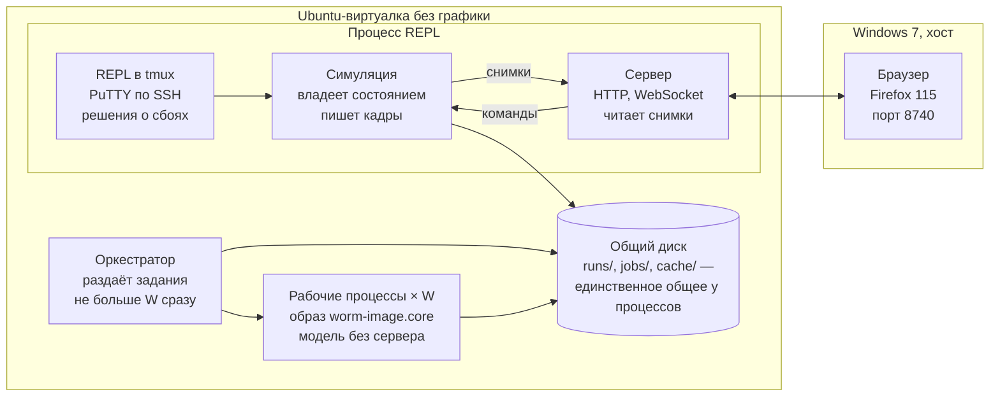
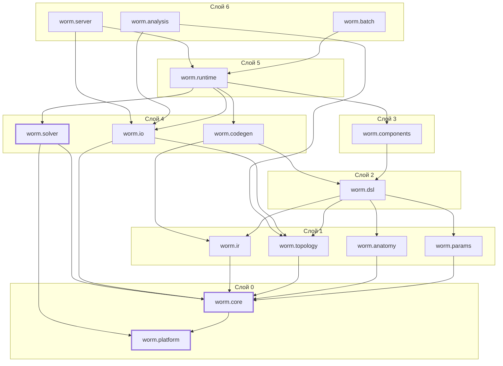

# Нематода на Лиспе: архитектура

Архитектурная документация симулятора; физика и уравнения модели — в [дизайн-документе](design.md).

Номера этапов в тексте — по [плану этапов](plan.md).

## Назначение, рамки и принятые решения

Документ описывает, как устроена программа: процессы и потоки, модули, представление модели, кодогенерацию, решатель, сервер, пакетные прогоны, форматы и тесты. Что считается — уравнения тела, мышц, нервов и среды — описано в дизайн-документе; здесь на него только ссылки.

**Решения пользователя, определяющие архитектуру.**

| Вопрос          | Решение                               | Следствие для архитектуры                                                                                               |
|-----------------|---------------------------------------|-------------------------------------------------------------------------------------------------------------------------|
| Геометрия тела  | 3D с первой версии                    | трубка из N колец по K узлов, четыре ряда мышц раздельно, контакт с поверхностью; ленточный якобиан с шириной ~2K узлов |
| Режимы прогона  | REPL плюс пакетные развёртки по ядрам | один процесс для интерактивной работы, отдельные рабочие процессы для пакетов                                           |
| Просмотр        | офлайн по файлам и вживую             | один формат кадра для файла и для сети; сервер в процессе REPL                                                          |
| Нервная система | все три уровня                        | общий интерфейс управления; нервная подсистема интегрируется отдельно от механики                                       |

**Требования, которые архитектура обязана выполнить.**

1. Шаг прогона не создаёт мусора и не вызывает обобщённых функций.
2. Одинаковые входы на одной сборке дают побитово одинаковый результат.
3. Параметры меняются на работающей модели без пересборки; структура — пересборкой за секунды.
4. Живой просмотр никогда не тормозит симуляцию: медленный клиент теряет кадры, а не задерживает шаг.
5. Численный сбой не теряет состояние: в REPL решение принимает человек, в пакете — политика.
6. Каждый результат воспроизводим по своему каталогу прогона: конфигурация, версия кода, хэши модели и параметров.

**Вне рамок.** Метод частиц для жидкости, распределённые прогоны на нескольких машинах, многопользовательский доступ к серверу, переносимость на другие реализации Common Lisp.

## Среда исполнения и ограничения

Счёт идёт в Ubuntu-виртуалке без графики, а смотрят на него в браузере основной машины под Windows 7. Отсюда три жёстких ограничения: всё вычислительное работает без дисплея, всё визуальное — в браузерах, которые ещё поддерживают Windows 7, а память делится между хостом и виртуалками.

| Площадка                         | Что на ней работает                                                          | Ограничение                                                             |
|----------------------------------|------------------------------------------------------------------------------|-------------------------------------------------------------------------|
| Ubuntu 24, виртуалка без графики | SBCL: процесс REPL с сервером, оркестратор пакетов, рабочие процессы         | 4 ядра, 5120 МБ памяти; дисплея нет                                     |
| Windows 7, хост                  | Firefox 115 с просмотрщиком; PuTTY (SSH) для команд, WinSCP (SSH) для файлов | последние версии браузеров для Windows 7 — Chrome 109 и Firefox ESR 115 |
| Общая память                     | 8 ГБ на хост и все виртуалки                                                 | на процесс SBCL задаётся явный `--dynamic-space-size`                   |

**Common Lisp.** Только SBCL на Linux x86-64: нужны нативная компиляция во время работы (`compile`), потоки `sb-thread`, почтовые ящики `sb-concurrency`, профилировщик `sb-sprof` и сохранение образа `save-lisp-and-die`. Потоки, почтовые ящики, семафоры, атомарные ячейки, MD5, память процесса и переименование каталогов собраны в `worm.platform`. Напрямую `sb-ext` и `sb-kernel` используют горячий путь и его окружение — ловушки плавающей точки в решателе, биты float в кадрах, пути запуска рабочих в `worm.batch`, `sb-sprof` в замерах рантайма, `save-lisp-and-die` в `scripts/build-image.lisp`. Минимальная проверенная версия SBCL — 2.2.9 (README).

**Браузер.** Просмотрщик пишется под Firefox 115, основной браузер хоста (совместимость с Chrome 109 желательна, но не проверяется на каждом изменении): WebGL2, WebSocket, `DataView`, ES2020. Новейшие возможности CSS и JS, появившиеся позже, не используются. Three.js берётся в сборке r128, которая подключается обычным тегом `<script>` без модулей и сборщика.

**Связь виртуалки и хоста.** Сервер в виртуалке слушает порт 8740, хост открывает его через проброс портов гипервизора. Команды вводятся по SSH из PuTTY, файлы передаются по SSH через WinSCP. Процесс REPL живёт внутри tmux, поэтому разрыв SSH-сессии его не убивает: после переподключения `tmux attach -t worm` возвращает тот же REPL. Строковое редактирование и история в терминальном REPL — через rlwrap. Отдельного редактора с подключением к Lisp-процессу нет, и архитектура на него не рассчитывает.

**Бюджет памяти.** Виртуалке выделено 5120 МБ и 4 ядра. Процесс REPL запускается с `--dynamic-space-size 1536`; системе и файловому кэшу остаётся около 1 ГБ, рабочим процессам — около 2,5 ГБ. Одно ядро остаётся процессу REPL и системе, поэтому W ≤ 3. Замер этапа 11: рабочий на 50 колец держит 115 МБ резидентной памяти, так что W = 3 упирается в ядра, а не в память (раздел «Пакетные прогоны»).

## Развёртывание

В виртуалке работают процессы двух видов: один долгоживущий процесс REPL для интерактивной работы и живого просмотра и группа короткоживущих рабочих процессов для пакетов под управлением оркестратора. Общая у них только файловая система: каталог `runs/` и кэш скомпилированных моделей.



Симуляция — единственный поток, который меняет состояние модели; REPL и сервер шлют ей команды и читают снимки, а пакетные процессы связаны с остальным только через диск.

**Процесс REPL** — образ SBCL с загруженной системой `worm`. Внутри:

- основной поток — терминальный REPL в tmux, к нему подключаются по SSH из PuTTY;
- поток симуляции — единственный владелец состояния модели, крутит шаги;
- потоки Hunchentoot — HTTP и WebSocket: раздача просмотрщика, файлов прогонов и живых кадров.

**Оркестратор** — отдельный процесс SBCL, запускаемый из командной строки или из REPL. Разворачивает описание развёртки в задания, держит не больше W рабочих одновременно, следит за таймаутами, собирает сводку.

**Рабочий процесс** — SBCL из сохранённого образа, получает путь к файлу задания, считает одну модель без сервера и без потоков, пишет каталог прогона и завершается.

**Хост** — браузер с просмотрщиком (живой режим через WebSocket, офлайн-режим через HTTP-раздачу `runs/` или локальный файл) и PuTTY с WinSCP для команд и файлов.

## Модули и зависимости

Система делится на 15 систем ASDF в семи слоях, и зависимости идут только вниз. Ключевое разделение: решатель знает только структуру `compiled-model` из `worm.core` и не зависит ни от DSL, ни от кодогенерации, поэтому его можно тестировать на моделях, написанных руками.



Система может зависеть только от систем нижних слоёв; точные зависимости — в таблице ниже.

| Слой | Система           | Ответственность                                                                                                   | Зависит от                      |
|------|-------------------|-------------------------------------------------------------------------------------------------------------------|---------------------------------|
| 0    | `worm.platform`   | потоки, почтовые ящики, атомарные ячейки, MD5, память процесса, каталоги                                          | —                               |
| 0    | `worm.core`       | типы массивов, числовые утилиты, корневые условия, журнал, структура `compiled-model`                             | platform                        |
| 1    | `worm.ir`         | промежуточное представление выражений: упрощение, общие подвыражения, символьное дифференцирование, интерпретатор | core                            |
| 1    | `worm.topology`   | трубка N×K: нумерация узлов, массивы индексов семейств элементов, профиль R(s), геометрия                         | core                            |
| 1    | `worm.anatomy`    | чтение и проверка анатомии: мышцы и их привязка к рёбрам, нейроны, синапсы                                        | core                            |
| 1    | `worm.params`     | реестр параметров: имена, единицы, границы, источники; наборы параметров                                          | core                            |
| 2    | `worm.dsl`        | `define-component`, `defmodel`, связывание компонентов                                                            | ir, topology, anatomy, params   |
| 3    | `worm.components` | тело, мышцы, три уровня управления, среда — описания на DSL                                                       | dsl                             |
| 4    | `worm.codegen`    | понижение модели в IR, якобиан, эмиссия Лиспа, компиляция, кэш fasl                                               | dsl, ir                         |
| 4    | `worm.solver`     | ленточная LU, линейно-неявный шаг, расщепление, события, контрольные точки                                        | core, platform                  |
| 4    | `worm.io`         | кадры, файлы прогона, контрольные точки, JSON                                                                     | core, topology                  |
| 5    | `worm.runtime`    | поток симуляции, команды, снимки, API для REPL, каталог прогона                                                   | codegen, solver, io, components |
| 6    | `worm.server`     | HTTP и WebSocket, протокол живого просмотра                                                                       | runtime, io                     |
| 6    | `worm.batch`      | развёртки, оркестратор, точка входа рабочего                                                                      | runtime                         |
| 6    | `worm.analysis`   | метрики походки, сводки развёрток, экспорт WCON (кимограмму строит просмотрщик)                                    | io, topology                    |

Тесты — система `worm/tests`, зависит от всех. Просмотрщик — отдельный файл `viewer/worm-viewer.html`, с Лиспом связан только протоколом и форматом кадра.

**Правила.**

- Горячий путь — сгенерированный код и `worm.solver` — зависит только от слоя 0.
- `worm.components` не знает о решателе, потоках и файлах: компонент — это только уравнения.
- `worm.server` и `worm.batch` не трогают состояние модели напрямую, только через API `worm.runtime`.
- `worm.analysis` работает с файлами прогонов и не требует загруженной модели, поэтому сводки строятся без пересчёта.
- Все идентификаторы — латиницей; пакеты называются так же, как системы.

## Представление модели

Модель во время прогона — это плоские массивы и ничего больше: топология в массивах индексов, состояние в векторах `double-float`, параметры в отдельном векторе. Объекты CLOS и символы существуют только на сборке и в API для REPL.

**Топология трубки.** Узел кольца i с номером k на кольце имеет номер i·K + k, его координата c лежит по индексу 3(i·K + k) + c. Семейства элементов и их размеры при N = 50, K = 8:

| Семейство           | Число элементов  | Хранение                            |
|---------------------|------------------|-------------------------------------|
| Продольные рёбра    | (N − 1)·K = 392  | концы a, b; длина покоя             |
| Окружные рёбра      | N·K = 400        | концы a, b; длина покоя             |
| Диагонали           | 2(N − 1)·K = 784 | концы a, b; длина покоя             |
| Диаметральные рёбра | N·K / 2 = 200    | концы a, b; длина покоя             |
| Отсеки              | N − 1 = 49       | номер переднего кольца; объём покоя |
| Кольца              | N = 50           | длина участка Δs; радиус покоя      |

Концы рёбер — массивы `(unsigned-byte 32)`, величины покоя — массивы `double-float`, всё вычисляется один раз из профиля R(s) и длины тела при сборке топологии.

**Связи между подсистемами** хранятся в разреженном виде (смещения, индексы, веса):

- мышца → продольные рёбра её квадранта с весами покрытия;
- проприоцептивная единица второго уровня → кольца её рецептивного поля с весами;
- нейрон → синапсы и щелевые контакты третьего уровня.

**Векторы состояния.**

| Вектор     | Содержимое                                                                | Порядок                                                                                   |
|------------|---------------------------------------------------------------------------|-------------------------------------------------------------------------------------------|
| `y-mech`   | координаты узлов                                                          | по кольцам: 3K координат кольца подряд                                                    |
| `y-neural` | нервно-мышечная часть: кальций мышц и сглаженные скорости их длины; сглаженный сигнал рецептора и потенциалы проводимостных B-единиц второго уровня; потенциалы нейронов третьего уровня | блоками (экземпляр, переменная) в порядке компонентов модели |
| `aux`      | скорости `y-mech` прошлого шага, Δy/h — для `lagged`                       | как `y-mech`; пуст, если модель их не читает                                              |
| `z`        | дискретное состояние: включённость B-нейронов бинарной версии             | по единицам                                                                               |
| `clock`    | время, номер шага, текущий шаг h                                          | —                                                                                         |

Порядок блоками по кольцам держит якобиан механики ленточным: всё, что связано, лежит рядом. Кальций мышц в `y-mech` не входит (решение 22): клетка охватывает 3–6 колец, и её кальций связал бы узлы на 4 кольца назад и 3 вперёд, расширив ленту с 47 до примерно 110 при K = 8. Ширину ленты кодогенерация вычисляет по фактической разреженности, а не задаёт вручную. Раскладка — `model-layout` в `compiled-model` (`model-neural-states`, `model-discrete-states`); в REPL значения читаются из снимка: `(state-ref :ring 10 :node 3 :axis :x)`, `(state-ref :muscle 5)`.

**Параметры.** Скаляры лежат в векторе `p`, поэлементные величины (профиль радиуса, максимальная сила каждой мышцы, веса синапсов) — в структуре `param-arrays`. Каждый параметр зарегистрирован с именем, индексом, единицами, границами, источником значения и признаком живой правки. Живая правка разрешена тем параметрам, которые не входят в величины покоя: коэффициенты сопротивления — да, длина тела и профиль радиуса — нет, они требуют пересборки топологии.

**Единицы.** Внутренняя система — миллиметры, секунды, микроньютоны, так что характерные величины модели порядка единицы. Для нервной части к ним добавлены милливольты и фемтокулоны: тогда пФ, пСм и мВ — внутренние единицы, а пФ/пСм даёт секунды. Отсюда 1 Па = 1 мкН/мм² и 1 Па·с = 1 мкН·с/мм². Файлы параметров хранят значения с явными единицами, загрузчик переводит их во внутренние; значения без единиц отвергаются.

## DSL компонентов и defmodel

Компонент описывает уравнения одного элемента семейства, а `defmodel` расставляет компоненты по семействам и связывает их выходы со входами. Язык выражений закрыт: только перечисленные операции, без циклов и побочных эффектов. Поэтому для любого выражения всегда существуют и производная, и интерпретация, и скомпилированный код.

**`define-component`.**

```lisp
(define-component <name>
  :family   <family>                ; :edge (любое из рёбер) :long-edge :circ-edge :diagonal :diametral
                                    ; :compartment :ring :node :muscle :prop-unit :neuron :global
  :params   (<scalar> ... (<array> :per-element))
  :state    ((<var> <init-expr>) ...)          ; непрерывное состояние элемента
  :discrete ((<var> <init>) ...)               ; дискретное состояние, меняется событиями
  :inputs   ((<name> (link <tag>) [:default <число>]) ...)  ; выход другого компонента
  :let      ((<name> <expr>) ...)              ; промежуточные величины
  :derivs   ((<var> <expr>) ...)               ; производные состояния
  :outputs  ((<name> <expr>) ...)              ; для других компонентов
  :forces   (((pos <slot>) <vector-expr>) ...  ; сила на узлы, зависит от положений
             (:gradient <expr> :scale <coef>)) ; или coef·∂expr/∂x на все слоты
  :damping  ((<coef-expr> <linear-rate>) ...)  ; вязкий член: коэффициент × линейная по скоростям величина
  :events   ((<expr> :rising|:falling (set <discrete> <expr>)) ...)  ; на границе шага
  :checks   ((<cause> <expr>) ...))            ; сбой шага с причиной <cause>, если expr < 0
```

**Язык выражений.**

| Группа                    | Операции                                                                         |
|---------------------------|----------------------------------------------------------------------------------|
| Арифметика                | `+ - * /`, `expt` с целой степенью, `sqrt exp log tanh sin cos`, константа `pi`  |
| Гладкие нелинейности      | `logistic`, `hill`, `positive` (положительная часть), `clamp`                    |
| Векторы 3D                | `vec dot cross norm unit scale v+ v-`                                            |
| Геометрия ребра           | `(pos a)`, `(pos b)`, `edge-vector`, `edge-length`, `length-rate`, `rest-length` |
| Геометрия отсека          | `(pos 0)` … `(pos 2K−1)`, `volume`, `rest-volume`                                |
| Геометрия кольца и узла   | `centroid`, `ds`, `rest-radius`, `position`, `tangent` (касательная средней линии по центрам соседних колец) |
| Продольное ребро          | также `side` (+1 — дорсальная сторона, −1 — вентральная) и `radius-factor` (R_max / R отрезка) |
| Мышца                     | `position` (максимум веретена, доля L), `side` (+1 — дорсальная, −1 — вентральная) |
| Проприоцептивная единица  | `index` (1…M от головы), `position` (середина участка, доля L)                    |
| Нейрон коннектома         | `position` (середина иннервируемых мышц, у интернейронов 0,5), `side` (+1 — DA, DB, DD, AS; −1 — VA, VB, VD, VC; 0 — прочие), `gaba`, `proprioceptive` (DB, VB), `command` (+1 — AVB, −1 — AVA), `cord` (мотонейроны тяжа и хвоста), `head-side` (у нейронов вне тяжа: +1, если нервно-мышечных контактов на дорсальные мышцы больше, −1 — на вентральные, 0 — у тяжа и без контактов), `gap-total` (сумма щелевых контактов с масштабами классов) |
| Скорости                  | `length-rate` ребра, `(velocity <слот>)` — скорость узла; только в `:damping` и под `lagged` |
| Прочее                    | `(time)`, `(lagged <rate>)` — значение скорости с прошлого шага                  |

Положительная часть называется `positive`, а не `pos`, как было в первой редакции: `(pos a)` — положение слота, и одно имя для двух смыслов различалось бы только по аргументу. Синус и косинус нужны генератору ритма уровня 1.

Новая функция добавляется только вместе с производной: `(define-primitive name (args | &rest args) :indices (j …) :value <функция> :derivative <форма>)`. Значение — функция Лиспа от чисел; производная — форма, строящая список частных производных в IR (по одной на аргумент), где имена аргументов связаны с узлами, а `self` — с самим узлом. Примитив вызывается в выражениях компонента по имени. Примитив без производной можно вычислять, но не дифференцировать: такая попытка — условие `no-derivative`. Так заданы `hill` (производная по x — примитив `hill-dx`), `positive`, `clamp` и объём отсека: `volume` → `volume-grad` → `volume-hess` (решение 21).

**Семейства и слоты.** Ядро строится одно на пару «компонент × семейство», а выражения читают переменные относительно элемента: `(:pos слот c)`, `(:aux слот c)`, `(:param имя)`, `(:array имя)`, `(:state имя)`, `(:input имя)`, `(:element имя)`, `(:time)`. Какие узлы стоят за слотами, знает топология. У ребра слоты `a` и `b`, у отсека — 2K узлов двух колец, у кольца — его K узлов, у узла — `self` (слот 0) и узлы соседних колец (1…K — предыдущее кольцо, K+1…2K — следующее; у концов тела — своё кольцо), по которым считается `tangent`; у мышцы и глобального элемента слотов нет.

**Связи `:via`.**

| Отношение         | Концы                               | Как переходят значения                     |
|-------------------|-------------------------------------|--------------------------------------------|
| `:attachment`     | мышца ↔ продольное ребро            | взвешенная сумма с весами привязки, в обе стороны |
| `:identity`       | одно семейство                      | тот же элемент                             |
| `:broadcast`      | `:global` → любое                   | одно значение всем элементам               |
| `:innervation`    | единица управления → мышца          | мышца получает выход единицы своего участка со знаком своей стороны (+1 дорсальная, −1 вентральная); нейрон → мышца — по нервно-мышечным синапсам коннектома, вес — контакты, делённые на сумму возбуждающих контактов мотонейронов тяжа на эту мышцу |
| `:receptive-field`| продольное ребро → единица или нейрон | сумма по рёбрам поля с весом ±N_SR / (рёбер одной стороны в поле), N_SR = 48·rf-length; минус — у поля вперёд; у нейронов поле назад от положения есть только у B-нейронов |
| `:chemical`       | нейрон → нейрон                     | химические синапсы коннектома, вес — контакты × `chemical-scale` |
| `:gap`            | нейрон ↔ нейрон                     | щелевые контакты в обе стороны, вес — контакты × `gap-command-scale` (командный интернейрон с остальными) или `gap-motor-scale` (прочие) |

Нейроны `:neuron` — все нейроны файла `anatomy/neurons.sexp`; веса связей считаются при сборке, поэтому масштабы классов правятся пересборкой. Экземпляр нейронов связан сам с собой (щелевые контакты и синапсы). Такая связь не задаёт порядка экземпляров и не образует петли, если выход, который экземпляр передаёт себе, зависит только от состояния; это проверяется при сборке, а код сначала пишет эти выходы и лишь потом сводит входы.

Единицы `:prop-unit` (их число — параметр `units`) делят тело на равные участки. Поле назад начинается у начала участка единицы и идёт к хвосту, поле вперёд кончается у начала участка; у поля вперёд первая единица — головной осциллятор с полем назад (дизайн, «Направление рецептивного поля»). Веса считаются при сборке, поэтому `rf-length` и `rf-direction` правятся только пересборкой.

**Дискретное состояние и события.** `:discrete` — переменные элемента в векторе `z`, меняются только событиями: `(<условие> :rising (set <переменная> <значение>))` срабатывает, когда условие положительно, `:falling` — когда отрицательно. Функция `neural-discrete` в начале нервно-мышечного подшага вычисляет условия и значения всех событий элемента по состоянию начала шага и затем применяет их, поэтому порядок событий внутри шага не важен. Пороги с гистерезисом B-нейрона записываются двумя событиями на переменную. Проверка на границе шага, а не поиск точки пересечения: частота походки уровня 2 на агаре меняется меньше чем на 1% при h от 5·10⁻⁴ до 2·10⁻³ (этап 10).

Вход без `:default` обязан быть связан ровно один раз; вход с `:default` можно не связывать — например, натяжение мышц у рёбер, к которым мышцы не приложены. Поэлементный параметр (`(stiffness :per-element)`) после переименования называет массив, объявленный `define-element-array` с функцией, которая строит его из параметров и топологии.

**Скорости.** Скорость узлов может входить в уравнения двумя путями. Линейно — через `:damping`: компонент указывает коэффициент и линейную по скоростям величину (например, `length-rate`), а матрицу D кодогенерация выводит сама. Член `(c r)` — слагаемое ½·c·r² функции Рэлея, поэтому D = Σ c·g gᵀ, где g = ∂r/∂v; линейность r по скоростям проверяется при определении компонента. Нелинейно — только через явный `lagged`, который берёт скорость с прошлого шага из `aux`; так задаётся множитель Хилла f_V. Других путей нет, и система на каждом шаге остаётся линейной относительно скоростей.

Запаздывающая на шаг обратная связь по скорости устойчива, только пока её коэффициент меньше вязкости, которую она обходит (отношение ρ < 1), и уменьшение h этого не меняет. Поэтому `lagged` читается не напрямую, а через сглаживающее состояние: τ_v·dr/dt = lagged − r в нервно-мышечной части, с неявным шагом. Тогда шаг устойчив при h < 2·τ_v/(ρ − 1) (этап 5: без сглаживания f_V с v_max = 30 1/с разрушал тело за полсекунды).

**Пример: ребро кутикулы.**

```lisp
(define-component cuticle-edge                    ; src/components/body.lisp
  :family  :edge                                  ; любое семейство рёбер
  :params  ((stiffness :per-element) (viscosity :per-element) (rest-tension :per-element) prestress)
  :inputs  ((tension (link :muscle-tension) :default 0))   ; не связан — нет мышц
  :let     ((u (unit edge-vector))
            (f (+ (* stiffness (- edge-length rest-length)) (* prestress rest-tension) tension)))
  :forces  (((pos a) (scale f u))
            ((pos b) (scale (- f) u)))
  :damping ((viscosity length-rate))
  :outputs ((length edge-length) (rest rest-length) (rate (lagged length-rate))))
```

**`defmodel`.** Модель расставляет компоненты, переименовывает параметры при повторном использовании и описывает связи:

```lisp
(defmodel worm-3d-proprio                      ; src/components/models.lisp, сокращённо
  :topology   (tube :rings 50 :ring-nodes 8 :length body-length
                    :radius-max radius-max :radius-end-min radius-end-min)
  :anatomy    "anatomy/muscles.sexp"
  :components ((cuticle-long cuticle-edge :on :long-edge
                             :rename (stiffness k-long viscosity eta-long rest-tension t-long))
               (cuticle-circ cuticle-edge :on :circ-edge
                             :rename (stiffness k-circ viscosity eta-circ rest-tension t-circ))
               ...
               (pressure     hydrostatic      :on :compartment)
               (contact      substrate        :on :node :when (medium :agar))
               (drag         rft              :on :node)
               (receptors    stretch-receptor :on :long-edge)
               (units        b-unit           :on :prop-unit)
               (muscles      rate-muscle      :on :muscle
                             :rename (f-max muscle-f-max lambda-min muscle-lambda-min)))
  :wiring     (((receptors bend-strain) (units bend)        :via :receptive-field)
               ((units motor)           (muscles drive)     :via :innervation)
               ((muscles force)         (cuticle-long tension) :via :attachment)
               ((cuticle-long length)   (muscles attached-length) :via :attachment)
               ...)
  :subsystems ((:mechanical cuticle-long cuticle-circ shear shape pressure contact drag receptors)
               (:neural units muscles)))
```

**Проверки при определении компонента.** Компонент проверяется пробным понижением в IR: неизвестное имя, вектор там, где нужен скаляр, неверное число аргументов, скорость узлов вне `lagged` и `:damping`, нелинейная скорость в `:damping`, производная, которой нет, — всё это ловится при загрузке определения, с указанием компонента и формы.

**Проверки при раскрытии `defmodel`.** Компоненты определены, и каждый стоит на подходящем семействе. Каждый обязательный вход связан ровно один раз. Связи внутри одной подсистемы не образуют алгебраических петель: граф портов (выход → вход по связи, вход → выход того же экземпляра, если выход зависит от входа мгновенно) обходится в глубину; связь через переменную состояния петлёй не считается. Отношение `:via` соответствует семействам обоих концов. Все параметры есть в реестре, поэлементные массивы объявлены, анатомия загружается. Ошибка любого рода — условие `model-error` с указанием компонента и формы, а не падение в середине кодогенерации.

**Результат раскрытия** — объект `model-spec`: компоненты, семейства, связи, подсистемы и канонический текст модели. Канонический текст — форма модели и определения всех её компонентов, напечатанные без имён пакетов (имена языка сравниваются по имени символа) и в порядке, который не зависит от хэш-таблиц: компоненты — по именам. От него берётся хэш модели (`sb-md5`), который идёт в кэш скомпилированных моделей и в `meta.json` каждого прогона; тест сверяет хэш с отдельным процессом SBCL.

## Кодогенерация

Кодогенерация превращает `model-spec` в структуру `compiled-model`: набор скомпилированных функций, раскладку состояния, ширину ленты и карты рассеяния. Код порождается по ядру на пару «компонент × семейство», а не по элементу, поэтому его объём не зависит от N и K.

**Конвейер.**

1. **Раскрытие.** Каждый компонент из `model-spec` получает своё семейство, разрешённые входы и порядок вычисления. Ядра одной подсистемы упорядочиваются топологически по связям: мышцы считают силу раньше, чем рёбра кутикулы её читают.
2. **Понижение в IR.** Ядро становится ациклическим графом скалярных узлов. Векторные операции раскладываются на три компоненты, геометрические обращения заменяются чтениями из `y-mech` по массивам индексов, параметры — чтениями из `p` и `param-arrays`, связанные входы — чтениями из промежуточных буферов (например, буфера натяжений продольных рёбер).
3. **Упрощение.** Структурно одинаковые узлы склеиваются при создании (hash-consing), и общие подвыражения выделяются сами. Затем свёртка констант, тождества (x·1, x + 0), замена `(expt x 2)` на умножение.
4. **Локальные якобианы.** Каждый выход ядра дифференцируется символьно по каждому своему чтению состояния. Для ребра это блок 6×6, для отсека — блок по координатам двух колец, для кальция мышцы и сглаженной скорости — диагональ нервно-мышечной матрицы.
5. **Сборка глобальной матрицы.** Через связи производные сцепляются по цепному правилу: сила ребра → координаты его концов; натяжение мышцы в механике — вход, постоянный в пределах шага (решение 22). Положение каждого элемента локального блока в ленточной матрице известно на сборке и записывается в карту рассеяния — массив индексов. Шаг прогона только складывает числа по готовым индексам.
6. **Матрица вязкости.** Для каждого члена `:damping` производная линейной величины по скоростям даёт постоянный шаблон; на шаге он умножается на коэффициент и рассеивается в ту же ленту.
7. **Эмиссия.** Каждое ядро становится циклом `dotimes` по элементам с объявленными типами. Узлы IR связываются плоским `let` и присваиваются `setq` по порядку: `let*` из тысяч вложенных связок (ядро отсека) переполнял стек компилятора. Ядра собираются в функции этапов шага. Каждая функция — фабрика `(lambda (env) …)`: все массивы, которые нужны коду, — слоты элементов, поэлементные параметры, карты рассеяния, рабочие буферы геометрии отсека — приходят вектором `env` и связываются с объявленными типами, поэтому в тексте нет ни N, ни смещений, зависящих от N, и один текст годится для любой длины тела. Индексы объявлены `(unsigned-byte 30)`: с `fixnum` компилятор оставлял заметки о целочисленной арифметике.
8. **Градиентные силы.** Сила `(:gradient V :scale k)` равна k·∇V, и её якобиан собирается структурно: k·∇²V + ∇V ⊗ ∇k, вложенным циклом по слотам, где ∇V и ∇²V — примитивы объёма, а ∇k — производная коэффициента по объёму. Символьное дифференцирование k·∇V давало для K = 8 выражение, которое компилировалось больше десяти минут (решение 24).
9. **Якобиан нервно-мышечной части через связи.** Если выход одного экземпляра зависит от его состояния и связью входит в правую часть другого (выход проводимостной B-единицы — сигмоида её мембранного потенциала — вход мышц), якобиан получает внедиагональные блоки по цепному правилу: ∂f_u(e)/∂x_src(s) = ∂f_u/∂in(e) · w(e, s) · ∂out_src/∂x_src(s). Производные выходов источников считаются поэлементно в буферы, затем для каждого элемента приёмника обходится его строка связи CSR. Плотная LU нервно-мышечной части это допускает (решение 27).
10. **Компиляция и кэш.** Текст функций пишется в `cache/codegen/<ключ>.lisp` и компилируется в fasl рядом, заметки оптимизатора — в `<ключ>.notes`; ключ — MD5 от хэша модели, K, среды, версии кодогенератора и версии SBCL. Повторная сборка той же модели загружает fasl: так собирают `build-model`, `start-run`, `rebuild` и пакетные рабочие; `compile-model` без `:cache t` компилирует в памяти. В ключ входит и признак `damping-geometry`. Сборка `worm-3d` на 50 колец — около 3 с, из кэша — 0,07 с.

**Функции `compiled-model`.** Все функции пишут результат в переданные массивы и ничего не возвращают; буферы результатов решатель перед вызовом обнуляет, а функции только прибавляют к ним. Время и номер шага приходят вектором `clock` (tₙ, h, номер шага), а не числами: число на границе вызова упаковывается в кучу, а шаг не должен выделять память (решение 20).

| Функция           | Аргументы                    | Что делает                                                              |
|-------------------|------------------------------|-------------------------------------------------------------------------|
| `observables`     | y-mech, aux, p, obs          | кривизна по кольцам, длины и скорости мышц и другие наблюдаемые        |
| `neural-discrete` | y-neural, obs, z, p, clock   | события на границе шага: шаг дискретного состояния второго уровня       |
| `neural-rhs`      | y-neural, obs, z, p, clock, f | правая часть нервно-мышечной части при tₙ: кальций, сглаженные скорости, состояние уровней 2–3 |
| `neural-jacobian` | y-neural, obs, z, p, clock, jac | её якобиан, плотная матрица                                          |
| `neural-output`   | y-neural, obs, z, p, clock, syn | натяжение каждой мышцы при tₙ + h: F_max·a(Ca)·f_L·f_V             |
| `mech-forces`     | y-mech, syn, p, g            | силы на узлы                                                            |
| `mech-matrix`     | y-mech, aux, syn, p, clock, ab | ленточная матрица шага M + D + h·∂(D v)/∂y при v = aux − h·∂G/∂y      |
| `check-state`     | y-mech, p                    | проверки модели вроде V/V⁰ отсеков: NIL или причина и номер элемента    |

Лента хранится как в LAPACK `dgbtrf`: 2·kl + ku + 1 строк по столбцам, элемент A(i, j) — в строке kl + ku + i − j; функция `band-index` из `worm.core` даёт его индекс, и сгенерированный код пишет в ленту по готовым индексам.

**Известное узкое место.** Сила давления отсека зависит от координат двух колец, то есть от 2K узлов, и её якобиан — блок 6K × 6K (48 × 48 при K = 8), содержащий вторые производные объёма. Наивное дифференцирование раздувает выражение. Мера: объём и его градиент и гессиан заданы примитивом через `define-primitive` с написанной вручную структурой (вклад торцевых вееров и боковых треугольников), а не выводятся из формулы объёма вслепую.

**Эталонный интерпретатор** исполняет то же IR обобщённой арифметикой с теми же картами рассеяния. Он медленный, но служит эталоном для тестов кодогенерации и инструментом отладки одного ядра: `(worm.codegen:interpret-kernel model 'pressure 12 y)` — выходы и силы ядра на одном элементе. С этапа 6 он есть в `worm.dsl` (`instantiate`, `interpret`, `interpret-damping`): пробная модель на языке модели — кутикула на всех семействах рёбер с натяжениями покоя, давление с p₀ и кинематическая мышца через `:attachment` — даёт те же силы, что ручные ядра (до 10⁻¹⁰), и ту же матрицу вязкости (до 10⁻¹²).

**Детерминизм и читаемость.** Эмиссия обходит узлы в порядке их стабильных номеров, а не хэш-таблиц, поэтому одна модель всегда даёт один и тот же текст. Сгенерированный код любого ядра печатается в REPL командой `(worm.codegen:show-kernel model 'pressure)`.

**Компоненты модели (этап 7).** `worm.components` описывает на языке модели всё, что этапы 3 и 5 писали руками: `cuticle-edge` на четырёх семействах рёбер (с натяжением покоя от p₀ и натяжением мышц через `:attachment`), `hydrostatic` на отсеках (давление p₀ + K(V⁰ − V)/V⁰, проверка V/V⁰ ≥ 0,5), `substrate` и `rft` на узлах, `rhythm-generator` на мышцах и `rate-muscle` на мышцах. Модели — `worm-3d` (мышцы под генератором первого уровня), `worm-3d-kinematic` (заданная волна натяжения этапа 3) с этапа 10 `worm-3d-proprio`: рецептор растяжения `stretch-receptor` на продольных рёбрах и проприоцептивные единицы `b-unit` с дискретными DB и VB вместо генератора; с этапа 11 `worm-3d-proprio-graded` с проводимостной `b-unit-graded`; с этапа 12 `worm-3d-connectome` — нейроны `graded-neuron` на семействе `:neuron`. Ручные ядра `tests/oracle/` остаются эталоном: сгенерированные функции совпадают с ними до 10⁻¹⁰ на случайных состояниях, а прогоны идут с ними шаг в шаг (на агаре расхождение 10⁻¹⁵ мм за 4 с).

## Решатель

Шаг — расщепление Ли на две подсистемы: сначала нервно-мышечная при замороженной геометрии, затем механическая (положения узлов) при замороженном натяжении мышц. Обе интегрируются линейно-неявным методом Эйлера с постоянным шагом h, так что расщепление не понижает общий первый порядок.

**Почему расщепление.** Механика даёт ленточный якобиан, а коннектом третьего уровня связывает нейроны по всему телу и разрушил бы ленту. Порознь каждая часть решается своим методом: механика — ленточной LU за O(N K³), нервы — плотной LU малого размера.

**Механический шаг.** Система B(y) ẏ = G(y), где B = M + D (сопротивление среды и вязкость тканей), а G — силы:

```math
\Big(\mathbf{B}(\mathbf{y}_n) + h\,\mathbf{C}_n - h\,\frac{\partial \mathbf{G}}{\partial \mathbf{y}}(\mathbf{y}_n)\Big)\,\Delta\mathbf{y} = h\,\mathbf{G}(\mathbf{y}_n), \qquad \mathbf{y}_{n+1} = \mathbf{y}_n + \Delta\mathbf{y}, \qquad \mathbf{C}_n = \frac{\partial\,(\mathbf{B}(\mathbf{y})\,\mathbf{v})}{\partial \mathbf{y}}\Big|_{\mathbf{y}_n,\ \mathbf{v} = \mathbf{aux}}
```

C — производная вязких сил по положению при скоростях прошлого шага: вязкость рёбер направлена вдоль ребра, сопротивление среды — по касательной к телу, и при повороте ребра или касательной сила поворачивается вместе с ними. Без C этот поворот учитывался явно, и в воде, где сопротивление среды мало, а вязкость рёбер велика, шаг h ≥ 2,5·10⁻⁴ усиливал ошибку округления до 10⁻⁴–10⁻² мм и делал скорость плавания зависимой от шага (решение 26).

Матрица ленточная, но не обязательно положительно определённая: давление и мышцы дают несимметричные вклады. Поэтому LU ленточная с частичным выбором ведущего элемента (по схеме LAPACK `dgbtrf`), написанная на Лиспе без внешних библиотек; выбор ведущего расширяет верхнюю ленту на ширину нижней, и это учитывается при выделении памяти.

**Нервный шаг.** Тот же линейно-неявный Эйлер на всём `y-neural` — кальций мышц, сигнал рецептора и потенциалы второго уровня, нейроны третьего — с плотной LU. Матрица пересобирается и раскладывается не на каждом шаге, а раз в R шагов (`start-run :neural-every`, по умолчанию 10): для линейно-неявного метода приближённая матрица сохраняет первый порядок, а цена шага падает в R раз. Постоянные нервной части должны быть заметно больше h·R: проводимостная B-единица с τ_m = 2 мс при h = 1 мс расходится, с 20 мс — нет (этап 11).

**Порядок одного шага.**

1. Наблюдаемые по `y-mech(tₙ)` и скоростям прошлого шага `aux`: кривизна колец, длины и скорости мышц.
2. Нервно-мышечная подсистема до tₙ₊₁: уровень 1 — формула от времени; уровень 2 — дискретное состояние по кривизне с гистерезисом; уровень 3 — линейно-неявный шаг нейронов. Тем же шагом — кальций мышц и сглаженные скорости их длины. Выход — натяжение каждой мышцы, постоянное в пределах шага.
3. Механика: `mech-forces`, `mech-matrix`, ленточная LU, решение, обновление `y-mech`, `aux` = Δy/h.
4. Проверки: ловушки плавающей точки, нижняя граница отношения V/V⁰ каждого отсека, глубина проникновения в поверхность.
5. Запись по расписанию: кадр в файл, снимок для просмотра, контрольная точка в памяти.
6. Применение команд, накопившихся в почтовом ящике (раздел «Потоки»).

**События.** Пороги B-нейронов проверяются на границах шагов: функция `neural-discrete` в начале нервно-мышечного подшага вычисляет условия всех событий по состоянию начала шага и затем применяет действия `(set …)`; ошибка момента переключения — не больше h, как у всего метода. Поиск точки пересечения не нужен: частота походки на агаре меняется меньше чем на 1% при h от 5·10⁻⁴ до 2·10⁻³ (этап 10). Слот `event-functions` в `compiled-model` оставлен, но кодогенератор его не заполняет.

**Контрольные точки.** Кольцевой буфер из C снимков полного состояния (`y-mech`, `y-neural`, `z`, `aux`, `clock`, `p`) в памяти, раз в Q шагов; на диск — раз в Q′ шагов и по команде. Откат по умолчанию восстанавливает состояние, но не параметры: иначе он отменял бы правку, сделанную человеком после снимка; `(rollback 0 :params t)` восстанавливает и их. То же у точки с диска: параметры, отличные от текущих, пишутся в `log.txt` и выдаются предупреждением, а берутся только с `:params t`.

В снимок входят и скорости узлов прошлого шага, которые читает `lagged`. Интервал Q кратен R, а пересборка нервной матрицы привязана к абсолютному номеру шага, поэтому после отката счёт идёт побитово так же, как без остановки. То же — при продолжении с контрольной точки на диске: интегратору ставятся её время, номер шага и h (`set-integrator-position`), а новый интегратор можно сразу создать с номером шага (`make-integrator :step`).

**Детерминизм.** Один поток на прогон, постоянный h, детерминированная эмиссия кода, никаких параллельных сумм. На x86-64 SBCL считает в SSE с двойной точностью без расширенных регистров x87, поэтому повторный прогон на той же сборке и тех же системных библиотеках побитово совпадает. Между разными системами совпадение не гарантируется: `exp` и `log` идут из libm.

**Ловушки.** По умолчанию SBCL на x86-64 включает ловушки на переполнение, недопустимую операцию и деление на ноль, и они срабатывают и в коде с `(safety 0)`. Решатель ловит эти условия вокруг шага и переподаёт их как `numerical-blowup` с номером шага и причиной.

## Потоки и интерактивная работа

Состоянием прогона владеет ровно один поток — поток симуляции. Все остальные потоки общаются с ним двумя путями: пишут команды в его почтовый ящик и читают готовые снимки из атомарной ячейки. Блокировок на горячем пути нет.

**Объект прогона `run`.** Содержит `compiled-model`, векторы состояния, параметры, расписание записи, кольцо контрольных точек, почтовый ящик команд (`sb-concurrency:mailbox`), ячейку последнего снимка и политику ошибок. В одном процессе REPL может жить несколько объектов `run`, у каждого свой поток.

**Команды.** Применяются на границе шага в порядке поступления:

| Команда                            | Действие                                                                     |
|------------------------------------|------------------------------------------------------------------------------|
| `:pause`, `:resume`                | остановить или продолжить цикл шагов                                         |
| `:step n`                          | сделать n шагов и остановиться                                               |
| `:set-param name value`            | изменить параметр, допускающий живую правку; иначе ответить ошибкой          |
| `:apply-params changes set`        | применить живые правки загруженного набора (`load-params` разбирает файл в вызывающем потоке и сообщает о требующих пересборки) |
| `:checkpoint`, `:rollback k`       | снимок на диск; откат на k-ю контрольную точку                               |
| `:record t/nil`, `:record-to dir`  | включить или выключить запись кадров                                         |
| `:stop`                            | завершить прогон, закрыть файлы, записать итог в `meta.json`                 |
| `:choose name`, `:debug`           | решение о сбое (только в состоянии `:problem`, см. ниже)                     |
| `:replace model …`                 | заменить модель после `rebuild` и перенести состояние                        |
| `:call fn`                         | выполнить `(fn run)` в потоке симуляции — для тестов и разбора в REPL        |

Команда может нести «обещание» — ячейку, в которую поток симуляции кладёт ответ. Синхронные функции REPL ждут на ней; сервер ответа не ждёт. Ошибка выполнения команды возвращается через обещание и переподаётся в вызывающем потоке. Пока прогон идёт, поток забирает все накопившиеся команды и делает порцию шагов (не больше 50) до ближайшей границы кадра, снимка или контрольной точки; на паузе — ждёт команду.

**Состояния прогона:** `:paused`, `:running`, `:stepping` (идёт `:step n`), `:problem` (сбой ждёт решения), `:done`, `:failed`. Их меняет только поток симуляции.

**Снимки.** Раз в заданное число шагов, а также на паузе, после отката, сбоя и `:step`, поток симуляции заполняет новый объект снимка: координаты узлов в `single-float`, активации мышц, кривизну в кольцах, время, номер шага, h и состояние прогона. Активации для кадров и снимков даёт функция `activation` модели — выход `active` экземпляра на мышцах; кодогенератор собирает её, если такой выход есть. Ссылка на него атомарно записывается в ячейку. Читатели берут последнюю ссылку и работают с неизменяемым объектом; старые снимки забирает сборщик мусора. Снимок — единственное место, где поток симуляции выделяет память, и это происходит вне шага.

**API для REPL.** Пакет `worm` экспортирует:

```lisp
(build-model 'worm-3d :params "agar-a-v1")  ; => compiled-model
(start-run model :params "agar-a-v1" :dt 1d-3 :record t
                 :frames-every 0.01 :checkpoint-every 1.0)  ; => run, поток запущен
(start-run 'worm-3d :params "water-v1")     ; модель собирается сама
(pause) (resume) (step-run 1000)            ; step-run ждёт окончания
(set-param :tau-ca 40) (set-param :tau-ca 0.04 :unit :s) (param :tau-ca)  ; => 40, :ms
(load-params "agar-c-v1")                   ; живые — сразу, остальные — списком «нужна пересборка»
(state-ref :ring 10 :node 3 :axis :x) (state-ref :muscle 5) (state-ref :ring 10 :curvature t)
(save-checkpoint) (rollback 0) (rollback 1 :params t) (rollback #p"runs/…/checkpoints/step-2000.ckpt")
(record t) (record-to #p"runs/other/")
(problem) (choose 'halve-timestep) (debug-problem)  ; решение о сбое
(rebuild 'worm-3d-kinematic)                ; пересобрать модель, перенести совместимое состояние
(wait-run :status '(:paused :done)) (list-runs) (snapshot)
(call-in-run (lambda (run) …))              ; функция в потоке симуляции на границе шага
(stop-run)
(export-wcon) (export-metrics)              ; kinematics.wcon и metrics.csv прогона
(run-sweep "sweeps/x.sexp" :workers 2)      ; развёртка рабочими процессами
(serve :port 8740) (serving-p) (stop-serving)  ; сервер живого просмотра
(about)                                     ; реализация, ревизия, память, ядра
```

Числа в примере — заполнители, а не рекомендуемые значения. `*current-run*` хранит последний запущенный прогон, и все функции принимают его по умолчанию — последним необязательным аргументом или ключом `:run`. Интервалы в `start-run` — в секундах модели: кадры, снимки, точки на диск (0 — только по команде) и кольцо точек в памяти для `rollback` (`:memory-checkpoint-every`, по умолчанию 0,05 с). Политика — `:interactive` (по умолчанию), `:batch` или функция от условия.

**Живая правка параметров.** `set-param` принимает значение в единицах реестра или с `:unit`; число `single-float`, набранное в REPL (0.05), берётся по десятичной записи, а не по двоичному значению. Разбор, единицы и границы проверяются в вызывающем потоке — там же доступны перезапуски `use-value` и `keep-old-value`, — а в поток симуляции уходит готовое внутреннее значение. Живая правка возможна, только если параметр допускает её в реестре и ядра читают его из вектора p. Из остальных при сборке строятся поэлементные массивы (жёсткости рёбер из модуля кутикулы, F_max по клеткам), натяжения покоя (p₀) или топология; такая правка отвергается с объяснением и подсказкой `rebuild` (решение 25). Изменение пишется в `log.txt` и `meta.json` (`paramChanges`); `config.sexp` переписывается при `load-params` и `rebuild`; нервная матрица пересчитывается на следующем шаге.

**Каталог прогона** создаётся при запуске (`runs/<id>/` или `:directory`): `status`, `config.sexp`, `meta.json`, `log.txt`; `frames.bin` — при включённой записи, `checkpoints/step-<n>.ckpt` — по расписанию и по команде. `metrics.csv` и `kinematics.wcon` строит `worm.analysis` по файлам прогона: пакетный рабочий — `metrics.csv` в конце задания, в REPL — `(export-metrics)` и `(export-wcon)`; у идущего прогона записанные кадры сначала сбрасываются на диск (`flush-recording`), файл кадров остаётся открытым.

**Пересборка на ходу.** `rebuild` строит новую модель в вызывающем потоке, ставит прогон на паузу, переносит векторы состояния по именам раскладки (совпадающие величины — как есть, новые — начальными значениями) и продолжает. Нервно-мышечное состояние переносится блоками (экземпляр, переменная) одинаковой длины. Если топология изменилась, переносится только нервное состояние, а тело ставится в начальное положение. Параметры берутся из набора `:params`; без него — прежние значения тех же имён, включая живые правки. Если формат кадра изменился (другое число узлов или мышц), запись останавливается и продолжается командой `record-to`.

**Решения о сбоях без отладчика.** Отладчик SBCL в фоновом потоке плохо уживается с терминальным REPL: он ждёт, пока ему передадут терминал. Поэтому интерактивная политика в отладчик не входит. Поток симуляции при сбое ставит прогон на паузу, кладёт в ячейку `pending-problem` условие с перечнем доступных перезапусков и ждёт ответа в своём почтовом ящике, оставаясь внутри динамического контекста этих перезапусков.

В REPL `(problem)` показывает условие, шаг, отсек или узел и варианты, а `(choose 'halve-timestep)` отправляет выбор; поток вызывает перезапуск сам. Пока решения нет, команды, меняющие состояние (`:step`, `:resume`, `:rollback`, `:replace`), отвергаются, а `:stop` прерывает прогон перезапуском `abort-run` со статусом `failed`. Тот же выбор доступен в просмотрщике: сервер передаёт `error` со списком перезапусков, кнопки отправляют `choose`. Пока решения нет, состояние не меняется, остальные потоки работают. Для разбора на месте `(debug-problem)` всё же открывает отладчик в потоке симуляции на терминале вызвавшего REPL, а `(sb-thread:release-foreground)` в REPL передаёт ему терминал.

**Терминал.** Потоки вывода потока симуляции связаны с пустым потоком, а журнал идёт в файлы, поэтому закрытый терминал (обрыв SSH) счёту не мешает; REPL живёт в tmux и переживает обрыв сам. Тест `make test-full` запускает REPL в tmux, набирает команды через `send-keys` и обрывает клиента сигналом HUP.

## Сервер живого просмотра и протокол

Сервер — Hunchentoot с Hunchensocket внутри процесса REPL. Он раздаёт просмотрщик и файлы прогонов по HTTP и транслирует кадры по WebSocket в двоичном виде. С потоком симуляции сервер связан только снимками и командами, поэтому ни медленный клиент, ни ошибка в обработчике не влияют на счёт.

**Маршруты.**

| Маршрут                 | Ответ                                                                                |
|-------------------------|--------------------------------------------------------------------------------------|
| `GET /`                 | `worm-viewer.html`; рядом `lib/three.min.js`, `lib/OrbitControls.js`, `selftest-data.js` |
| `GET /runs`             | список прогонов: живые прогоны процесса и каталоги `runs/` (JSON: идентификатор, модель, среда, набор, кадры, длительность, статус, `live`) |
| `GET /runs/<id>/<файл>` | файлы каталога прогона: `meta.json`, `frames.bin`, `metrics.csv`, `kinematics.wcon`, `config.sexp`, `log.txt`, `status` |
| `GET /live` (WebSocket) | живой поток текущего прогона или выбранного: `/live?run=<id>`                        |
| `GET /selftest/<файл>`  | эталонные файлы из `tests/data/` для самопроверки просмотрщика                       |
| `GET /check`, `/health` | проверочная страница связи (этап 0) и ответ `ok`                                     |

Имена прогонов и файлов сверяются с белыми списками, поэтому за пределы `viewer/`, каталогов прогонов и эталонов сервер ничего не отдаёт.

**Кадр.** Один и тот же двоичный формат для сети и для `frames.bin`, little-endian:

| Смещение | Тип      | Поле                                        |
|----------|----------|---------------------------------------------|
| 0        | u32      | сигнатура `WRMF`                            |
| 4        | u16      | версия формата                              |
| 6        | u16      | флаги: какие необязательные секции есть     |
| 8        | u64      | номер шага                                  |
| 16       | f64      | время, с                                    |
| 24       | u32      | число узлов n                               |
| 28       | u32      | число мышц m                                |
| 32       | f32 × 3n | координаты узлов, мм                        |
| 32 + 12n | f32 × m  | активации мышц, 0…1                         |
| далее    | f32 × q  | необязательно: потенциалы нейронов (флаг 1) |

Кривизну и центральную линию просмотрщик вычисляет сам по координатам, поэтому в кадре их нет. При N = 50, K = 8 кадр занимает около 5 КБ; при 30 кадрах в секунду это около 150 КБ/с.

**Управляющие сообщения** — текстовые кадры WebSocket в JSON.

| Направление     | Сообщение                 | Содержание                                                                                                             |
|-----------------|---------------------------|------------------------------------------------------------------------------------------------------------------------|
| сервер → клиент | `hello`                   | метаданные прогона, N, K, привязка мышц к кольцам и квадрантам, список параметров с границами, единицами и признаком живой правки, `readOnly`; `run: null`, если прогона нет |
| сервер → клиент | `status`                  | состояние прогона (`running`, `paused`, `stepping`, `problem`, `done`, `failed`), шаг, время, h — при смене и раз в секунду |
| сервер → клиент | `param-changed`           | имя, новое значение в единицах реестра, шаг, кто изменил (`repl` или `browser`)                                       |
| сервер → клиент | `error`                   | `kind: problem` — причина, шаг, время, h, элемент и доступные перезапуски, ответ клиента — `choose`; `rejected`, `read-only`, `protocol` — текст отказа |
| клиент → сервер | `pause`, `resume`, `step` | команды прогону; у `step` — `n` от 1 до 10⁷                                                                            |
| клиент → сервер | `set-param`               | `name` и `value` в единицах реестра                                                                                    |
| клиент → сервер | `rate`                    | `fps` от 1 до 60                                                                                                       |
| клиент → сервер | `choose`                  | `restart` — имя перезапуска для ожидающего решения сбоя                                                                |
| клиент → сервер | `select`                  | `run` — смотреть другой прогон процесса                                                                                |

Команды от клиента уходят в почтовый ящик прогона без ожидания ответа; правка параметра проверяется на сервере теми же функциями, что `set-param` в REPL (живая правка, единицы, границы), и только готовое значение уходит в прогон. Имена из сети ищутся среди существующих символов, новые не создаются. Без явного выбора клиент смотрит `*current-run*` и переключается вместе с ним.

**Отправка кадров.** На каждое соединение — свой поток отправки: раз в 1/частоту он берёт последний снимок, и если его шаг новее отправленного, кодирует и отправляет кадр, а также `status`, `param-changed` и сбой, когда они меняются; раз в 30 с — ping. Очереди кадров нет: медленный клиент просто пропускает промежуточные снимки, а клиент, который совсем не читает, блокирует только свой поток отправки. Поток симуляции не знает о числе клиентов. Замер этапа 9: 600 шагов модели в 20 колец — 1,22 с без клиента и 1,24 с с клиентом на 30 кадрах в секунду.

**Безопасность.** Аутентификации нет: сервер рассчитан на сеть «виртуалка — хост». Порт открывается только в эту сеть. Флаг `:read-only t` у `serve` запрещает управляющие сообщения от клиентов, если просмотр нужно показать кому-то ещё.

**Ошибки сервера.** Ошибка в обработчике соединения пишется в журнал и закрывает это соединение; до потока симуляции она не доходит. Неизвестное или искажённое сообщение — не JSON, не объект, без `type`, с аргументами не того типа, двоичное — получает ответ `error`, соединение и прогон продолжают работу.

**Реализация.** Акцептор — подкласс `hunchensocket:websocket-acceptor` и `hunchentoot:easy-acceptor`; WebSocket даёт Hunchensocket (в `vendor/` с зависимостями `sha1` и `trivial-utf-8`), тайм-аут чтения соединения — час.

## Пакетные прогоны

Развёртка параметров описывается одним файлом, оркестратор превращает её в задания, а задания считают отдельные процессы SBCL по одному на ядро. Каждое задание идемпотентно: его идентификатор — хэш полной конфигурации, и уже посчитанное не пересчитывается.

**Конфигурация прогона** (`configs/*.sexp`):

```lisp
(config proprio-agar
  :model worm-3d-proprio            ; модель defmodel, по имени символа
  :params "agar-a-v1"               ; набор: имя или путь
  :medium nil :rings nil            ; необязательно
  :dt 1d-3 :duration 12             ; шаг и длительность, с
  :neural-every 10                  ; R: нервных подшагов на шаг тела, по умолчанию 10
  :set ((sr-scale 1.4) (c-n 52 :uN*s/mm^2))   ; правки, по умолчанию в единицах реестра
  :record (:frames-every 0.01)
  :metrics-from 4                   ; метрики походки сводки — с этого момента
  :timeout 1800)                    ; предел задания, с
```

**Описание развёртки** (`sweeps/*.sexp`):

```lisp
(sweep proprio-viscosity
  :base     #p"configs/proprio-water.sexp"
  :vary     ((viscosity :geometric 1 10000 :steps 5 :multiply t :params (c-t c-n))
             (sr-filter :list (100 200)))
  :design   :grid                    ; или (:latin-hypercube :samples 12 :seed 7)
  :duration 10 :timeout 3600 :workers :auto)
```

Изменение `:geometric` и `:linear` даёт `:steps` значений от и до, `:list` — перечень; `:params` — какие параметры оно меняет (по умолчанию одноимённый), `:multiply t` — значение умножает базовое. Оси `dt` и `neural-every` меняют не параметр, а шаг и R задания (так проверяется сходимость); `:neural-every` можно задать и в самой развёртке. Описание раскрывается в декартово произведение или в выборку латинского гиперкуба: каждая ось делится на столько слоёв, сколько точек, и в каждом слое ровно одна точка. Файлы читаются с `*read-eval*` = nil.

**Задание** — файл `jobs/<развёртка>/<id>.sexp` с полной разрешённой конфигурацией: модель, набор, шаг, длительность, правки с конечными значениями, запись, предел, точка развёртки. Идентификатор — 16 знаков MD5 канонического текста задания без имени развёртки вместе с хэшем модели и версией кодогенератора (`:neural-every` входит в текст, только если отличен от 10, чтобы прежние задания сохранили идентификаторы), поэтому одна и та же конфигурация в разных развёртках — один прогон.

**Оркестратор** (`worm.batch:orchestrate`).

1. Раскрывает развёртку в файлы заданий.
2. Пропускает задания, у которых в `runs/<id>/status` записано `done`; упавшие и прерванные считает снова.
3. Собирает fasl каждой модели заданий один раз до запуска рабочих (кэш кодогенерации не зависит от параметров).
4. Держит не больше W рабочих: запускает каждый через `uiop:launch-program` из сохранённого образа `worm-image.core` (без образа — с загрузкой системы) с формой `(worm::batch-worker "<путь к заданию>")`; вывод рабочего — `jobs/<развёртка>/<id>.out`.
5. Раз в полсекунды проверяет рабочих: завершившийся сдаёт статус из `runs/<id>/status`; превысивший предел задания убивается, задание получает `timeout` и запись в `log.txt`. Заодно читается пиковая резидентная память рабочих (`VmHWM`).
6. `worm:run-sweep` после оркестратора пишет сводку `runs/sweeps/<развёртка>/summary.csv`: идентификатор, статус, значения точки, частота, длина волны, κ·L и скорость с `:metrics-from`.

**Рабочий процесс.** Строит набор параметров задания — базовый набор с правками (`worm.params:derive-param-set`), поэтому меняются и параметры без живой правки, вплоть до длины рецептивного поля. Загружает fasl модели, создаёт прогон рантайма без сервера и без потока симуляции (`start-run :thread nil`: команды выполняются в вызывающем потоке), считает и пишет результат во временный каталог `runs/<id>.tmp/` — кадры, журнал, `meta.json`, конечную контрольную точку и `metrics.csv`. Успех — атомарное переименование в `runs/<id>/` и статус `done`. Сбой — `failed` и отчёт об условии в `log.txt`. Ошибки разрешает пакетная политика, отладчик не открывается никогда: процесс запускается с `--non-interactive`. Метрики считает `worm.analysis`, поэтому точка входа рабочего и сводка живут в фасадном пакете `worm`, который связывает `worm.batch` с `worm.analysis` — оба в слое 6 и друг от друга не зависят.

**Детерминизм.** Рабочий считает тем же кодом и в том же порядке, что прогон в REPL: конечное состояние задания побитово совпадает с тем же прогоном, посчитанным в процессе REPL с потоком симуляции (тест этапа 11).

**Почему процессы, а не потоки.** Независимые сборщики мусора без общих пауз, падение одного прогона не задевает остальные, память гарантированно возвращается системе, и каждый прогон детерминирован так же, как в REPL.

**Число рабочих W.** `:auto` — минимум из числа ядер минус одно и доступной памяти (`MemAvailable`), делённой на размер рабочего. Замер этапа 11: прогон на 50 колец с записью кадров держит 115 МБ резидентной памяти; для выбора W берётся 300 МБ с запасом. В виртуалке с 4 ядрами и 5 ГБ это W = 3.

**Запуск.** Из командной строки — `scripts/run-sweep.sh sweeps/proprio-viscosity.sexp [W]`; из REPL — `(run-sweep #p"sweeps/proprio-viscosity.sexp")` ждёт окончания, `(run-sweep … :wait nil)` запускает оркестратор отдельным процессом и пишет ход в `runs/sweeps/<имя>/orchestrator.log`.

## Хранилище и форматы файлов

Каждый прогон — самодостаточный каталог: по нему можно восстановить модель, параметры, версию кода и продолжить счёт. Входные данные — s-выражения, читаемые с `*read-eval*` = nil; выходные — двоичные кадры и JSON/CSV для внешних инструментов.

**Каталог прогона `runs/<id>/`.**

| Файл                        | Формат      | Содержание                                                                                      |
|-----------------------------|-------------|-------------------------------------------------------------------------------------------------|
| `config.sexp`               | s-выражения | полная разрешённая конфигурация: модель, все параметры во внутренних единицах (единицы — в заголовке), среда, h, расписание записи |
| `meta.json`                 | JSON        | версии, хэши, топология, единицы, число кадров, применённые перезапуски, время начала и конца   |
| `frames.bin`                | двоичный    | заголовок файла и кадры фиксированного размера                                                  |
| `metrics.csv`               | CSV         | метрики походки по окнам времени: скорость, частота, длина волны, κ·L, скорость волны, доля скорости волны (slip), κ·L по пятым частям тела |
| `checkpoints/step-<n>.ckpt` | двоичный    | полное состояние для продолжения                                                                |
| `kinematics.wcon`           | WCON (JSON) | средняя линия — центры колец в плоскости x–y модели; создаётся по запросу из `frames.bin`: `(export-wcon run)` или `worm.analysis:write-wcon` |
| `log.txt`                   | текст       | журнал прогона и отчёты об условиях                                                             |
| `status`                    | текст       | `running`, `done`, `failed` или `timeout`                                                       |

Идентификатор интерактивного прогона — дата-время и короткий хэш; пакетного — хэш конфигурации.

**`frames.bin`.** Заголовок файла 64 байта и затем кадры в формате из раздела о протоколе, little-endian:

| Смещение | Тип | Поле                                         |
|----------|-----|----------------------------------------------|
| 0        | u32 | сигнатура `WRMS`                             |
| 4        | u16 | версия формата (та же, что у кадра)          |
| 6        | u16 | флаги (бит 0 — в кадрах есть нейроны)        |
| 8        | u32 | число узлов n                                |
| 12       | u32 | число мышц m                                 |
| 16       | u32 | число нейронов q (кадр его не хранит)        |
| 20       | u32 | размер кадра, байт: 32 + 12n + 4m + 4q       |
| 24       | u64 | число кадров                                 |
| 32…63    |     | резерв, нули                                 |

Размер кадра постоянен, поэтому кадр k читается одним смещением без индекса. Число кадров в заголовке обновляется при закрытии; если прогон оборвался (в заголовке 0 или больше, чем целых кадров), читаются целые кадры по длине файла, хвост недописанного кадра отбрасывается.

**`meta.json`.**

```json
{
  "format": 1,
  "code": {"commit": "<git>", "dirty": null, "sbcl": "<version>", "codegen": 1},
  "model": {"name": "worm-3d", "hash": "<md5>", "rings": 50, "ringNodes": 8},
  "params": {"set": "agar-v1", "hash": "<md5>"},
  "units": {"length": "mm", "time": "s", "force": "uN"},
  "medium": "agar",
  "connectome": {"name": "Cook et al. 2019, …", "file": "anatomy/source/…", "origin": "…", "md5": "<md5>",
                 "selection": "…", "neurons": 147},
  "dt": [{"fromStep": 0, "value": 0.0001}],
  "frames": {"every": 0.01, "count": 2000},
  "restarts": [],
  "paramChanges": [{"step": 1200, "name": "tau-ca", "from": 0.05, "to": 0.08, "source": "repl"}],
  "unreliable": false,
  "started": "<ISO 8601>", "finished": "<ISO 8601>",
  "topology": {"rings": 50, "ringNodes": 8, "length": 1.0, "radiusMax": 0.04},
  "muscles": [{"name": "mdl01", "quadrant": "dorsal-left", "row": "medial",
               "from": 0.02, "peak": 0.05, "to": 0.09}]
}
```

Поле `connectome` — источник таблицы связей и её MD5 из `anatomy/neurons.sexp`; оно пишется у каждого прогона, чья анатомия содержит коннектом, и равно `null` без него. Поле `paramChanges` — живые правки параметров; `unreliable` ставится, когда прогон продолжен перезапуском `clamp-and-continue`. Поле `dt` — список, потому что перезапуск `halve-timestep` меняет шаг посреди прогона, и это должно быть видно. Значения в примере — заполнители. `topology` и `muscles` нужны просмотрщику и `worm.analysis`, чтобы читать кадры без загруженной модели: число колец и узлов на кольце задаёт разбиение координат, профили мышц (доли длины тела) — раскраску вершин по активациям.

**Контрольная точка.** Заголовок 96 байт (сигнатура `WRMC`, версия u16, число векторов u16, хэш модели и хэш раскладки по 32 байта ASCII, шаг u64, время f64, h f64) и именованные векторы (длина имени, имя, число элементов, значения f64): `y-mech`, `y-neural`, `z`, `aux`, `p` в `double-float`; `aux` — скорости узлов прошлого шага, нужные lagged. Загрузка сверяет хэши: точку от другой модели загрузить нельзя, точку от модели с той же раскладкой, но другими параметрами — можно, с предупреждением (параметры точки берутся только с `:params t`).

**Входные данные.**

| Каталог    | Содержание                                                                           |
|------------|--------------------------------------------------------------------------------------|
| `anatomy/` | мышцы, нейроны, синапсы; конвертируются скриптом из опубликованных таблиц коннектома |
| `params/`  | наборы параметров: значение, единицы, границы, источник для каждого                  |
| `configs/` | конфигурации прогонов                                                                |
| `sweeps/`  | описания развёрток                                                                   |

**Пример набора параметров (значения — заполнители).**

```lisp
(params agar-v1
  :extends base-v1
  (tau-ca  40 :ms  :bounds (5 500) :source "<ссылка>")
  (c-n     ?  :uN*s/mm^2 :source "подгонка, этап 4"))
```

Знак `?` — значение не задано; прогон с таким набором отвергается с перечнем незаданных параметров. Это не даёт тихо считать на значениях по умолчанию.

## Просмотрщик

Просмотрщик — один HTML-файл без сборки, который работает и с живым потоком, и с записанными прогонами. Режимы различаются только источником кадров; декодер, сцена и панели общие.

**Источники кадров.**

| Режим                 | Откуда кадры                                                      | Управление                                    |
|-----------------------|-------------------------------------------------------------------|-----------------------------------------------|
| Живой                 | WebSocket `/live` на сервере, с которого открыта страница         | пауза, шаг, правка параметров, частота кадров |
| Записанный, с сервера | `GET /runs/<id>/frames.bin` и `meta.json`                         | воспроизведение, скорость, перемотка          |
| Записанный, с диска   | выбор файлов `frames.bin` и `meta.json` через `<input type=file>` | то же; сервер не нужен                        |

**Части.**

- **Декодер** — `DataView` над `ArrayBuffer`: разбирает заголовок файла и кадры по формату из раздела о протоколе, проверяет сигнатуру и версию. Один и тот же для файла и сети.
- **Сцена** — Three.js r128: трубка из N×K вершин, индексы треугольников строятся один раз по N и K; на кадре меняется только атрибут положений. Цвет вершины — активация мышцы её квадранта на этом кольце. На агаре — плоскость поверхности. Камера — `OrbitControls`.
- **Кимограмма** — canvas 2D: по горизонтали время, по вертикали положение вдоль тела, цвет — кривизна. Кривизна считается по центральной линии (центрам колец). Бегущая волна видна как наклонные полосы, их наклон даёт скорость волны.
- **Графики** — скорость центра масс (производная на окне ±0,1 с, спроецированная на направление тела) и частота волны (по переходам кривизны середины тела через ноль снизу вверх, с тем же гистерезисом, что в `worm.analysis`).
- **Панель параметров** (живой режим) — строится по списку из `hello`, живые сверху; параметры без живой правки показаны, но не редактируются. Правка уходит по Enter или при потере фокуса, если значение изменилось.
- **Сбой** (живой режим) — плашка над сценой с причиной, шагом, элементом и кнопками перезапусков; в режиме только просмотра кнопки неактивны.
- **Список прогонов** — когда страница открыта с сервера: живые прогоны процесса и записанные из `runs/`.
- **Строка состояния** — шаг, время, h, частота кадров, отставание от симуляции.

**Живой режим** включается сам, когда страница открыта с сервера без `?run=`; `?live=<id>` выбирает прогон. Кадры копятся в буфере на 600 кадров; кимограмма и графики считаются по нему, сцена показывает последний кадр (или выбранный ползунком). После отката прогона шаг кадра уменьшается, и буфер начинается заново. Кадр с нечисловыми координатами (сбой с NaN) сцену не трогает. При обрыве соединения страница переподключается.

**Память.** Записанный прогон читается целиком в `ArrayBuffer`: при 5 КБ на кадр и 2000 кадрах это около 10 МБ. Чтение окна кадров через `Blob.slice` для больших файлов не сделано: прогоны пока укладываются в десятки мегабайт.

**Совместимость.** Только возможности, поддерживаемые Chrome 109 и Firefox 115: обычные скрипты вместо ES-модулей, WebGL через Three.js r128, никаких сборщиков. Проверка — открытие в обоих браузерах на хосте как пункт приёмки каждого изменения просмотрщика.

**Самопроверка.** Параметр `?selftest` берёт эталонный `frames.bin` и сверяет декодированные значения с ожидаемыми, которые записал Лисп-кодировщик: заголовок, шаг и время каждого кадра, координаты и активации, а также кривизну колец, посчитанную Лиспом (`worm.topology:ring-curvatures`) по тем же значениям одинарной точности, — так проверяется и кинематика просмотрщика. Итог пишется на страницу и в заголовок окна (`WORM SELFTEST PASS` или `FAIL`). Эталон лежит рядом с просмотрщиком как `viewer/selftest-data.js` (файл в base64 и ожидаемые значения): страница, открытая с диска, может подключить скрипт тегом `<script>`, но не может прочитать соседний файл через `fetch`. Все три файла — `tests/data/frames.bin`, `tests/data/frames-expected.json` и `selftest-data.js` — порождает `scripts/make-selftest.lisp`; тест `viewer-selftest-data-is-current` следит, чтобы они не разошлись. Так формат кадра проверяется с обеих сторон без отдельной JS-среды в виртуалке.

**Раскладка.** `viewer/worm-viewer.html` — один файл: разметка, стили и скрипт. Рядом `viewer/lib/` — `three.min.js` и `OrbitControls.js` из r128 (вариант `examples/js`, без модулей) с лицензией Three.js, и `selftest-data.js`. Чтобы смотреть прогоны на хосте, каталог `viewer/` копируется целиком; данные прогона выбираются кнопкой открытия файлов.

**Без WebGL.** Если WebGL недоступен (виртуалка без GPU, отключён в браузере), трёхмерный вид заменяется надписью, а кимограмма, графики и метрики работают как обычно.

## Ошибки

Все ошибки проекта — условия одной иерархии с корнем `worm-error`, и каждое место, где ошибку можно исправить без потери работы, предлагает перезапуски. Выбирает перезапуск либо человек (в REPL или в просмотрщике), либо политика прогона — код, сигнализирующий условие, этого не различает.

**Иерархия условий.**

| Условие                                                                                                      | Когда                                                 | Перезапуски                                                                   |
|--------------------------------------------------------------------------------------------------------------|-------------------------------------------------------|-------------------------------------------------------------------------------|
| `model-error` → `anatomy-invalid`, `unbound-input`, `input-bound-twice`, `algebraic-loop`, `unknown-parameter`, `family-mismatch`, `unknown-component`, `unknown-name`, `dsl-syntax-error` | определение компонента, раскрытие `defmodel`, загрузка анатомии | `use-value`, `reload-anatomy` (у анатомии); иначе сборка прерывается |
| `codegen-error` → `ir-type-error`, `no-derivative`                                                           | понижение в IR, кодогенерация                         | нет: сборка прерывается, прежняя модель прогона не тронута                    |
| `params-error` → `missing-value`, `unit-mismatch`, `out-of-bounds`, `params-syntax-error` (ошибка в файле набора; исправляется правкой файла) | загрузка параметров, `set-param`                      | `use-value`, `keep-old-value`                                                 |
| `numerical-error` → `numerical-blowup` (причина: NaN, переполнение, `volume-collapse`, `singular-matrix`)    | шаг решателя                                          | `halve-timestep`, `rollback-to-checkpoint`, `clamp-and-continue`, `abort-run` |
| `numerical-error` → `event-storm`                                                                            | дребезг: единица переключается чаще заданного предела — объявлено, не сигнализируется: на уровне 2 дребезга не было | `halve-timestep`, `abort-run`                                                 |
| `io-error` → `format-version-mismatch`, `checkpoint-mismatch`                                                | чтение файлов                                         | нет; ошибка записи кадров — обычная ошибка потока симуляции (`failed`)        |
| `run-error` → `run-timeout`; `batch-error`                                                                   | команда прогона не выполнена или не дождалась ответа; ошибка описания развёртки | нет                                                         |
| `protocol-error`                                                                                             | искажённое сообщение клиента                          | не сигнализируется в поток симуляции; соединение получает `error`             |

Ошибки языка модели несут примесь `dsl-location` — компонент (или экземпляр) и форму. Условия других модулей, найденные при раскрытии, переподаются как их подтипы с этой примесью (`model-unknown-parameter`, `model-anatomy-invalid`, `component-ir-type-error`, `component-no-derivative`), поэтому ловятся и по исходному типу.

**Что делают перезапуски решателя.**

| Перезапуск               | Действие                                                                                  |
|--------------------------|-------------------------------------------------------------------------------------------|
| `halve-timestep`         | откатить текущий шаг, уменьшить h вдвое до конца прогона, записать в `meta.json`          |
| `rollback-to-checkpoint` | вернуться к последней контрольной точке в памяти и продолжить с прежним h                 |
| `clamp-and-continue`     | заменить нечисловые значения значениями начала шага; помечает прогон как недостоверный     |
| `abort-run`              | закрыть файлы, записать отчёт, статус `failed`                                            |

**Политики.**

- **Интерактивная** (по умолчанию в REPL) — пауза и ожидание решения: выбор через choose в REPL или кнопкой в просмотрщике.
- **Пакетная** — `halve-timestep` до трёх раз за прогон, затем `abort-run`; `clamp-and-continue` никогда. Каждое применение пишется в `log.txt` и `meta.json`.
- **Своя** — функция от условия, возвращающая имя перезапуска; передаётся в `start-run :policy`. Пакетные задания всегда считаются с пакетной политикой.

**Отчёт об ошибке** (`(problem)`, `log.txt`) содержит условие, номер шага, время, h и отсек или узел, где обнаружен сбой; кольцо контрольных точек в памяти — `(rollback k)`. Этого достаточно, чтобы воспроизвести сбой: загрузить точку и сделать несколько шагов в REPL под интерпретатором.

## Производительность и память

Документ фиксирует порядок величин, правила, которые скорость берегут, то, как её мерить, и замеры этапа 7.

**Порядок величин при N = 50, K = 8.**

| Величина                                           | Оценка                                                                             |
|----------------------------------------------------|------------------------------------------------------------------------------------|
| Размер `y-mech`                                    | 3NK = 1200 переменных (кальций — в `y-neural`, решение 22)                         |
| Полуширина ленты механики                          | 6K − 1 = 47 при K = 8: связь через соседние кольца; кальций мышц вне механики (решение 22) |
| Ленточная LU с выбором ведущего                    | порядка 10⁷ операций на шаг; замер — 2,6–3,0 мс                                    |
| Сборка матрицы                                     | основная доля — блоки отсеков 48 × 48; замер — 2,0–2,6 мс                          |
| Шаг `worm-3d` целиком (этап 7)                     | 5,0–5,6 мс сгенерированный код, 5,4–6,3 мс ручные ядра; силы 0,06 мс, нервно-мышечная часть 0,02 мс |
| Секунда модели                                     | 11 с счёта в воде (h = 5·10⁻⁴), 5,3 с на агаре (h = 10⁻³)                          |
| Нервный уровень 3                                  | плотная LU порядка q³/3 при q переменных, раз в R шагов; `worm-3d-connectome`: 631 переменная (147 нейронов по три и 95 мышц по две), шаг 10,3 мс, из них сборка матрицы механики 3,0, ленточная LU 3,1, нервная LU около 4 |
| Кадр                                               | около 5 КБ                                                                         |
| Запись 60 с модели при 100 кадрах в секунду модели | около 31 МБ                                                                        |

Последняя строка важна для пакетов: развёртка на сотню прогонов с такой записью займёт несколько гигабайт диска виртуалки. Метрики походки считаются по кадрам, поэтому пакетные прогоны по умолчанию пишут кадры каждые 0,01 с модели (`:record (:frames-every 0.01)`): прогон на 6–12 с — 3–6 МБ, 84 прогона этапа 11 заняли около 0,5 ГБ. Реже кадры — `:frames-every` побольше; `:record nil` выключает запись, но и метрики.

**Правила горячего пути.**

- Шаг не выделяет память. Тест решателя прогоняет 50 000 шагов и допускает прирост `sb-ext:get-bytes-consed` не больше одного блока выделения SBCL (32 КБ): на 1000 шагах замер шумит; сгенерированная модель — 3000 шагов.
- Все массивы — `simple-array` с объявленным типом элементов; никакой обобщённой арифметики.
- Сгенерированный код компилируется с `(optimize speed)`, заметки оптимизатора пишутся в журнал сборки; заметка о боксировании чисел в ядре — дефект.
- Буферы шага (силы, лента, рабочие массивы LU) выделяются один раз при создании прогона и переиспользуются.

**Как мерить.**

- `(benchmark-step model :steps 2000 :h 1d-4)` — время шага и его доли: наблюдаемые, нервно-мышечная часть, силы, сборка матрицы, LU и остальное. Шаг целиком меряется прогоном интегратора, доли — вызовами функций модели на его состоянии.
- `(profile-run model :steps 2000)` — статистический профиль `sb-sprof` с выводом по функциям.
- `make bench` замеряет `worm-3d` в воде и на агаре и `worm-3d-kinematic` рядом с ручными ядрами и пишет результат в `bench/<дата>-<ревизия>.sexp`, чтобы регрессии скорости были видны. Запись `worm.runtime:write-benchmark`.

**Память процесса.** Состояние модели занимает килобайты; основную память занимают образ SBCL, сгенерированный код и буферы записи. Рабочий процесс на 50 колец держит 115 МБ резидентной памяти (этап 11).

## Тестирование

Тесты идут пятью уровнями, от выражений до целых прогонов, на FiveAM в системе `worm/tests`. Запуск — `make test` в виртуалке: `scripts/run-tests.lisp` загружает `worm/tests` и запускает быструю часть; `make test-full` (переменная `WORM_FULL=1`) — ещё набор `physics`. Физические тесты из дизайн-документа входят сюда как четвёртый уровень.

| Уровень           | Что проверяется                                                              | Как                                                                                                                                                                                                          |
|-------------------|------------------------------------------------------------------------------|--------------------------------------------------------------------------------------------------------------------------------------------------------------------------------------------------------------|
| 1\. IR            | упрощение, склейка подвыражений, символьная производная                      | сравнение с ожидаемыми выражениями; производная против конечных разностей на случайных точках                                                                                                                |
| 2\. Кодогенерация | скомпилированные ядра против интерпретатора; локальные и глобальный якобианы | случайные состояния и параметры: совпадение до округления; якобиан против конечных разностей; ширина ленты против фактической разреженности                                                                  |
| 3\. Решатель      | ленточная LU, линейно-неявный шаг, расщепление                               | LU против плотного решения; сходимость первого порядка при уменьшении h; нет прироста памяти за 50 000 шагов                                                                                                |
| 4\. Физика        | тесты звеньев и походки из дизайн-документа                                  | изолированные звенья на задачах с известным ответом; адаптация походки на уровне 2                                                                                                                           |
| 5\. Система       | прогоны, файлы, протокол                                                     | детерминизм: два прогона дают побитово одинаковый `frames.bin`; круговое кодирование кадра; откат и продолжение дают тот же результат, что прогон без остановки; рабочий процесс на задании из `tests/data/` |

**Ручные ядра.** Тело, среда и мышцы, написанные вручную в интерфейсе `compiled-model` (этапы 3 и 5), лежат в `tests/oracle/` — система `worm/oracle` вне слоёв. Шаг ручной модели не выделяет памяти, как и шаг решателя: ядра, которым передаются числа из вектора параметров, встраиваются, а шаг h ядро рёбер берёт из `clock`. Их якобианы сверяются с конечными разностями быстрыми тестами, а физические тесты звеньев дизайна гоняют ручную модель на 50 колец в `make test-full`. С этапа 7 ручные ядра — эталон для сгенерированного кода.

**Эталонные прогоны** (этап 13). Пять коротких прогонов на 50 колец всех трёх уровней управления — уровень 1 в воде и на агаре, уровень 2 в воде и на агаре, уровень 3 на агаре — описаны в `tests/golden/goldens.sexp`. Хэши их `frames.bin` и каждого кадра лежат в `tests/golden/<имя>.sexp`. Благодаря детерминизму сверка побитовая (`make test-full`); при расхождении тест называет первый отличающийся кадр. Изменение, которое законно меняет эталон, требует явной команды `(worm.tests:update-golden :<имя> :reason "…")` после `(asdf:load-system "worm/tests")`, и причина пишется в `tests/golden/journal.txt`. На системе с другой libm эталон может разойтись (раздел «Детерминизм»).

**WCON.** Экспорт проверяется по схеме формата `tests/data/wcon/wcon_schema.json` из openworm/tracker-commons. Проверку делает подмножество JSON Schema в `tests/wcon.lisp`, которым схема пользуется. Сама проверка сверяется с примерами того же репозитория и с намеренно испорченными файлами.

**Протокол и просмотрщик.** Лисп-сторона проверяет кодирование и декодирование кадров и разбор управляющих сообщений, включая искажённые. JS-сторона проверяется самопроверкой просмотрщика на эталонном файле, который записывает тест пятого уровня.

**Время тестов.** Уровни 1–3 и быстрая часть уровня 5 должны укладываться в минуту и запускаться при каждом изменении. Физика и эталоны — отдельная цель `make test-full`.

## Сборка, зависимости, раскладка репозитория

Проект — один репозиторий с одним файлом `worm.asd`, описывающим все системы, и с минимумом внешних зависимостей. Внешние библиотеки лежат в репозитории, в каталоге vendor/, и закреплены на конкретных коммитах; Quicklisp не используется. Загрузчик scripts/init.lisp велит ASDF искать системы только в vendor/ и в корне репозитория, поэтому git pull даёт в точности тот же набор библиотек, что у разработчика. Всё, что можно сделать средствами SBCL, делается ими.

Системы называются worm/\<имя> (worm/platform, worm/core, …), а их пакеты — worm.\<имя>. Имена систем через «/» ASDF разрешает держать в одном worm.asd; в остальных разделах документа «worm.platform» и подобные означают систему и пакет вместе. SBCL всегда запускается с --no-userinit, чтобы ~/.sbclrc не подключил Quicklisp в обход vendor/.

**Зависимости.**

| Библиотека                                           | Зачем                                          | Где                         |
|------------------------------------------------------|------------------------------------------------|-----------------------------|
| alexandria                                           | общие утилиты                                  | тесты (приходит с hunchentoot) |
| hunchentoot                                          | HTTP-сервер                                    | `worm.server`               |
| hunchensocket, sha1, trivial-utf-8                   | WebSocket поверх Hunchentoot                   | `worm.server`               |
| com.inuoe.jzon                                       | JSON: `meta.json`, управляющие сообщения, WCON | `worm.io` (WCON — через него), `worm.server` |
| closer-mop, float-features (с documentation-utils и trivial-indent) | зависимости jzon                 | `worm.io`                   |
| cl-base64, cl-ppcre                                  | эталон самопроверки просмотрщика, тесты        | `scripts/`, `worm/tests`    |
| fiveam                                               | тесты                                          | `worm/tests`                |
| contrib SBCL: `sb-concurrency`, `sb-md5`, `sb-sprof` | почтовые ящики, хэши, профиль                  | `worm.platform`, `worm.runtime` |

LAPACK, CFFI и внешние решатели не используются: ленточная и плотная LU пишутся на Лиспе, чтобы горячий путь был целиком виден компилятору и детерминирован.

**Раскладка репозитория.**

```text
worm/
  worm.asd
  Makefile                 ; test, test-full, bench, image, repl, clean
  src/
    platform/ core/ ir/ topology/ anatomy/ params/ dsl/
    components/ codegen/ solver/ io/ runtime/ server/ batch/ analysis/
    package.lisp           ; фасадный пакет worm и пакет worm-user для REPL
  vendor/                  ; библиотеки с закреплёнными коммитами, vendor/README.md
  anatomy/                 ; мышцы, нейроны, синапсы (s-выражения)
  params/                  ; наборы параметров
  configs/                 ; конфигурации прогонов
  sweeps/                  ; описания развёрток
  viewer/
    worm-viewer.html       ; просмотрщик: один файл без сборки
    lib/                   ; Three.js r128 и OrbitControls
    selftest-data.js       ; эталон самопроверки (порождён make-selftest.lisp)
  scripts/
    init.lisp              ; настройка ASDF: только vendor/ и корень
    repl.sh                ; REPL в tmux, сервер на 8740
    repl-start.lisp
    run-tests.lisp
    build-image.lisp       ; сохраняет worm-image.core
    convert-connectome.lisp ; этап 12
    run-sweep.sh           ; развёртка рабочими процессами
    make-selftest.lisp     ; эталон кадров для тестов и самопроверки просмотрщика
    make-muscles.lisp      ; anatomy/muscles.sexp
    record-oracle-runs.lisp ; прогоны ручной модели в runs/ (до рантайма этапа 8)
    bench.lisp             ; make bench
  tests/
    data/                  ; эталонные кадры, пробная модель, задания развёрток
    golden/                ; эталонные прогоны: конфигурации и хэши (этап 13)
  bench/                   ; результаты замеров
  tools/firefox/           ; Firefox 115 для проверки просмотрщика в виртуалке, tools/firefox/README.md
  cache/ runs/ jobs/ log/  ; не в git
```

**Образ.** `make image` загружает систему `worm` с зависимостями и сохраняет `worm-image.core` через `save-lisp-and-die`. Им пользуются рабочие процессы и, при желании, процесс REPL — так старт занимает доли секунды вместо загрузки исходников. Образ пересобирается при изменении кода; кэш fasl моделей от образа не зависит, но привязан к версии SBCL.

**Запуск в виртуалке.** `scripts/repl.sh` открывает сессию tmux `worm` (или подключается к существующей) и запускает в ней `rlwrap sbcl --core worm-image.core --dynamic-space-size 1536`, затем `(serve :port 8740)`. Подключение — по SSH из PuTTY и `tmux attach -t worm`. tmux и rlwrap ставятся из apt. Файлы прогонов попадают на хост через WinSCP или через HTTP-раздачу сервера.

## Расширение

Большинство изменений модели — это новый компонент на DSL и строка в `defmodel`; ядро, решатель и сервер при этом не трогаются. Таблица показывает, где проходит граница для типичных расширений.

| Расширение                                    | Что меняется                                                                       | Что не меняется                                       |
|-----------------------------------------------|------------------------------------------------------------------------------------|-------------------------------------------------------|
| Новый вариант мышцы (например, электрический) | компонент в `worm.components`, при нужде примитив с производной                    | кодогенерация, решатель, протокол                     |
| Новая среда (неоднородная, препятствия)       | компонент среды на семействе `:node`, параметры                                    | всё остальное                                         |
| Другой уровень управления                     | компонент на `:prop-unit` или `:neuron`, связи в `defmodel`                        | механика, решатель механики                           |
| Другая дискретизация тела (иное K, утолщения) | параметры топологии в `worm.topology`                                              | DSL, кодогенерация: ширина ленты пересчитывается сама |
| Новый формат экспорта                         | функция в `worm.analysis` поверх `worm.io` и команда в пакете `worm` (так сделан WCON) | счёт, кадр                                            |
| Новая метрика походки                         | функция в `worm.analysis`                                                          | счёт, форматы                                         |
| Метод частиц для жидкости                     | новое семейство и подсистема, связь с телом через силы на узлы, отдельный решатель | DSL, протокол, просмотрщик (кадр уже несёт узлы)      |
| Рабочие на других машинах                     | оркестратор раздаёт задания через общий каталог или по сети                        | рабочий процесс, формат заданий и прогонов            |

**Порядок добавления компонента.**

1. Описать компонент через `define-component`; новые функции — через `define-primitive` вместе с производной.
2. Зарегистрировать его параметры с единицами, границами и источниками.
3. Добавить тесты уровня 1–2: интерпретатор против кода, якобиан против конечных разностей.
4. Включить в `defmodel` и проверить физическим тестом звена.
5. Если меняются эталонные прогоны — обновить их явной командой с причиной.

## Журнал архитектурных решений

Каждое решение ниже принято и действует, пока его не отменят новой записью. Отменённая запись не удаляется, а получает пометку и ссылку на заменившую.

| №   | Решение                                                                                                | Альтернативы                                                 | Почему так                                                                                                                                             |
|-----|--------------------------------------------------------------------------------------------------------|--------------------------------------------------------------|--------------------------------------------------------------------------------------------------------------------------------------------------------|
| 1   | Только SBCL на Linux x86-64                                                                            | переносимый Common Lisp через bordeaux-threads и т. п.       | нужны `compile` во время работы, `sb-sprof`, `save-lisp-and-die`; переносимость не требуется, а SBCL-специфичное собрано в одном модуле                |
| 2   | Кодогенерация специализированных функций из DSL                                                        | интерпретация графа на каждом шаге; объекты CLOS на элемент  | на шаге нет диспетчеризации и выделения памяти; гибкость остаётся на сборке                                                                            |
| 3   | Передемпфированная динамика (первый порядок)                                                           | динамика с инерцией                                          | число Рейнольдса ≪ 1; уходит самый жёсткий масштаб — масса                                                                                             |
| 4   | Трёхмерная трубка N × K, K = 8                                                                         | плоская лестница; метод частиц                               | решение пользователя; четыре квадранта точно ложатся на кольцо; цена умеренная                                                                         |
| 5   | Линейно-неявный Эйлер с постоянным шагом                                                               | явный метод; адаптивный неявный (внешний решатель через FFI) | жёсткость; детерминизм; нет внешних библиотек                                                                                                          |
| 6   | Расщепление Ли: нервы, затем механика                                                                  | монолитный неявный шаг                                       | коннектом разрушил бы ленточность; первый порядок сохраняется                                                                                          |
| 7   | Нелинейная зависимость от скорости — через скорость прошлого шага                                      | полностью неявная                                            | система остаётся линейной по скоростям; ошибка O(h), как у метода                                                                                      |
| 8   | Локальные якобианы символьно, сборка по картам рассеяния                                               | конечные разности; автоматическое дифференцирование на шаге  | точно, дёшево, разреженность известна на сборке                                                                                                        |
| 9   | Нервная матрица раз в R шагов                                                                          | на каждом шаге                                               | для линейно-неявного метода приближённая матрица сохраняет порядок                                                                                     |
| 10  | Пакеты — процессами из сохранённого образа                                                             | потоки в одном процессе                                      | изоляция падений и сборки мусора, возврат памяти, детерминизм                                                                                          |
| 11  | Один владелец состояния, почтовый ящик и атомарные снимки                                              | блокировки вокруг состояния                                  | нет конкуренции на горячем пути, детерминизм                                                                                                           |
| 12  | WebSocket с двоичными кадрами, «последний снимок побеждает»                                            | SSE с base64; опрос по HTTP                                  | компактно, двусторонне, симуляция никогда не ждёт клиента                                                                                              |
| 13  | Один формат кадра для сети и файла                                                                     | два формата                                                  | один кодировщик, один декодер, одна самопроверка                                                                                                       |
| 14  | Просмотрщик — один HTML с Three.js r128 без сборки                                                     | фреймворк со сборщиком                                       | работает в браузерах Windows 7, без инструментов сборки                                                                                                |
| 15  | Входные данные — s-выражения с `*read-eval*` = nil                                                     | JSON, YAML                                                   | родной формат, комментарии, безопасное чтение                                                                                                          |
| 16  | Своя LU на Лиспе вместо LAPACK                                                                         | LAPACK через CFFI                                            | код виден компилятору, нет внешней зависимости, детерминизм                                                                                            |
| 17  | Решения о сбоях — через ячейку pending-problem и choose, без отладчика в фоновом потоке                | отладчик SBCL в потоке симуляции через Swank                 | работа идёт в терминальном REPL по SSH; выбор доступен и из браузера                                                                                   |
| 18  | Библиотеки — в vendor/ с закреплёнными коммитами, без Quicklisp; системы названы worm/\<имя> (этап 0) | Quicklisp; системы worm.\<имя> в одном worm.asd             | одинаковый набор библиотек у всех и офлайн; Quicklisp из песочницы разработки недоступен; ASDF допускает в одном файле только вторичные системы worm/… |
| 19  | Привязка мышц к рёбрам получает положения колец и номера рёбер квадранта от вызывающего; профиль R(s) — в `worm.topology` (этап 1) | `worm.anatomy` зависит от `worm.topology` | оба модуля в слое 1 и по таблице друг от друга не зависят; анатомия хранит положения в долях длины и не знает нумерации узлов |
| 20  | Функции модели получают время и шаг вектором clock и ничего не возвращают (этап 2) | числа аргументами и возвращаемыми значениями | число double-float на границе вызова упаковывается в кучу; иначе шаг выделял бы 16 байт на каждое такое число |
| 21  | Градиент и гессиан объёма отсека — вручную по треугольникам граней, вклад центров колец переносится на узлы с весом 1/K (этап 3) | символьный вывод из формулы объёма | структура известна: ∂²(a·(b×c)) — кососимметричные блоки; выражение не раздувается, а сверка с конечными разностями даёт 10⁻⁹. В DSL — примитив `define-primitive` с этой структурой |
| 22  | Кальций мышц — в нервно-мышечной подсистеме (`y-neural`) вместе со сглаженной скоростью длины; натяжение F_max·a·f_L·f_V вычисляется перед механическим шагом и в нём постоянно; f_L и f_V — по длине и скорости начала шага (этап 5) | кальций в `y-mech` блоками по кольцам, натяжение с полным якобианом | клетка охватывает 3–6 колец: связь кальция и длины с узлами всего охвата расширила бы ленту с 47 до ~110 и LU — в ~5 раз. Кальций от геометрии не зависит, поэтому расщепление его не огрубляет; явная зависимость от длины устойчива, пока жёсткость мышцы по длине много меньше τ_c·k_c/h, а по скорости — благодаря сглаживанию (раздел «DSL компонентов», «Скорости») |
| 23  | Язык модели сравнивает свои имена по имени символа, а имена компонента хранит ключевыми словами; ядро читает переменные относительно элемента — слоты семейства, параметры, входы, состояние (этап 6) | имена по пакету; ядро на каждый элемент | компоненты пишутся в своих пакетах, а канонический текст и хэш не должны от пакета зависеть; ядро одно на «компонент × семейство», и его объём не зависит от N и K |
| 24  | Сгенерированная функция — фабрика от вектора окружения с массивами модели; якобиан градиентной силы k·∇V собирается структурно, k·∇²V + ∇V ⊗ ∇k (этап 7) | числа и массивы, вшитые в текст; символьная производная k·∇V | один текст на любую длину тела, а кэш fasl не зависит от N; символьная производная давления при K = 8 компилировалась больше десяти минут, структурная сборка — секунды |
| 25  | Живая правка — только параметры, которые ядра читают из вектора p и которые реестр отмечает живыми; разбор единиц и границ — в вызывающем потоке, применение — в потоке симуляции (этап 8) | правка любых параметров с пересчётом массивов на ходу | поэлементные массивы, натяжения покоя и топология посчитаны при сборке: тихая правка дала бы модель, не равную своему набору; перезапуски `use-value`/`keep-old-value` доступны человеку только в его потоке |
| 26  | В матрицу механического шага входит производная вязких сил по положению при скоростях прошлого шага, h·∂(D(y)v)/∂y при v = aux; `mech-matrix` получает `aux` (этап 10) | явный учёт поворота вязкой силы; малый шаг в воде | вязкость рёбер направлена вдоль ребра, сопротивление среды — по касательной; явный поворот при малом сопротивлении воды усиливал ошибку округления и требовал h = 10⁻⁴. С поправкой вода устойчива при 5·10⁻⁴ и 10⁻³. Ручные ядра остаются без неё: сверка с ними идёт с `compile-model :damping-geometry nil` |
| 27  | Якобиан нервно-мышечной части собирается и через связи между экземплярами по цепному правилу, со строками CSR связи (этап 11) | запрет выходов, зависящих от состояния; явная подстановка входа с прошлого шага | проводимостная B-единица отдаёт мышцам сигмоиду своего потенциала; без перекрёстных блоков шаг нервов был бы полуявным по самой сильной связи. Матрица нервной части и так плотная, а этап 12 (коннектом) связывает нейроны тем же путём |
| 28  | Экземпляр может быть связан сам с собой, если выходы, которые он себе передаёт, зависят только от его состояния; код сначала пишет эти выходы, затем сводит входы (этап 12) | отдельные экземпляры на каждый класс нейронов; задержка связи на шаг | щелевые контакты и синапсы коннектома связывают нейроны одного семейства; разбиение на экземпляры по классам не убирает связей внутри класса, а задержка на шаг сделала бы нервный шаг полуявным |
| 29  | Расщепление Ли и на третьем уровне, R = 10 (этап 12) | расщепление Стрэнга; R = 1 | ошибка расщепления и устаревшей нервной матрицы меньше 0,2% по метрикам походки при h от 10⁻³ до 2,5·10⁻⁴ и R от 1 до 20; Стрэнг удвоил бы нервные подшаги |

## Открытые вопросы

Часть вопросов закрывается сведениями о машине, часть — замерами на соответствующих этапах. Ни один не блокирует начало работы.

**Нужны сведения.**

- [x] Какой гипервизор и как устроена сеть виртуалки: проброс портов или адаптер «только хост».
- [x] Сколько ядер и памяти выделено Ubuntu-виртуалке — от этого зависит W.
- [x] Редактор на хосте: Emacs со SLIME/Sly через SSH-туннель или работа в терминале виртуалки.
- [x] Какой браузер на хосте основной: Chrome 109 или Firefox 115 — на нём проверяется просмотрщик в первую очередь.

Ответы: проброс портов; 4 ядра и 5120 МБ; редактора нет — PuTTY и WinSCP по SSH; основной браузер — Firefox 115. Всё внесено в разделы выше.

**Решаются замером.**

- [x] Хватает ли переключения событий на границе шага или нужен поиск точки пересечения (этап 10). Хватает: частота походки уровня 2 на агаре — 0,730 / 0,730 / 0,737 Гц при h = 2 / 1 / 0,5·10⁻³.
- [x] Хватает ли расщепления Ли на третьем уровне или нужно расщепление Стрэнга (этап 12). Хватает: при h от 10⁻³ до 2,5·10⁻⁴ частота, длина волны и κ·L на агаре меняются меньше 0,1%, скорость — меньше 0,2% (решение 29).
- [x] Каким должен быть R для нервной матрицы и не мешает ли он сходимости (этап 12). R = 10: при R = 1, 5, 10, 20 метрики меняются меньше 0,05%.
- [x] Нужен ли ручной гессиан объёма отсека или хватит символьного вывода с упрощением (этап 3). Решено: ручной, по треугольникам граней (решение 21).
- [x] Реальная скорость шага и размер рабочего процесса (этапы 7 и 11). Шаг — 5,0–5,6 мс при N = 50, K = 8 (этап 7); рабочий — 115 МБ, W = 3 (этап 11).
- [x] Почему в воде при h ≥ 2,5·10⁻⁴ ошибка округления растёт до 10⁻⁴–10⁻² мм, а скорость плавания зависит от шага (этап 10). Поворот вязких сил вместе с рёбрами учитывался явно; с его производной в матрице шага (решение 26) две копии прогона остаются в 10⁻¹¹ мм при h = 5·10⁻⁴ и 10⁻³, а скорость плавания — 0,067 / 0,063 мм/с при 5 / 2,5·10⁻⁴. Вода считается с h = 5·10⁻⁴.

**Вне архитектуры.**

- [x] Значения параметров с источниками — отдельный документ ([параметры](parameters.md)), наборы — в `params/`.
