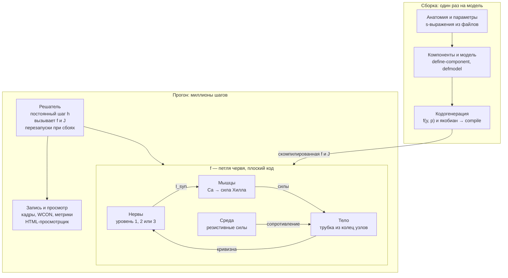

# Нематода на Лиспе: дизайн-документ

Симулятор локомоции *C. elegans* с биофизической моделью мышц на Common Lisp

## Цель и рамки

Симулятор воспроизводит прямую ундуляторную локомоцию взрослой гермафродитной *C. elegans* в воде и на агаре, причём движение возникает из работы мышц, а не задаётся кинематически. Главный критерий успеха: один и тот же контроллер без перенастройки сам меняет походку с плавания на ползание при смене среды.

**Цели первой версии**

- Трёхмерная модель тела: трубка из колец узлов с гидростатикой, упругой кутикулой и четырьмя раздельными рядами мышц.
- Мышца как динамическая система: кальциевая кинетика, активная и пассивная сила.
- Три сменных уровня управления: генератор ритма, проприоцептивная цепь, коннектом.
- Среда через теорию резистивных сил с параметрами воды и агара.
- Ядро на Common Lisp с кодогенерацией правой части ОДУ из декларативного описания модели.

**Вне рамок первой версии**

- Метод частиц (SPH) для жидкости: среда описывается резистивными силами и контактом с поверхностью.
- Повороты, омега-изгибы, задний ход как поведение (задний ход — только как проверка обращения волны).
- Глотка, голова как отдельный орган, развитие и личиночные стадии.

Тело трёхмерное с первой версии. Плоская модель проще, но склеивает левый и правый ряды мышц и не умеет описать ползание как контакт тела, лежащего на боку, с поверхностью агара; обе вещи в 3D получаются без натяжек.

## Биологическая основа

Движение червя — замкнутая петля: мотонейроны возбуждают мышцы, мышцы изгибают гидростатическое тело, среда превращает волну изгиба в поступательное движение, а изгиб через проприоцепцию снова влияет на мотонейроны. Модель обязана воспроизвести каждое звено этой петли.

**Тело.** Длина взрослой особи около 1 мм, диаметр порядка 50–80 мкм (ориентировочно). Жёсткого скелета нет: полость тела под давлением, снаружи упругая кутикула. Сокращение мышцы на одной стороне укорачивает эту сторону и изгибает тело, а давление не даёт ему схлопнуться.

**Мышцы.** 95 клеток стенки тела в четырёх продольных рядах: дорсальный левый и правый, вентральный левый и правый. Мышцы косо исчерченные и прикреплены к кутикуле через гиподерму, поэтому тянут не кость, а оболочку. Нервно-мышечные контакты лежат на «руках» мышечных клеток, которые тянутся к нервным тяжам.

**Электрика.** Мотонейроны работают на градуальных потенциалах. Мышцы стенки тела генерируют кальциевые потенциалы действия, и частота их разрядов отражает силу входа. Для локомоции на масштабе всего тела допустимо усреднение: модель по скорости разрядов, то есть по концентрации кальция.

**Мотонейроны вентрального тяжа.**

| Класс  | Медиатор    | Мишень                         | Роль                                             |
|--------|-------------|--------------------------------|--------------------------------------------------|
| VB, DB | ацетилхолин | вентральные / дорсальные мышцы | движение вперёд, проприоцептивная связь          |
| VA, DA | ацетилхолин | вентральные / дорсальные мышцы | движение назад                                   |
| VD, DD | ГАМК        | вентральные / дорсальные мышцы | перекрёстное торможение противоположной стороны  |
| AS     | ацетилхолин | дорсальные мышцы               | вспомогательный, в первой версии не моделируется |

Передние мышцы иннервируются нейронами нервного кольца, остальные — мотонейронами вентрального тяжа. Перекрёстное торможение критично: без него дорсальная и вентральная стороны сокращаются одновременно и волны нет.

## Модель тела

Тело — трубка из N колец (N ≈ 50) по K узлов (K = 8), соединённых упругими элементами и наполненных несжимаемой средой. Инерцией пренебрегаем: число Рейнольдса для червя много меньше единицы, поэтому силы в каждый момент уравновешены, и система первого порядка по положениям узлов.

**Узлы.** Кольцо i — K узлов на окружности радиуса R(s_i) вокруг средней линии, под углами 22,5° + 45°·k от дорсальной средней линии. При таком расположении каждый из четырёх мышечных квадрантов накрывает ровно два узла кольца, а дорсальная, вентральная и обе латеральные линии проходят между узлами. Профиль R(s) сужается к голове и хвосту.

**Элементы.**

- Продольные рёбра — узел k кольца i с узлом k кольца i+1: продольная упругость кутикулы; к ним приложены мышцы своего квадранта.
- Окружные рёбра — соседние узлы одного кольца: окружная упругость кутикулы, отдельный параметр со своей жёсткостью.
- Диагонали между соседними кольцами — сопротивление сдвигу и кручению.
- Диаметральные рёбра — противоположные узлы кольца, слабые: не дают сечению сплющиться в эллипс при сильном изгибе.

**Гидростатика.** Отсек между кольцами i и i+1 — замкнутый многогранник: боковые четырёхугольники, разбитые на треугольники, и два торца-веера вокруг центров колец (центр — среднее узлов кольца). Объём отсека и давление:

```math
V_i = \frac{1}{6}\sum_{(a,b,c)} \mathbf{x}_a \cdot (\mathbf{x}_b \times \mathbf{x}_c), \qquad p_i = k_p \,\frac{V_i^{0} - V_i}{V_i^{0}}, \qquad \mathbf{F}^{p}_{j} = p_i \,\frac{\partial V_i}{\partial \mathbf{x}_j}
```

Сжатый отсек (p_i > 0) толкает узлы в сторону роста объёма. Общий торец двух соседних отсеков входит в них с противоположной ориентацией, поэтому при равных давлениях его вклады взаимно гасятся. Сокращение мышц одного квадранта укорачивает его сторону, давление раздвигает противоположную, и тело изгибается без потери объёма.

**Кутикула.** Все рёбра — линейная упругость с вязким демпфированием внутренних тканей:

```math
F^{c} = k_c \,(\ell - \ell_0) + \eta_c \, \dot{\ell}
```

**Контакт с поверхностью.** На агаре червь лежит на боку, и плёнка жидкости прижимает его к поверхности. Поверхность — плоскость z = 0; проникновение под неё штрафуется, а прижимающая сила мениска распределяется по узлам сечения:

```math
\mathbf{F}^{s}_j = \Big(k_s \max(0,\,-z_j) - \frac{f_m \,\Delta s_j}{K}\Big)\,\mathbf{e}_z
```

В воде контакт выключен. Начальное положение на агаре — на боку: дорсо-вентральная ось параллельна поверхности, поэтому дорсо-вентральный изгиб лежит в её плоскости.

**Уравнение движения.** Сумма внутренних сил узла уравновешивает сопротивление среды. Сопротивление линейно по скорости (раздел «Среда»), вязкие члены кутикулы и зависимость мышечной силы от скорости тоже, поэтому:

```math
(\mathbf{M} + \mathbf{D})\,\dot{\mathbf{x}} = \mathbf{F}^{c,el} + \mathbf{F}^{p} + \mathbf{F}^{m,a} + \mathbf{F}^{s}
```

M — блочно-диагональная матрица сопротивления среды (блок 3×3 на узел), D — вязкие и скоростные члены рёбер и мышц, F^{c,el} — упругая часть сил кутикулы, F^{m,a} — мышечная сила без скоростного множителя, вынесенного в D линеаризацией. Узлы нумеруются кольцо за кольцом, и каждый элемент связывает только соседние кольца, поэтому матрица ленточная с шириной около 2K узлов и решается за O(N K³) на шаг.

## Модель мышцы

Каждая из 95 клеток — отдельная динамическая система с переменной состояния кальций (и вспомогательной — сглаженной скоростью укорочения, см. ниже) и силой хилловского типа, приложенной к продольным рёбрам своего квадранта. Электрика мышцы по умолчанию усреднена до скорости разрядов; подробная модель с ионными токами — сменный вариант того же интерфейса.

**Вход → кальций.** Синаптический ток от мотонейронов задаёт стационарный уровень кальция, к которому концентрация релаксирует с постоянной времени τ_Ca:

```math
\tau_{Ca} \, \frac{dCa_k}{dt} = Ca_{\infty}(I^{syn}_k) - Ca_k, \qquad Ca_{\infty}(I) = \frac{Ca_{max}}{1 + e^{-(I - I_{1/2})/\sigma}}
```

**Кальций → активация.** Связывание кальция сократительным аппаратом — функция Хилла:

```math
a_k = \frac{Ca_k^{\,n}}{Ca_k^{\,n} + K_{Ca}^{\,n}}
```

**Активация → сила.** Активная сила умножается на зависимости от длины и скорости укорочения; параллельно работает пассивная упругость:

```math
F_k = F_{max} \, a_k \, f_L(\ell_k) \, f_V(\dot{\ell}_k) + k_{pe} \,(\ell_k - \ell_k^{0})_{+}
```

В модели k_pe = 0: пассивную упругость даёт кутикула (параметры, «Мышцы»).

- f_L — колокол с максимумом при оптимальной длине: перерастянутая или пережатая мышца слабее.
- f_V — гипербола Хилла: при быстром укорочении сила падает, при удлинении под нагрузкой немного растёт.
- Длина ℓ_k и скорость мышцы берутся как средние по рёбрам, которые она покрывает.
- f_L и f_V берутся по длине и скорости в начале шага и в его пределах постоянны. f_V читает скорость, сглаженную с постоянной τ_v порядка 10 мс: без сглаживания запаздывающая на шаг обратная связь по скорости расходится, как только демпфирование мышцы превышает вязкость тканей (параметры, «Мышцы»).

**Мышца → тело.** Клетка k покрывает несколько соседних сечений с весами w_{k,i}. Сила на продольное ребро i своего квадранта — взвешенная сумма:

```math
F^{m}_{i} = \sum_{k} w_{k,i} \, F_k
```

Каждый из четырёх рядов действует на два продольных ряда рёбер своего квадранта, и сила клетки делится между ними поровну. Левый и правый ряды одной стороны работают раздельно, поэтому их рассогласование даёт изгиб вне дорсо-вентральной плоскости и кручение.

**Варианты мышцы.**

| Вариант                    | Состояние на клетку                | Когда нужен                                          |
|----------------------------|------------------------------------|------------------------------------------------------|
| Усреднённый (по умолчанию) | Ca                                 | локомоция, подбор параметров, массовые прогоны       |
| Электрический              | V, Ca, воротные переменные каналов | изучение разрядов мышц и их связи с нейронным входом |
| Кинематический             | нет, сила задана функцией          | отладка тела и среды без мышечной динамики           |

## Нервное управление

Управление — сменный слой с единым выходом: синаптический ток I^syn_k на каждую из 95 мышц. Три уровня различаются тем, откуда берётся волна: задана извне, возникает из проприоцепции или из сети целиком. Начинать следует с первого, а критерий успеха проекта проверяется на втором.

**Уровень 1: генератор ритма.** Бегущая волна задаётся напрямую, с полупериодным сдвигом между сторонами:

```math
I^{syn}_{D}(s,t) = A \,\big[\sin\!\big(2\pi(ft - s/\lambda)\big)\big]_{+}, \qquad I^{syn}_{V}(s,t) = A \,\big[-\sin\!\big(2\pi(ft - s/\lambda)\big)\big]_{+}
```

Здесь s — положение вдоль тела, f — частота, λ — длина волны. Уровень нужен для отладки тела, мышц и среды; походка к среде не приспосабливается, потому что f и λ заданы.

**Уровень 2: проприоцептивная цепь.** Вентральный тяж разбит на M повторяющихся единиц (порядка 6–12). В каждой единице дорсальный и вентральный B-нейрон с порогом и гистерезисом:

- вход B-нейрона — изгиб тела в рецептивном поле его единицы: растяжение своей стороны тела при изгибе;
- B-нейрон возбуждает мышцы своей стороны и через D-нейрон тормозит противоположную;
- отдельного головного осциллятора нет: каждая единица сама — релаксационный осциллятор (этап 10, ниже).

Волна здесь не задана: изгиб передней части через проприоцепцию включает следующую единицу, и возмущение бежит назад по телу. Пороговую (бинарную) модель B-нейрона дополняет проводимостная версия Бойла с мембранным потенциалом (этап 11; параметры, «Уровень 2: проводимостная версия»). Частота и длина волны получаются из механики, поэтому в вязкой среде волна сама замедляется и укорачивается. Это и есть проверяемый эффект адаптации походки.

**Направление рецептивного поля (этап 10).** Поле — параметр: назад от единицы (Boyle et al. 2012) или вперёд (Wen et al. 2012). Проверены оба.

- Поле **назад** длиной 0,35 L (у Бойла 0,5 L) с отрицательной обратной связью — B-нейрон своей стороны включается растяжением этой стороны и выключается её сжатием — даёт бегущую от головы к хвосту волну, и червь движется вперёд. Каждая единица сама — релаксационный осциллятор, отдельный головной осциллятор не нужен. Это базовый вариант.
- Поле **вперёд** с тем же знаком связи гонит волну от хвоста к голове: на агаре 0,68 Гц, λ = 0,25 L, червь ползёт назад (−0,25 мм/с).
- Поле **вперёд** со знаком Wen — единица повторяет изгиб участка впереди, а первая единица служит головным осциллятором с полем назад — с параметрами Бойла волны не даёт: тело застывает в изгибе, потому что смещения AVB и пороги подобраны под отрицательную обратную связь. Для этого варианта нужна своя настройка.

Сигнал рецептора — изгибная часть удлинения стороны: полуразность дорсального и вентрального удлинения продольных рёбер, приведённая к толщине тела. Общее укорочение тела при сокращении мышц в него не входит: в трёхмерном гидростатическом теле сокращение одной стороны сильно укорачивает её, а противоположную почти не растягивает, и сигнал «удлинения своей стороны» почти не срабатывал бы. Сигнал проходит через сглаживание с постоянной τ_sr = 200 мс — задержку передачи изгиба (у Wen около 80 мс на участок). Без него проприоцептивный осциллятор в воде колеблется с частотой 7–8 Гц.

**Уровень 3: коннектом.** Нейроны, участвующие в локомоции, как градуальные элементы с химическими синапсами и щелевыми контактами; у каждого синапса своя переменная активности s (Kunert et al. 2014):

```math
C_i \frac{dV_i}{dt} = -g_L (V_i - E_L) + \sum_j w_{ij} \, g_s \, s_j\,(E_{ij} - V_i) + \sum_j g^{gap}_{ij}\,(V_j - V_i) + I^{sr}_i, \qquad \frac{ds_j}{dt} = a_r\,\sigma(V_j)\,(1 - s_j) - a_d\,s_j
```

σ — сигмоида пресинаптического потенциала с порогом, при котором сеть в покое активна на заданную долю; E_ij — потенциал реверсии (возбуждающий для ацетилхолина, тормозный для ГАМК). Мгновенная сигмоида σ(V) вместо s заметно портит поведение (Kim et al. 2025). Связи — таблица Cook et al. 2019, 147 нейронов: мотонейроны тяжа и хвоста, командные интернейроны и все нейроны с нервно-мышечными синапсами (параметры, «Уровень 3»). B-нейроны чувствуют изгиб, как единицы второго уровня: растяжение своей стороны открывает канал растяжения. Анатомия даёт число контактов, а не их силу, поэтому веса масштабируются по классам связей: щелевые контакты командных интернейронов, остальные щелевые контакты, химические синапсы, нервно-мышечные синапсы нейронов вне тяжа.

**Общий интерфейс.** Каждый уровень принимает текущее состояние тела (кривизну по сечениям) и возвращает I^syn для всех мышц. Поэтому уровни взаимозаменяемы без правки тела, мышц и среды.

## Среда

Среда задаётся теорией резистивных сил: каждый участок тела испытывает сопротивление, линейное по своей скорости, но разное вдоль и поперёк тела. Именно эта анизотропия превращает волну изгиба в движение вперёд.

```math
\mathbf{F}^{drag}_j = -\Big( C_t \,(\mathbf{v}_j\!\cdot\!\mathbf{t}_j)\,\mathbf{t}_j + C_n \,\big(\mathbf{v}_j - (\mathbf{v}_j\!\cdot\!\mathbf{t}_j)\,\mathbf{t}_j\big) \Big)\,\frac{\Delta s_j}{K}
```

Здесь t_j — касательная к средней линии в кольце узла, Δs_j — длина участка, сопротивление делится между K узлами кольца. Отсюда блок 3×3 узла M_j = (C_t t tᵀ + C_n (I − t tᵀ)) Δs_j / K, который используется в разделе «Модель тела». На агаре коэффициенты описывают сопротивление в плоскости поверхности, а движение поперёк неё ограничено контактом.

**Параметры сред.** Отношение K = C_n / C_t определяет, насколько эффективна волна.

| Среда             | K = C_n / C_t       | Абсолютное сопротивление                      | Ожидаемая походка               |
|-------------------|---------------------|-----------------------------------------------|---------------------------------|
| Вода (буфер)      | около 1,5           | низкое                                        | плавание: длинная частая волна  |
| Вязкий раствор    | около 1,5           | растёт с вязкостью                            | промежуточная                   |
| Поверхность агара | на порядок и больше | высокое, задаётся канавкой и плёнкой жидкости | ползание: короткая редкая волна |

Значения ориентировочные и подлежат подбору по литературе и по кинематике. Среда с K = 1 не даёт тяги при любой волне; это используется как контрольный тест.

**Интерфейс.** Среда — компонент `rft` на узлах с параметрами C_t и C_n из набора среды, контакт — компонент `substrate`, включённый только на агаре. Неоднородную среду (граница вода/агар) или препятствия можно добавить новым компонентом на узлах, не трогая ядро.

## Численная схема

Система жёсткая, поэтому базовый интегратор — линейно-неявный (полунеявный) метод Эйлера с ленточным якобианом и постоянным шагом. Постоянный шаг выбран ради воспроизводимости: одинаковые параметры дают побитово одинаковую траекторию.

**Вектор состояния.** Один плоский массив `double-float`, разделы которого раскладываются при сборке модели:

| Раздел               | Размер                                        | Скорость изменения                |
|----------------------|-----------------------------------------------|-----------------------------------|
| Положения узлов      | K узлов × N колец × 3 координаты              | медленная (масштаб периода волны) |
| Кальций мышц         | 95 (усреднённый вариант) и 95 сглаженных скоростей | средняя (τ_Ca, τ_v)          |
| Потенциалы нейронов  | 0 / 2M / число нейронов, по уровню управления | быстрая                           |
| Внутреннее состояние | фазы, гистерезис B-нейронов                   | дискретные переключения           |

**Откуда жёсткость.** Окружные рёбра и штраф объёма намного жёстче продольного изгиба, а нейронные постоянные времени много короче периода волны. Явный метод вынужден был бы брать шаг по самой быстрой моде.

**Шаг.** Линеаризация правой части вокруг текущего состояния:

```math
\big(\mathbf{I} - h\,\mathbf{J}(\mathbf{y}_n)\big)\,\Delta\mathbf{y} = h\,\mathbf{f}(\mathbf{y}_n), \qquad \mathbf{y}_{n+1} = \mathbf{y}_n + \Delta\mathbf{y}
```

Якобиан механической части ленточный по сечениям, поэтому решение — O(N). Нейронная и мышечная части связаны с механикой разреженно (кривизна → нейроны, кальций → силы) и обрабатываются расщеплением: сначала нервно-мышечный подшаг с плотной LU, затем механический с ленточной (архитектура, «Решатель», решения 6 и 22).

**Порядок развития интегратора.**

1. Явный метод с мелким шагом — эталон для проверки, медленный, но очевидно верный.
2. Полунеявный Эйлер с численным якобианом — первая рабочая версия.
3. Тот же метод с символьно выведенным якобианом из кодогенерации — рабочая версия для массовых прогонов.
4. При нужде точности выше первого порядка — метод Розенброка того же устройства.

**Дискретные события.** Переключения B-нейронов с гистерезисом — разрывы правой части. Шаг детектирует пересечение порога и обрабатывает переключение на границе шага, не интегрируя через разрыв.

## Архитектура на Common Lisp

Программа делится на две фазы: сборку, где декларативное описание модели превращается в специализированную скомпилированную функцию, и прогон, где эта функция вызывается миллионы раз без единой диспетчеризации. Вся гибкость Лиспа — CLOS, макросы, символьные выражения — живёт в фазе сборки; горячий цикл состоит из плоской арифметики над массивами `double-float`.

Реализация — SBCL. Сборка — ASDF, по системе на модуль.



Верхняя полоса выполняется один раз и порождает функцию f с якобианом; на каждом шаге решатель вызывает только её, а петля нервы → мышцы → тело → кривизна → нервы целиком живёт внутри f.

Устройство программы — системы ASDF по слоям, язык модели, кодогенерация, решатель, рантайм, сервер и пакетные прогоны — описано в [архитектуре](architecture.md); здесь только то, что определяет модель.

**Компонент на языке модели.** Компонент объявляет семейство элементов, параметры, состояние, входы, производные и выходы символьными выражениями (архитектура, «DSL компонентов и defmodel»):

```lisp
(define-component rate-muscle                 ; src/components/body.lisp, сокращённо
  :family :muscle
  :params (tau-ca ca-half hill-n syn-half syn-width … (f-max :per-element))
  :state  ((ca (logistic (/ (- syn-half) syn-width))) (rate 0))
  :inputs ((drive (link :drive)) (attached-length (link :attached-length)) …)
  :derivs ((ca (/ (- (logistic (/ (- drive syn-half) syn-width)) ca) tau-ca)) …)
  :outputs ((force (* f-max activation f-l f-v)) (active activation)))
```

**Модель целиком.** `defmodel` расставляет компоненты по семействам элементов трубки и связывает выходы со входами; модели `worm-3d` (уровень 1), `worm-3d-kinematic` (заданное натяжение), `worm-3d-proprio` и `worm-3d-proprio-graded` (уровень 2), `worm-3d-connectome` (уровень 3) — в `src/components/models.lisp`.

**Кодогенерация.** `compile-model` понижает модель в граф выражений, дифференцирует его символьно и порождает типизированные функции шага — наблюдаемые, правую часть и якобиан нервно-мышечной части, натяжение мышц, силы, ленточную матрицу шага — без обращения к объектам и хэш-таблицам на шаге. Объекты и макросы живут только на сборке.

**Параметры отдельно от кода.** Параметры приходят в функции вектором `p`, а не впечатываются константами. Поэтому в REPL можно менять τ_Ca или C_n на работающей модели, и изменение действует со следующего шага. Изменение структуры (другой уровень управления, параметры поэлементных массивов) требует пересборки `rebuild`: около 3 с, из кэша — доли секунды. Другое N — новый прогон, `start-run :rings`.

**Условия и перезапуски.** Решатель сигнализирует о численных бедах условием `numerical-blowup` с причиной (NaN, переполнение, сжатие отсека, вырожденная матрица) и предлагает перезапуски `halve-timestep`, `rollback-to-checkpoint`, `clamp-and-continue`, `abort-run`. В интерактивной работе прогон встаёт на паузу и ждёт решения человека — `(choose …)` в REPL или кнопкой в просмотрщике, без отладчика в фоновом потоке; в пакетных прогонах перезапуск выбирает политика (архитектура, «Ошибки»).

**Эталонный интерпретатор.** Помимо кодогенерации, модель умеет вычислять правую часть прямым обходом выражений. Это медленно, но служит эталоном: на тестовых состояниях результаты двух путей обязаны совпадать до округления. Так отлавливаются ошибки генератора, самые трудные для отладки.

## Данные и форматы

Всё, что описывает организм и прогон, хранится в s-выражениях и читается `read` с отключённым `*read-eval*`; всё, что выходит наружу, пишется в форматах, понятных внешним инструментам.

| Файл                        | Формат                  | Содержание                                                                               |
|-----------------------------|-------------------------|------------------------------------------------------------------------------------------|
| `anatomy/muscles.sexp`      | s-выражения             | 95 мышц: имя, квадрант, ряд, номер, концы и середина веретена в долях длины тела          |
| `anatomy/neurons.sexp`      | s-выражения             | источник таблицы (`connectome-source`: файл, MD5, правило отбора); нейроны: имя, класс, медиатор, положение вдоль тела, число нервно-мышечных контактов |
| `anatomy/synapses.sexp`     | s-выражения             | химические синапсы, щелевые контакты и нервно-мышечные синапсы: пре, пост, число контактов |
| `params/*.sexp`             | s-выражения             | именованные наборы параметров с единицами и указанием источника каждого значения         |
| `configs/*.sexp`, `sweeps/*.sexp` | s-выражения       | конфигурация прогона: модель, набор параметров, среда, шаг, длительность, частота записи; описания развёрток |
| `runs/<id>/frames.bin`      | float32, кадр за кадром | координаты узлов с прореживанием по времени                                              |
| `runs/<id>/meta.json`       | JSON                    | конфигурация, версия кода, хэш параметров, сведения о кадрах                             |
| `runs/<id>/kinematics.wcon` | WCON                    | средняя линия в формате, принятом в сообществе трекеров червей (Worm tracker Commons)    |
| `runs/<id>/metrics.csv`     | CSV                     | скорость, частота, длина волны, амплитуда, скорость волны, проскальзывание, профиль кривизны по окнам времени |

**Пример анатомии.**

```lisp
(muscle mdl07 :quadrant :dorsal-left :row :medial :index 7 :from 0.226 :peak 0.261 :to 0.295)
(neuron vb06 :class :vb :transmitter :acetylcholine :position 0.52 :nmj 20)
(synapse vb06 dd04  :contacts 3)    ; химический синапс между нейронами
(gap     vb06 vb07  :contacts 2)    ; щелевой контакт
(nmj     vb06 mvl11 :contacts 4)    ; нервно-мышечный синапс
```

Значения в примере иллюстративные. Веса покрытия рёбер мышцей не хранятся, а считаются при сборке по профилю веретена и числу колец. Таблицы связей конвертируются в s-выражения отдельным скриптом из опубликованных реконструкций коннектома; скрипт — `scripts/convert-connectome.lisp`; источник таблицы и его MD5 фиксируются в поле `connectome` файла `meta.json` каждого прогона.

**Просмотрщик.** Отдельный HTML-файл без сборки (Three.js r128 лежит рядом) читает `frames.bin` и `meta.json` с диска или с сервера, показывает и живой прогон, и проигрывает движение: тело, раскраска мышц по активации, график кривизны по времени и телу (кимограмма). Кимограмма — главный инструмент глазной проверки: бегущая волна на ней выглядит как наклонные полосы.

## Валидация

Проверка идёт снизу вверх: каждое звено сначала проверяется изолированно на задачах с известным ответом, затем вся петля сверяется с кинематикой живых червей.

**Тесты звеньев.**

| Звено         | Тест                                    | Ожидаемый результат                                                                   |
|---------------|-----------------------------------------|---------------------------------------------------------------------------------------|
| Мышца         | ступенька входа при фиксированной длине | кальций растёт с постоянной τ_Ca, сила выходит на плато                               |
| Мышца         | развёртка по длине и скорости           | воспроизводятся f_L и f_V, заданные в параметрах                                      |
| Тело          | изогнутое тело без мышц                 | расслабляется к прямому, монотонно, без колебаний                                     |
| Тело          | сильный изгиб чистым моментом           | объём каждого отсека меняется меньше чем на 1% (одностороннее сокращение сжимает тело вдоль, и там объём законно меняется по объёмному модулю) |
| Среда         | K = 1, любая волна                      | нет поступательного движения                                                          |
| Среда         | обращение направления волны             | движение меняет знак                                                                  |
| Кодогенерация | случайные состояния                     | правая часть и якобиан совпадают с эталонным интерпретатором и с конечными разностями |
| Решатель      | уменьшение шага вдвое                   | траектория сходится с первым порядком                                                 |

**Ориентиры походки.** Цифры — по Fang-Yen et al. 2010 (вода — NGM-буфер, агар — 2% агароза); источники и прочие ориентиры собраны в документе параметров.

| Метрика       | Вода                   | Агар                             |
|---------------|------------------------|----------------------------------|
| Частота волны | 1,76 ± 0,07 Гц         | 0,30 ± 0,02 Гц                   |
| Длина волны   | 1,54 ± 0,04 длины тела | 0,65 ± 0,03 длины тела           |
| Форма         | C-образные изгибы      | синусоида из нескольких полуволн |

**Главный тест — адаптация походки.** Контроллер второго уровня с одним набором параметров прогоняется при плавно растущем сопротивлении среды. Проходом считается монотонное падение частоты и длины волны от водных значений к агаровым без перенастройки. На первом уровне этот тест провален по построению; это служит контролем, что эффект создают проприоцепция и механика.

Результат этапа 10 (поле назад 0,35 L, вязкость воды ×μ при C_n/C_t = 1,6):

| Среда           | Частота, Гц | λ/L   | κ·L  |
|-----------------|-------------|-------|------|
| вода, μ = 1     | 1,72        | 1,80  | 3,3  |
| μ = 10          | 1,72        | 1,83  | 3,3  |
| μ = 100         | 1,74        | 2,12  | 3,4  |
| μ = 1000        | 1,59        | 5,4   | 3,1  |
| μ = 3000        | 1,32        | 0,21  | 3,0  |
| μ = 10⁴         | 0,73        | 0,88  | 3,9  |
| μ = 3·10⁴       | 0,51        | 0,60  | 3,7  |
| агар            | 0,73        | 0,77  | 3,5  |

Концы походят на живого червя по направлению: от воды к агару частота падает в 2,4 раза, длина волны — в 2,3 раза; вода близка к ориентиру. Тест не пройден: в промежутке μ = 10³–3·10³ волна почти стоячая (λ от 0,2 до 5 L), а частота на агаре вдвое выше ориентира 0,30 Гц. Разбор и решение — в плане, этап 10, итог.

Развёртка этапа 11 искала настройку второго уровня, проходящую тест. Одна и та же выборка латинского гиперкуба из 12 точек считалась в трёх средах: вода, вязкая вода (C_t и C_n ×1000) и агар. Бинарная версия B-нейрона варьировала сглаживание рецептора τ_sr = 50–400 мс, его усиление s = 0,8–2,5, длину поля 0,2–0,5 L и постоянную кальция 80–400 мс. Проводимостная версия (Boyle 2012, ур. 14–15) варьировала постоянную мембраны τ_m = 10–100 мс, ток рецептора 30–300 пА, τ_sr = 20–300 мс и длину поля. Ещё 12 точек на агаре варьировали механическое время тела: C_n = 64–512 мкН·с/мм², EI = 0,095–0,28 мкН·мм² и F_max = 8–33 мкН.

| Развёртка                | Вода: f, Гц / λ, L    | Вязкая вода: f / λ   | Агар: f / λ          | f падает | λ падает |
|--------------------------|-----------------------|----------------------|----------------------|----------|----------|
| бинарная, 12 точек       | 0,84–3,7 / 0,89–6,8   | 0,84–3,1 / 0,20–7,2  | 0,37–1,30 / 0,50–1,8 | 8 из 12  | 0 из 12  |
| проводимостная, 12 точек | 1,8–5,8 / 0,2–78      | 1,7–3,3 / 0,21–1,7   | 0,91–1,9 / 0,51–0,88 | 11 из 12 | 0 из 12  |
| механика агара, 12 точек | —                     | —                    | 0,75–1,36 / 0,52–0,75 | —       | —        |

Тест не проходит ни в одной точке. Частота от воды к агару падает почти всегда — это даёт механика, как и ожидалось. Длина волны не падает монотонно ни разу. В воде и вязкой воде цепь с полем назад не держит направление волны: единицы либо переключаются почти синхронно (λ в несколько длин тела, стоячая волна), либо волна бежит от хвоста к голове (λ ≈ 0,2 L по модулю, червь пятится). На агаре, где тело медленное, проводимостная версия даёт длину волны живого червя (0,51–0,65 L) при любой точке, но частоту 0,9–1,9 Гц. Механика агара её не опускает ниже 0,75 Гц даже при C_n = 500 и слабых мышцах. Бинарная доходит до 0,37 Гц только ценой длины волны 1,3–1,8 L.

Вывод: проприоцептивной цепи с полем назад и одним механическим временем недостаточно. Направление волны в среде с малым сопротивлением ей нечем задать, а частота на агаре определяется порогом рецептора, а не временем тела. Решение — в плане, этап 11, итог: главный тест переносится на третий уровень. Второй уровень остаётся с бинарной версией как базовой; проводимостная — модель `worm-3d-proprio-graded`.

Третий уровень (этап 12, модель `worm-3d-connectome`, параметры подобраны на агаре, вязкость воды ×μ):

| Среда       | Частота, Гц | λ/L  | κ·L | Скорость, мм/с |
|-------------|-------------|------|-----|----------------|
| вода, μ = 1 | 1,72        | 0,23 | 1,8 | 0,000          |
| μ = 10      | 1,55        | 0,22 | 1,9 | 0,000          |
| μ = 100     | 1,37        | 0,21 | 2,3 | 0,002          |
| μ = 1000    | 1,09        | 10,6 | 2,6 | 0,005          |
| μ = 3000    | 0,90        | 6,3  | 2,5 | 0,004          |
| μ = 10⁴     | 0,66        | 1,72 | 2,1 | 0,002          |
| агар        | 0,55        | 0,92 | 2,0 | 0,078          |

Частота падает монотонно на всём пути, и в воде она та же, что у живого червя (1,72 Гц против 1,76). На агаре сеть сама даёт бегущую от головы к хвосту волну с длиной 0,92 L и ползёт вперёд. Длина волны монотонно не падает, и в воде червь не плывёт: колебание заперто в передней трети тела (кольца 10–25 из 50), задняя часть почти неподвижна; λ ≈ 0,2 L там — это запаздывание между 0,35 и 0,55 L внутри стоячего колебания, а не бегущая волна. Поиск плавания в воде (12 точек вокруг настройки агара) скорости не дал ни в одной точке. Поле вперёд по Wen с теми же параметрами застывает в изгибе, как и на втором уровне.

Этап 12а проверил поле вперёд и головной генератор. На втором уровне головная единица с утомлением колеблется сама, около 2 Гц в воде, но бинарные единицы тела, повторяющие изгиб впереди, сворачиваются в ровную дугу и застывают: однородный изгиб — неподвижная точка правила «повторяй участок впереди», а гистерезис не даёт единице выключиться. На третьем уровне градуальные B-нейроны не застывают, но и заданный синусоидой ритм головы тело не повторяет — ни при поле вперёд, ни при поле назад (2 + 16 точек в воде). Нашлась ошибка настройки этапа 12. С химическими синапсами Kunert полного веса порог V_th всех нейронов выше потенциала реверсии возбуждения, и сеть работает только на нижнем хвосте сигмоиды. Масштаб 0,15 это исправил, и на агаре сеть ползёт немного быстрее (0,50 Гц, λ = 0,93 L, 0,085 мм/с). Но в воде и после поиска (24 точки) червь не плывёт; частота от воды к агару по-прежнему падает монотонно, с 1,31 до 0,50 Гц.

Вывод по трём уровням. Частоту от среды механика и проприоцепция меняют, как ожидалось. А длину волны и бегущую волну в воде при поле назад и без головного генератора не даёт ни бинарная, ни проводимостная цепь, ни сеть коннектома. В среде с малым сопротивлением тело изгибается целиком, и задние участки не получают от своего поля сигнала, который бы их запустил. Поле вперёд, где каждый участок повторяет изгиб участка впереди, требует источника ритма в голове, но и с ним волна в нашем теле не бежит. Единственный вариант, при котором в воде волна прошла по телу и червь поплыл, — бинарная цепь с полем назад этапа 10 (λ = 1,8 L, 0,078 мм/с). Бистабильная единица с порогом и гистерезисом переключается в воде резко; градуальные и проводимостные единицы при малом сопротивлении не набирают изгиба, достаточного для переключения соседа. Главный тест в первой версии не пройден; что проверять дальше — в плане, этап 12а, итог.

**Регрессии.** Эталонные траектории всех трёх уровней управления лежат в `tests/golden/` (с этапа 13) и сверяются побитово в `make test-full`; до этапа 13 регрессии ловили только физические тесты с допусками. Изменение кода, меняющее эталон, требует явного обновления эталона с записью причины.

## План работ и риски

Этапы работ с условиями готовности ведутся в отдельном документе — [плане этапов](plan.md). Здесь остаются только риски модели.

**Риски.**

| Риск                                                                        | Последствие                            | Мера                                                                                     |
|-----------------------------------------------------------------------------|----------------------------------------|------------------------------------------------------------------------------------------|
| Параметры мышц и кутикулы известны плохо                                    | модель движется, но не похоже на червя | подгонка по кинематике; параметры с указанием источника; анализ чувствительности         |
| Сила синапсов не следует из анатомии                                        | третий уровень не даёт волны           | масштабировать по классам связей; сначала добиться волны на втором уровне                |
| Направление рецептивного поля B-нейронов в литературе трактуется по-разному | неверная причина возникновения волны   | сделать направление параметром модели и проверить оба варианта                           |
| Ошибки кодогенерации                                                        | тихо неверные результаты               | эталонный интерпретатор и проверка якобиана конечными разностями в каждом прогоне тестов |
| Жёсткость и разрывы                                                         | неустойчивость, мелкий шаг             | полунеявный метод, обработка событий, перезапуски при сбоях                              |
| Усреднение мышечных разрядов                                                | не воспроизводятся быстрые эффекты     | электрический вариант мышцы за тем же интерфейсом                                        |

**Литература для сверки.** Первые три работы прочитаны и сверены, полные ссылки — в [документе параметров](parameters.md#источники); остальные указаны по памяти.

- Boyle, Berri, Cohen, 2012 — интегрированная нейромеханическая модель адаптации походки.
- Wen и соавт., 2012 — проприоцептивная связь мотонейронов как двигатель прямой локомоции; B-нейроны включаются изгибом участка впереди.
- Fang-Yen и соавт., 2010 — биомеханика смены походки в средах разной вязкости.
- Gray, Lissmann, 1964 — теория резистивных сил для нематод.
- Palyanov и соавт., 2018 — Sibernetic, модель тела методом частиц (OpenWorm).
- Gleeson и соавт., 2018 — c302, многоуровневая модель нервной системы (OpenWorm).
- Varshney и соавт., 2011; Cook и соавт., 2019 — реконструкции коннектома.
