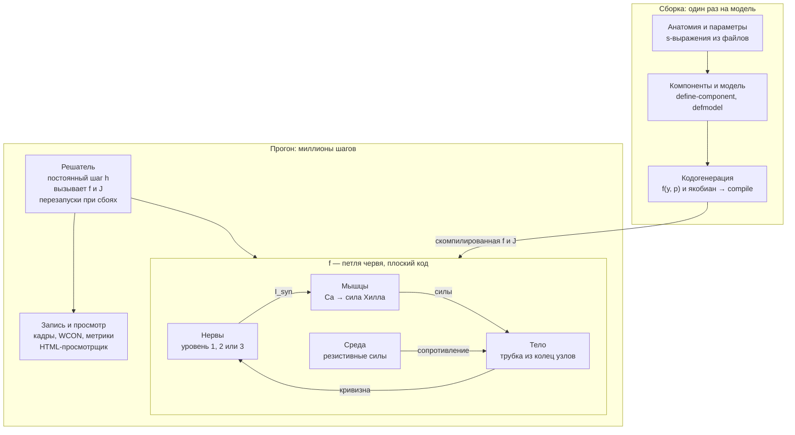

# Нематода на Лиспе: дизайн-документ

Симулятор локомоции *C. elegans* с биофизической моделью мышц на Common Lisp

## Цель и рамки

Симулятор воспроизводит прямую ундуляторную локомоцию взрослой гермафродитной *C. elegans* в воде и на агаре, причём движение возникает из работы мышц, а не задаётся кинематически. Главный критерий успеха: один и тот же контроллер без перенастройки сам меняет походку с плавания на ползание при смене среды.

**Цели первой версии**

- Трёхмерная модель тела: трубка из колец узлов с гидростатикой, упругой кутикулой и четырьмя раздельными рядами мышц.
- Мышца как динамическая система: кальциевая кинетика, активная и пассивная сила.
- Три сменных уровня управления: генератор ритма, проприоцептивная цепь, коннектом.
- Среда через теорию резистивных сил с параметрами воды и агара.
- Ядро на Common Lisp с кодогенерацией правой части ОДУ из декларативного описания модели.

**Вне рамок первой версии**

- Метод частиц (SPH) для жидкости: среда описывается резистивными силами и контактом с поверхностью.
- Повороты, омега-изгибы, задний ход как поведение (задний ход — только как проверка обращения волны).
- Глотка, голова как отдельный орган, развитие и личиночные стадии.

Тело трёхмерное с первой версии. Плоская модель проще, но склеивает левый и правый ряды мышц и не умеет описать ползание как контакт тела, лежащего на боку, с поверхностью агара; обе вещи в 3D получаются без натяжек.

## Биологическая основа

Движение червя — замкнутая петля: мотонейроны возбуждают мышцы, мышцы изгибают гидростатическое тело, среда превращает волну изгиба в поступательное движение, а изгиб через проприоцепцию снова влияет на мотонейроны. Модель обязана воспроизвести каждое звено этой петли.

**Тело.** Длина взрослой особи около 1 мм, диаметр порядка 50–80 мкм (ориентировочно). Жёсткого скелета нет: полость тела под давлением, снаружи упругая кутикула. Сокращение мышцы на одной стороне укорачивает эту сторону и изгибает тело, а давление не даёт ему схлопнуться.

**Мышцы.** 95 клеток стенки тела в четырёх продольных рядах: дорсальный левый и правый, вентральный левый и правый. Мышцы косо исчерченные и прикреплены к кутикуле через гиподерму, поэтому тянут не кость, а оболочку. Нервно-мышечные контакты лежат на «руках» мышечных клеток, которые тянутся к нервным тяжам.

**Электрика.** Мотонейроны работают на градуальных потенциалах. Мышцы стенки тела генерируют кальциевые потенциалы действия, и частота их разрядов отражает силу входа. Для локомоции на масштабе всего тела допустимо усреднение: модель по скорости разрядов, то есть по концентрации кальция.

**Мотонейроны вентрального тяжа.**

| Класс  | Медиатор    | Мишень                         | Роль                                             |
|--------|-------------|--------------------------------|--------------------------------------------------|
| VB, DB | ацетилхолин | вентральные / дорсальные мышцы | движение вперёд, проприоцептивная связь          |
| VA, DA | ацетилхолин | вентральные / дорсальные мышцы | движение назад                                   |
| VD, DD | ГАМК        | вентральные / дорсальные мышцы | перекрёстное торможение противоположной стороны  |
| AS     | ацетилхолин | дорсальные мышцы               | вспомогательный, в первой версии не моделируется |

Передние мышцы иннервируются нейронами нервного кольца, остальные — мотонейронами вентрального тяжа. Перекрёстное торможение критично: без него дорсальная и вентральная стороны сокращаются одновременно и волны нет.

## Модель тела

Тело — трубка из N колец (N ≈ 50) по K узлов (K = 8), соединённых упругими элементами и наполненных несжимаемой средой. Инерцией пренебрегаем: число Рейнольдса для червя много меньше единицы, поэтому силы в каждый момент уравновешены, и система первого порядка по положениям узлов.

**Узлы.** Кольцо i — K узлов на окружности радиуса R(s_i) вокруг средней линии, под углами 22,5° + 45°·k от дорсальной средней линии. При таком расположении каждый из четырёх мышечных квадрантов накрывает ровно два узла кольца, а дорсальная, вентральная и обе латеральные линии проходят между узлами. Профиль R(s) сужается к голове и хвосту.

**Элементы.**

- Продольные рёбра — узел k кольца i с узлом k кольца i+1: продольная упругость кутикулы; к ним приложены мышцы своего квадранта.
- Окружные рёбра — соседние узлы одного кольца: окружная упругость кутикулы, отдельный параметр со своей жёсткостью.
- Диагонали между соседними кольцами — сопротивление сдвигу и кручению.
- Диаметральные рёбра — противоположные узлы кольца, слабые: не дают сечению сплющиться в эллипс при сильном изгибе.

**Гидростатика.** Отсек между кольцами i и i+1 — замкнутый многогранник: боковые четырёхугольники, разбитые на треугольники, и два торца-веера вокруг центров колец (центр — среднее узлов кольца). Объём отсека и давление:

```math
V_i = \frac{1}{6}\sum_{(a,b,c)} \mathbf{x}_a \cdot (\mathbf{x}_b \times \mathbf{x}_c), \qquad p_i = k_p \,\frac{V_i^{0} - V_i}{V_i^{0}}, \qquad \mathbf{F}^{p}_{j} = p_i \,\frac{\partial V_i}{\partial \mathbf{x}_j}
```

Сжатый отсек (p_i > 0) толкает узлы в сторону роста объёма. Общий торец двух соседних отсеков входит в них с противоположной ориентацией, поэтому при равных давлениях его вклады взаимно гасятся. Сокращение мышц одного квадранта укорачивает его сторону, давление раздвигает противоположную, и тело изгибается без потери объёма.

**Кутикула.** Все рёбра — линейная упругость с вязким демпфированием внутренних тканей:

```math
F^{c} = k_c \,(\ell - \ell_0) + \eta_c \, \dot{\ell}
```

**Контакт с поверхностью.** На агаре червь лежит на боку, и плёнка жидкости прижимает его к поверхности. Поверхность — плоскость z = 0; проникновение под неё штрафуется, а прижимающая сила мениска распределяется по узлам сечения:

```math
\mathbf{F}^{s}_j = \Big(k_s \max(0,\,-z_j) - \frac{f_m \,\Delta s_j}{K}\Big)\,\mathbf{e}_z
```

В воде контакт выключен. Начальное положение на агаре — на боку: дорсо-вентральная ось параллельна поверхности, поэтому дорсо-вентральный изгиб лежит в её плоскости.

**Уравнение движения.** Сумма внутренних сил узла уравновешивает сопротивление среды. Сопротивление линейно по скорости (раздел «Среда»), вязкие члены кутикулы и зависимость мышечной силы от скорости тоже, поэтому:

```math
(\mathbf{M} + \mathbf{D})\,\dot{\mathbf{x}} = \mathbf{F}^{c,el} + \mathbf{F}^{p} + \mathbf{F}^{m,a} + \mathbf{F}^{s}
```

M — блочно-диагональная матрица сопротивления среды (блок 3×3 на узел), D — вязкие и скоростные члены рёбер и мышц, F^{c,el} — упругая часть сил кутикулы, F^{m,a} — мышечная сила без скоростного множителя, вынесенного в D линеаризацией. Узлы нумеруются кольцо за кольцом, и каждый элемент связывает только соседние кольца, поэтому матрица ленточная с шириной около 2K узлов и решается за O(N K³) на шаг.

## Модель мышцы

Каждая из 95 клеток — отдельная динамическая система с одной переменной состояния (кальций) и силой хилловского типа, приложенной к продольным рёбрам своего квадранта. Электрика мышцы по умолчанию усреднена до скорости разрядов; подробная модель с ионными токами — сменный вариант того же интерфейса.

**Вход → кальций.** Синаптический ток от мотонейронов задаёт стационарный уровень кальция, к которому концентрация релаксирует с постоянной времени τ_Ca:

```math
\tau_{Ca} \, \frac{dCa_k}{dt} = Ca_{\infty}(I^{syn}_k) - Ca_k, \qquad Ca_{\infty}(I) = \frac{Ca_{max}}{1 + e^{-(I - I_{1/2})/\sigma}}
```

**Кальций → активация.** Связывание кальция сократительным аппаратом — функция Хилла:

```math
a_k = \frac{Ca_k^{\,n}}{Ca_k^{\,n} + K_{Ca}^{\,n}}
```

**Активация → сила.** Активная сила умножается на зависимости от длины и скорости укорочения; параллельно работает пассивная упругость:

```math
F_k = F_{max} \, a_k \, f_L(\ell_k) \, f_V(\dot{\ell}_k) + k_{pe} \,(\ell_k - \ell_k^{0})_{+}
```

- f_L — колокол с максимумом при оптимальной длине: перерастянутая или пережатая мышца слабее.
- f_V — гипербола Хилла: при быстром укорочении сила падает, при удлинении под нагрузкой немного растёт.
- Длина ℓ_k и скорость мышцы берутся как средние по рёбрам, которые она покрывает.

**Мышца → тело.** Клетка k покрывает несколько соседних сечений с весами w_{k,i}. Сила на продольное ребро i своего квадранта — взвешенная сумма:

```math
F^{m}_{i} = \sum_{k} w_{k,i} \, F_k
```

Каждый из четырёх рядов действует на два продольных ряда рёбер своего квадранта, и сила клетки делится между ними поровну. Левый и правый ряды одной стороны работают раздельно, поэтому их рассогласование даёт изгиб вне дорсо-вентральной плоскости и кручение.

**Варианты мышцы.**

| Вариант                    | Состояние на клетку                | Когда нужен                                          |
|----------------------------|------------------------------------|------------------------------------------------------|
| Усреднённый (по умолчанию) | Ca                                 | локомоция, подбор параметров, массовые прогоны       |
| Электрический              | V, Ca, воротные переменные каналов | изучение разрядов мышц и их связи с нейронным входом |
| Кинематический             | нет, сила задана функцией          | отладка тела и среды без мышечной динамики           |

## Нервное управление

Управление — сменный слой с единым выходом: синаптический ток I^syn_k на каждую из 95 мышц. Три уровня различаются тем, откуда берётся волна: задана извне, возникает из проприоцепции или из сети целиком. Начинать следует с первого, а критерий успеха проекта проверяется на втором.

**Уровень 1: генератор ритма.** Бегущая волна задаётся напрямую, с полупериодным сдвигом между сторонами:

```math
I^{syn}_{D}(s,t) = A \,\big[\sin\!\big(2\pi(ft - s/\lambda)\big)\big]_{+}, \qquad I^{syn}_{V}(s,t) = A \,\big[-\sin\!\big(2\pi(ft - s/\lambda)\big)\big]_{+}
```

Здесь s — положение вдоль тела, f — частота, λ — длина волны. Уровень нужен для отладки тела, мышц и среды; походка к среде не приспосабливается, потому что f и λ заданы.

**Уровень 2: проприоцептивная цепь.** Вентральный тяж разбит на M повторяющихся единиц (порядка 6–12). В каждой единице дорсальный и вентральный B-нейрон с порогом и гистерезисом:

- вход B-нейрона — кривизна тела на участке **впереди** его единицы (рецептивное поле проприоцептора);
- B-нейрон возбуждает мышцы своей стороны и через D-нейрон тормозит противоположную;
- в голове работает отдельный осциллятор, который задаёт первый изгиб.

Волна здесь не задана: изгиб передней части через проприоцепцию включает следующую единицу, и возмущение бежит назад по телу. Частота и длина волны получаются из механики, поэтому в вязкой среде волна сама замедляется и укорачивается. Это и есть проверяемый эффект адаптации походки.

**Уровень 3: коннектом.** Все нейроны, участвующие в локомоции, как градуальные элементы с химическими синапсами и щелевыми контактами:

```math
C_i \frac{dV_i}{dt} = -g_L (V_i - E_L) + \sum_j w_{ij} \, g_s \, \sigma(V_j)\,(E_{ij} - V_i) + \sum_j g^{gap}_{ij}\,(V_j - V_i)
```

σ — сигмоида пресинаптического потенциала, E_ij — потенциал реверсии (возбуждающий для ацетилхолина, тормозный для ГАМК). Связи берутся из опубликованных реконструкций коннектома. Анатомия даёт число контактов, а не их силу, поэтому коэффициенты w_ij требуют масштабирования и подгонки. Это главный открытый вопрос уровня.

**Общий интерфейс.** Каждый уровень принимает текущее состояние тела (кривизну по сечениям) и возвращает I^syn для всех мышц. Поэтому уровни взаимозаменяемы без правки тела, мышц и среды.

## Среда

Среда задаётся теорией резистивных сил: каждый участок тела испытывает сопротивление, линейное по своей скорости, но разное вдоль и поперёк тела. Именно эта анизотропия превращает волну изгиба в движение вперёд.

```math
\mathbf{F}^{drag}_j = -\Big( C_t \,(\mathbf{v}_j\!\cdot\!\mathbf{t}_j)\,\mathbf{t}_j + C_n \,\big(\mathbf{v}_j - (\mathbf{v}_j\!\cdot\!\mathbf{t}_j)\,\mathbf{t}_j\big) \Big)\,\frac{\Delta s_j}{K}
```

Здесь t_j — касательная к средней линии в кольце узла, Δs_j — длина участка, сопротивление делится между K узлами кольца. Отсюда блок 3×3 узла M_j = (C_t t tᵀ + C_n (I − t tᵀ)) Δs_j / K, который используется в разделе «Модель тела». На агаре коэффициенты описывают сопротивление в плоскости поверхности, а движение поперёк неё ограничено контактом.

**Параметры сред.** Отношение K = C_n / C_t определяет, насколько эффективна волна.

| Среда             | K = C_n / C_t       | Абсолютное сопротивление                      | Ожидаемая походка               |
|-------------------|---------------------|-----------------------------------------------|---------------------------------|
| Вода (буфер)      | около 1,5           | низкое                                        | плавание: длинная частая волна  |
| Вязкий раствор    | около 1,5           | растёт с вязкостью                            | промежуточная                   |
| Поверхность агара | на порядок и больше | высокое, задаётся канавкой и плёнкой жидкости | ползание: короткая редкая волна |

Значения ориентировочные и подлежат подбору по литературе и по кинематике. Среда с K = 1 не даёт тяги при любой волне; это используется как контрольный тест.

**Интерфейс.** Среда — объект с методом, возвращающим C_t и C_n для узла. Так позже можно добавить неоднородную среду (граница вода/агар) или препятствия, не трогая ядро.

## Численная схема

Система жёсткая, поэтому базовый интегратор — линейно-неявный (полунеявный) метод Эйлера с ленточным якобианом и постоянным шагом. Постоянный шаг выбран ради воспроизводимости: одинаковые параметры дают побитово одинаковую траекторию.

**Вектор состояния.** Один плоский массив `double-float`, разделы которого раскладываются при сборке модели:

| Раздел               | Размер                                        | Скорость изменения                |
|----------------------|-----------------------------------------------|-----------------------------------|
| Положения узлов      | K узлов × N колец × 3 координаты              | медленная (масштаб периода волны) |
| Кальций мышц         | 95 (усреднённый вариант)                      | средняя (τ_Ca)                    |
| Потенциалы нейронов  | 0 / 2M / число нейронов, по уровню управления | быстрая                           |
| Внутреннее состояние | фазы, гистерезис B-нейронов                   | дискретные переключения           |

**Откуда жёсткость.** Окружные рёбра и штраф объёма намного жёстче продольного изгиба, а нейронные постоянные времени много короче периода волны. Явный метод вынужден был бы брать шаг по самой быстрой моде.

**Шаг.** Линеаризация правой части вокруг текущего состояния:

```math
\big(\mathbf{I} - h\,\mathbf{J}(\mathbf{y}_n)\big)\,\Delta\mathbf{y} = h\,\mathbf{f}(\mathbf{y}_n), \qquad \mathbf{y}_{n+1} = \mathbf{y}_n + \Delta\mathbf{y}
```

Якобиан механической части ленточный по сечениям, поэтому решение — O(N). Нейронная и мышечная части связаны с механикой разреженно (кривизна → нейроны, кальций → силы), их блоки включаются в ту же ленточную структуру или обрабатываются расщеплением.

**Порядок развития интегратора.**

1. Явный метод с мелким шагом — эталон для проверки, медленный, но очевидно верный.
2. Полунеявный Эйлер с численным якобианом — первая рабочая версия.
3. Тот же метод с символьно выведенным якобианом из кодогенерации — рабочая версия для массовых прогонов.
4. При нужде точности выше первого порядка — метод Розенброка того же устройства.

**Дискретные события.** Переключения B-нейронов с гистерезисом — разрывы правой части. Шаг детектирует пересечение порога и обрабатывает переключение на границе шага, не интегрируя через разрыв.

## Архитектура на Common Lisp

Программа делится на две фазы: сборку, где декларативное описание модели превращается в специализированную скомпилированную функцию, и прогон, где эта функция вызывается миллионы раз без единой диспетчеризации. Вся гибкость Лиспа — CLOS, макросы, символьные выражения — живёт в фазе сборки; горячий цикл состоит из плоской арифметики над массивами `double-float`.

Реализация — SBCL. Сборка — ASDF, по системе на модуль.



Верхняя полоса выполняется один раз и порождает функцию f с якобианом; на каждом шаге решатель вызывает только её, а петля нервы → мышцы → тело → кривизна → нервы целиком живёт внутри f.

**Модули.**

| Система                                               | Ответственность                                                              | Фаза          |
|-------------------------------------------------------|------------------------------------------------------------------------------|---------------|
| `worm.anatomy`                                        | загрузка и проверка анатомии: мышцы, нейроны, синапсы, профиль R(s)          | сборка        |
| `worm.model`                                          | DSL компонентов и `defmodel`; граф компонентов и раскладка вектора состояния | сборка        |
| `worm.codegen`                                        | генерация правой части ОДУ и якобиана, компиляция                            | сборка        |
| `worm.body`, `worm.muscle`, `worm.neural`, `worm.env` | описания компонентов на DSL                                                  | сборка        |
| `worm.solver`                                         | интеграторы, события, контрольные точки, условия и перезапуски               | прогон        |
| `worm.io`                                             | запись траекторий, экспорт кинематики, журнал прогона                        | прогон        |
| `worm.validate`                                       | метрики походки, сравнение с эталонами, регрессии                            | после прогона |
| `worm.viz`                                            | экспорт для однофайлового HTML-просмотрщика                                  | после прогона |

**Компонент на DSL.** Компонент объявляет состояние, параметры, входы, производные и выходы символьными выражениями:

```lisp
(define-component rate-muscle
  :state   ((ca 0d0))
  :params  (tau-ca ca-max i-half sigma k-ca n-hill f-max k-pe)
  :inputs  (i-syn len len-dot len0)
  :derivs  ((ca (/ (- (* ca-max (logistic (/ (- i-syn i-half) sigma))) ca)
                   tau-ca)))
  :outputs ((force (+ (* f-max (hill ca k-ca n-hill) (f-l len) (f-v len-dot))
                      (* k-pe (pos (- len len0)))))))
```

**Модель целиком.** `defmodel` связывает компоненты и анатомию:

```lisp
(defmodel worm-v1
  :anatomy     #p"anatomy/hermaphrodite.sexp"
  :body        (segment-tube :rings 50 :ring-nodes 8)
  :muscle      rate-muscle
  :control     (proprioceptive-chain :units 8 :receptive-field :anterior)
  :environment (rft :medium :agar))
```

**Кодогенерация.** `compile-model` обходит граф компонентов, подставляет выражения выходов во входы, раскладывает переменные по индексам вектора состояния и порождает одну функцию:

```lisp
(lambda (y dydt p)
  (declare (optimize speed (safety 0))
           (type (simple-array double-float (*)) y dydt p))
  ...)  ; плоский код без обращения к объектам и хэш-таблицам
```

Тот же обход дифференцирует выражения символьно и порождает функцию, заполняющую ленточный якобиан. Символьное дифференцирование деревьев выражений — классическая задача Лиспа и занимает несколько сотен строк.

**CLOS — только на сборке.** Варианты компонентов — классы; обобщённые функции `component-expressions`, `state-layout`, `emit-jacobian` выбирают, какой код порождать. Диспетчеризация происходит один раз при сборке, а не на каждом шаге.

**Параметры отдельно от кода.** Параметры приходят в функцию массивом `p`, а не впечатываются константами. Поэтому в REPL можно менять τ_Ca или C_n на работающей модели, и изменение действует со следующего шага. Изменение структуры (другой уровень управления, другое N) требует пересборки, которая в SBCL занимает доли секунды.

**Условия и перезапуски.** Решатель сигнализирует о численных бедах условиями, а не исключениями:

```lisp
(define-condition numerical-blowup (error)
  ((step :initarg :step) (reason :initarg :reason)))  ; NaN, объём отсека < порога

;; перезапуски, предлагаемые решателем:
;;   halve-timestep        повторить шаг с h/2
;;   rollback-to-checkpoint вернуться к последней контрольной точке
;;   clamp-and-continue     обрезать состояние и продолжить
;;   abort-run              завершить прогон с сохранением журнала
```

В интерактивной работе выбор делает человек в отладчике, не теряя состояния. В пакетных прогонах `handler-bind` выбирает перезапуск автоматически по политике прогона.

**Эталонный интерпретатор.** Помимо кодогенерации, модель умеет вычислять правую часть прямым обходом выражений. Это медленно, но служит эталоном: на тестовых состояниях результаты двух путей обязаны совпадать до округления. Так отлавливаются ошибки генератора, самые трудные для отладки.

## Данные и форматы

Всё, что описывает организм и прогон, хранится в s-выражениях и читается `read` с отключённым `*read-eval*`; всё, что выходит наружу, пишется в форматах, понятных внешним инструментам.

| Файл                        | Формат                  | Содержание                                                                               |
|-----------------------------|-------------------------|------------------------------------------------------------------------------------------|
| `anatomy/muscles.sexp`      | s-выражения             | 95 мышц: имя, квадрант, ряд, номер, концы и середина веретена в долях длины тела          |
| `anatomy/neurons.sexp`      | s-выражения             | нейроны: имя, класс, медиатор, положение вдоль тела                                      |
| `anatomy/synapses.sexp`     | s-выражения             | химические синапсы и щелевые контакты: пре, пост, число контактов                        |
| `params/*.sexp`             | s-выражения             | именованные наборы параметров с единицами и указанием источника каждого значения         |
| `runs/*.sexp`               | s-выражения             | конфигурация прогона: модель, набор параметров, среда, шаг, длительность, частота записи |
| `out/<run>/frames.bin`      | float32, кадр за кадром | координаты узлов с прореживанием по времени                                              |
| `out/<run>/meta.json`       | JSON                    | конфигурация, версия кода, хэш параметров, сведения о кадрах                             |
| `out/<run>/kinematics.wcon` | WCON                    | средняя линия в формате, принятом в сообществе трекеров червей                           |
| `out/<run>/metrics.csv`     | CSV                     | скорость, частота, длина волны, амплитуда по окнам времени                               |

**Пример анатомии.**

```lisp
(muscle mdl07 :quadrant :dorsal-left :row :medial :index 7 :from 0.226 :peak 0.261 :to 0.295)
(neuron vb06 :class :vb :transmitter :acetylcholine :position 0.52)
(synapse vb06 mvl11 :kind :chemical :contacts 4)
(gap     vb06 vb07  :contacts 2)
```

Значения в примере иллюстративные. Веса покрытия рёбер мышцей не хранятся, а считаются при сборке по профилю веретена и числу колец. Таблицы связей конвертируются в s-выражения отдельным скриптом из опубликованных реконструкций коннектома; скрипт и версия источника фиксируются в `meta.json` каждого прогона.

**Просмотрщик.** Отдельный HTML-файл без зависимостей читает `frames.bin` и `meta.json` и проигрывает движение на canvas: тело, раскраска мышц по активации, график кривизны по времени и телу (кимограмма). Кимограмма — главный инструмент глазной проверки: бегущая волна на ней выглядит как наклонные полосы.

## Валидация

Проверка идёт снизу вверх: каждое звено сначала проверяется изолированно на задачах с известным ответом, затем вся петля сверяется с кинематикой живых червей.

**Тесты звеньев.**

| Звено         | Тест                                    | Ожидаемый результат                                                                   |
|---------------|-----------------------------------------|---------------------------------------------------------------------------------------|
| Мышца         | ступенька входа при фиксированной длине | кальций растёт с постоянной τ_Ca, сила выходит на плато                               |
| Мышца         | развёртка по длине и скорости           | воспроизводятся f_L и f_V, заданные в параметрах                                      |
| Тело          | изогнутое тело без мышц                 | расслабляется к прямому, монотонно, без колебаний                                     |
| Тело          | сильный изгиб                           | объём каждого отсека меняется меньше чем на 1%                                        |
| Среда         | K = 1, любая волна                      | нет поступательного движения                                                          |
| Среда         | обращение направления волны             | движение меняет знак                                                                  |
| Кодогенерация | случайные состояния                     | правая часть и якобиан совпадают с эталонным интерпретатором и с конечными разностями |
| Решатель      | уменьшение шага вдвое                   | траектория сходится с первым порядком                                                 |

**Ориентиры походки.** Цифры — по Fang-Yen et al. 2010 (вода — NGM-буфер, агар — 2% агароза); источники и прочие ориентиры собраны в документе параметров.

| Метрика       | Вода                   | Агар                             |
|---------------|------------------------|----------------------------------|
| Частота волны | 1,76 ± 0,07 Гц         | 0,30 ± 0,02 Гц                   |
| Длина волны   | 1,54 ± 0,04 длины тела | 0,65 ± 0,03 длины тела           |
| Форма         | C-образные изгибы      | синусоида из нескольких полуволн |

**Главный тест — адаптация походки.** Контроллер второго уровня с одним набором параметров прогоняется при плавно растущем сопротивлении среды. Проходом считается монотонное падение частоты и длины волны от водных значений к агаровым без перенастройки. На первом уровне этот тест провален по построению; это служит контролем, что эффект создают проприоцепция и механика.

**Регрессии.** Эталонные траектории фиксируются на каждом закрытом этапе. Изменение кода, меняющее эталон, требует явного обновления эталона с записью причины.

## План работ и риски

Этапы работ с условиями готовности ведутся в отдельном документе — [плане этапов](plan.md). Здесь остаются только риски модели.

**Риски.**

| Риск                                                                        | Последствие                            | Мера                                                                                     |
|-----------------------------------------------------------------------------|----------------------------------------|------------------------------------------------------------------------------------------|
| Параметры мышц и кутикулы известны плохо                                    | модель движется, но не похоже на червя | подгонка по кинематике; параметры с указанием источника; анализ чувствительности         |
| Сила синапсов не следует из анатомии                                        | третий уровень не даёт волны           | масштабировать по классам связей; сначала добиться волны на втором уровне                |
| Направление рецептивного поля B-нейронов в литературе трактуется по-разному | неверная причина возникновения волны   | сделать направление параметром модели и проверить оба варианта                           |
| Ошибки кодогенерации                                                        | тихо неверные результаты               | эталонный интерпретатор и проверка якобиана конечными разностями в каждом прогоне тестов |
| Жёсткость и разрывы                                                         | неустойчивость, мелкий шаг             | полунеявный метод, обработка событий, перезапуски при сбоях                              |
| Усреднение мышечных разрядов                                                | не воспроизводятся быстрые эффекты     | электрический вариант мышцы за тем же интерфейсом                                        |

**Литература для сверки.** Первые три работы прочитаны и сверены, полные ссылки — в [документе параметров](parameters.md#источники); остальные указаны по памяти.

- Boyle, Berri, Cohen, 2012 — интегрированная нейромеханическая модель адаптации походки.
- Wen и соавт., 2012 — проприоцептивная связь мотонейронов как двигатель прямой локомоции; B-нейроны включаются изгибом участка впереди.
- Fang-Yen и соавт., 2010 — биомеханика смены походки в средах разной вязкости.
- Gray, Lissmann, 1964 — теория резистивных сил для нематод.
- Palyanov и соавт., 2018 — Sibernetic, модель тела методом частиц (OpenWorm).
- Gleeson и соавт., 2018 — c302, многоуровневая модель нервной системы (OpenWorm).
- Varshney и соавт., 2011; Cook и соавт., 2019 — реконструкции коннектома.
