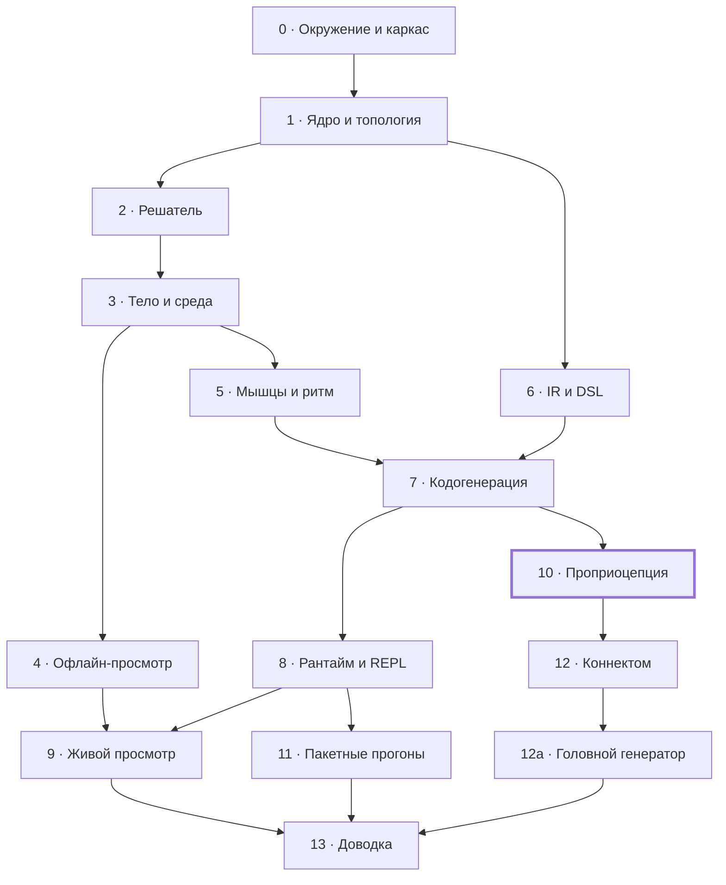

# Нематода на Лиспе: план этапов

Работа разбита на 15 этапов, каждый заканчивается работающей программой и проверяемыми условиями готовности. Модель описана в [дизайн-документе](design.md), устройство программы — в [архитектуре](architecture.md).

## Как пользоваться планом

Команда «перейди к этапу N» означает: я перечитываю раздел этапа и указанные в нём разделы дизайна и архитектуры, пишу код этапа целиком и отдаю его вместе с инструкцией проверки. Останавливаюсь посреди этапа только там, где нужен выбор между настоящими альтернативами.

**Ход одного этапа.**

1. Я пишу код этапа и прогоняю у себя всё, что можно проверить без виртуалки.
2. Я коммичу код в репозиторий на GitHub, в виртуалке делается git pull.
3. В PuTTY: `make test` и шаги проверки из раздела этапа; вывод присылается мне целиком.
4. Я исправляю, пока все пункты «Готово, когда» не выполнены.
5. Пункты отмечаются галочками, под разделом этапа пишется строка «Итог» с датой и главным результатом.

**Доставка кода — через GitHub** (решение от 16.10.2026). Автор коммитов — GitHub-аккаунт Ranatar (sheogorath2006@gmail.com), без упоминания ассистента; в виртуалке достаточно `git pull`. Репозиторий — [Ranatar/Wormlisp](https://github.com/Ranatar/Wormlisp).

**Если этап меняет решения.** Когда работа показывает, что дизайн или архитектура должны быть другими, правится соответствующий документ в `docs/`, в том же коммите, что и код. Новое архитектурное решение записывается в журнал решений архитектуры.

**Параллельная работа: параметры.** Значения параметров с источниками собраны в документе [параметров модели](parameters.md). Физическим тестам этапа 3 их точность не нужна; начиная с этапа 5 подбираемые параметры уточняются по кинематике, а открытые вопросы того документа закрываются по ходу этапов.

## Карта этапов

Этап можно начинать, когда закрыты все этапы, из которых в него идут стрелки. Этап 6 не зависит от физики и может идти параллельно этапам 2–5.

Обе ветки — физика на ручных ядрах и язык модели — сходятся на этапе 7, где сгенерированный код сверяется с ручным; главная проверка модели — этап 10.

## Этап 0. Окружение и каркас репозитория

В виртуалке собирается пустой проект, проходят тесты, а Firefox на хосте видит сервер через проброс порта.

**Опирается на:** архитектура — «Среда исполнения и ограничения», «Модули и зависимости», «Сборка, зависимости, раскладка репозитория».

**Результат.**

- Установлены SBCL, tmux, rlwrap (apt); библиотеки — в vendor/ с закреплёнными коммитами вместо Quicklisp.
- Репозиторий с `worm.asd`, пустыми системами всех семи слоёв и фасадным пакетом `worm`.
- `Makefile` с целями `test` и `image`; `scripts/repl.sh`.
- Проверочная страница Hunchentoot на порту 8740.

**Готово, когда:**

- [x] `make test` проходит: 85 проверок FiveAM, включая сверку слоёв с архитектурой
- [x] `scripts/repl.sh` открывает REPL в tmux, и разрыв SSH-сессии его не убивает
- [ ] Firefox 115 на хосте открывает проверочную страницу через проброс порта 8740
- [x] версия SBCL записана в README

**Зависит от:** —

**Итог** (16.10.2026, коммит `a759346`). Три пункта проверены в песочнице на той же Ubuntu 24.04 и SBCL 2.2.9: тесты на чистом клоне, сборка образа, REPL в tmux, переживший SIGHUP подключённого клиента. Проверочная страница открывается в Firefox 115 для Linux. Остался пункт с пробросом порта: его можно проверить только на твоём хосте. Отступление от архитектуры: вместо Quicklisp используется vendor/, а системы названы worm/\<имя>. Оба изменения внесены в архитектуру.

## Этап 1. Ядро, параметры, топология

Появляются нижние слои: типы и условия, реестр параметров с единицами, трубка N × K в массивах индексов и чтение анатомии мышц.

**Опирается на:** архитектура — «Представление модели», «Ошибки»; дизайн — «Модель тела» (узлы и элементы).

**Результат.**

- `worm.platform`, `worm.core`: типы массивов, корневые условия, журнал, структура `compiled-model`.
- `worm.params`: реестр, единицы и их перевод, загрузка наборов, отказ на `?`.
- `worm.topology`: нумерация узлов, семейства элементов, длины и объёмы покоя из профиля R(s).
- `worm.anatomy`: чтение файла мышц и привязка к рёбрам квадранта; нейроны и синапсы — заглушка до этапа 12.
- `anatomy/muscles.sexp`: положения мышц вдоль тела по правилу из документа параметров («Геометрия тела»): нумерация и ряды по WormAtlas, клетки 1–16 впереди вульвы, 17–24 позади; положение вульвы и концы рядов — параметры. Координаты в файле помечены как оценка.

**Готово, когда:**

- [x] число элементов каждого семейства совпадает с таблицей «Представление модели»
- [x] все объёмы покоя положительны, а их сумма совпадает с объёмом многогранной трубки, посчитанным независимым способом
- [x] загрузчик параметров отвергает значения без единиц и незаданные `?`
- [x] анатомия даёт 95 мышц, каждая привязана к двум рядам рёбер своего квадранта

**Зависит от:** этапа 0.

**Итог** (16.10.2026, коммит `ec82470`). Все четыре пункта проверены тестами в песочнице на той же Ubuntu 24.04 и SBCL 2.2.9, на чистом клоне: 1815 проверок. Независимый объём — формула усечённой пирамиды для каждого отсека; замкнутость поверхности отсека проверена тем, что объём не меняется при повороте и сдвиге искажённой трубки. Три намеренные поломки (перевёрнутый торец, неразделённый вес мышцы, число без единиц) тесты ловят. Отступления: профиль R(s) отнесён к `worm.topology`, а привязка мышц получает номера рёбер от вызывающего — решение 19 архитектуры; к внутренним единицам добавлены мВ и фКл для нервной части. По ходу найдена и исправлена ошибка в документе параметров: 120 кПа = 1,2·10⁵ мкН/мм², а не 120.

## Этап 2. Решатель на эталонных задачах

Решатель строится и проверяется на моделях, написанных руками, до появления тела: так ошибки численного метода не смешиваются с ошибками физики.

**Опирается на:** архитектура — «Решатель», «Ошибки», «Производительность и память».

**Результат.**

- Ленточная LU с частичным выбором ведущего элемента и плотная LU.
- Линейно-неявный шаг, каркас расщепления на нервную и механическую подсистемы.
- Кольцо контрольных точек в памяти, откат.
- Условия и перезапуски решателя; политика как функция от условия (потоков ещё нет).
- Эталонные модели: цепочка вязкоупругих звеньев с известным решением, жёсткая линейная система, модель с намеренным NaN.

**Готово, когда:**

- [x] ленточная LU совпадает с плотной на случайных ленточных матрицах, включая требующие перестановок
- [x] на эталонной задаче ошибка убывает с первым порядком по h
- [x] 1000 шагов не выделяют памяти
- [x] NaN превращается в `numerical-blowup`; `halve-timestep` и `rollback-to-checkpoint` работают

**Зависит от:** этапа 1.

**Итог** (16.10.2026, коммит `05022d1`). Все пункты проверены тестами в песочнице на чистом клоне, 2253 проверки. Порядок сходимости — отношение ошибок около 2 при делении h пополам (допуск 1,8–2,2, для связанной модели 1,7–2,3): на вязкоупругой цепочке против точного решения, на жёсткой системе с h·λ = 10⁴ и на связанной модели нервы — механика, в том числе с нервной матрицей, пересобираемой раз в 10 шагов. Память замеряется на 50 000 шагах: SBCL учитывает выделение блоками по 32 КБ, и на 1000 шагах замер шумит. Первая версия шага выделяла 16 байт: числа h и t упаковывались на границе вызова функций модели. Отсюда решение 20 архитектуры: время и шаг передаются вектором `clock`, функции модели ничего не возвращают. Откат к контрольной точке и повтор шага с h/2 дают побитово тот же результат, что прогон без сбоя. Три намеренные поломки (без перестановки строк, повтор без возврата к началу шага, явный шаг вместо неявного) тесты ловят.

## Этап 3. Тело и среда ручными ядрами

Тело и среда пишутся вручную в интерфейсе `compiled-model`, без DSL. Это даёт работающую физику раньше кодогенерации, а ручные ядра потом остаются в тестах как оракул, с которым сверяется сгенерированный код.

**Опирается на:** дизайн — «Модель тела», «Среда», «Валидация» (тесты звеньев); архитектура — «Кодогенерация» (известное узкое место).

**Результат.**

- Ядра рёбер всех четырёх семейств с упругостью и вязкостью.
- Давление отсеков с градиентом и гессианом объёма.
- Контакт с поверхностью; сопротивление по теории резистивных сил.
- Привод — заданное натяжение продольных рёбер как функция времени (кинематический вариант мышцы).
- Ручные ядра с якобианами в `tests/oracle/`.

**Готово, когда:**

- [x] тесты тела и среды из дизайна проходят: расслабление к прямому, объём отсеков меняется меньше чем на 1%, при K = 1 нет тяги, обращение волны меняет направление движения
- [x] якобиан каждого ручного ядра совпадает с конечными разностями
- [x] решено, задаётся ли гессиан объёма вручную или выводится символьно, и решение записано в архитектуру
- [x] заданная волна натяжения даёт движение вперёд и в воде, и на агаре

**Зависит от:** этапа 2.

**Итог** (16.10.2026, коммит `da2840f`). Все пункты проверены в песочнице на чистом клоне: `make test` — 2607 проверок, `make test-full` — ещё 13 физических за минуту. Изогнутое тело расслабляется монотонно с постоянной около 5 мс (τ_c тканей). При K = 1 центр тела не сдвигается вовсе (меньше 10⁻⁹ мм), при K ≈ 1,6 та же волна даёт 0,12 мм/с в воде; на агаре червь ползёт вперёд. Якобианы всех ядер совпадают с конечными разностями до 10⁻⁹; гессиан объёма — ручной (решение 21). Шаг на 50 колец — около 5,5 мс.

Три находки, которые меняют документы. Закон жёсткости вдоль тела был записан неверно: EI ∝ D⁴ — это сравнение стадий, а вдоль тела EI постоянна и мягче к хвосту; исправлено в ядрах и в документе параметров. Пункт дизайна «объём при сильном изгибе меньше 1%» верен для чистого изгиба (0,8% при кривизне 9 1/мм), а одностороннее сокращение сжимает тело вдоль и меняет объём на 2,5% — это следует из K = 120 кПа; уточнено в дизайне. Без предварительного давления мениск сплющивает тело на агаре на 16% по высоте — вопрос p₀ записан в открытые вопросы параметров на этап 5. Две намеренные поломки якобианов (без натяжения, без p·∇²V) быстрые тесты ловят.

## Этап 4. Запись и офлайн-просмотр

Прогоны начинают сохраняться в файлы, а червя становится видно в браузере. С этого этапа физику проверяют не только числами, но и глазами.

**Опирается на:** архитектура — «Хранилище и форматы файлов», «Сервер живого просмотра и протокол» (формат кадра), «Просмотрщик».

**Результат.**

- `worm.io`: `frames.bin`, `meta.json`, контрольные точки на диск, каталог прогона.
- `worm.analysis`: центральная линия, кривизна, скорость, частота и длина волны.
- `viewer/worm-viewer.html` в режиме чтения файлов с диска: трубка, раскраска, кимограмма, графики.
- Эталонный `tests/data/frames.bin` и самопроверка просмотрщика.

**Готово, когда:**

- [x] кадр кодируется и декодируется в Лиспе без потерь
- [x] самопроверка на эталонном файле проходит в Firefox 115
- [x] прогон этапа 3 виден как трубка с бегущей волной, а кимограмма показывает наклонные полосы
- [ ] файлы прогона доходят до хоста через WinSCP и открываются просмотрщиком — проверяет пользователь на хосте

**Зависит от:** этапа 3.

**Итог** (16.10.2026, коммит `7042111`). На чистом клоне `make test` — 2680 проверок, `make test-full` — ещё 13 физических. Кадр, `frames.bin`, контрольная точка и JSON проходят круговую запись без потерь; оборванный файл читается по целым кадрам. Самопроверка `?selftest` в Firefox 115 (headless, `tools/firefox`) — 38 из 38, включая кривизну колец, совпавшую с Лиспом точно. `scripts/record-oracle-runs.lisp` пишет два прогона ручной модели; просмотрщик (проверен в Chromium, по HTTP и выбором файлов с диска) показывает трубку с бегущей волной и наклонные полосы кимограммы. Метрики восстанавливают заданное: вода — 2,00 Гц, λ = 1,51 L, 0,17 мм/с; агар — 0,50 Гц, λ = 0,62 L при заданной 0,65, 0,19 мм/с. Без WebGL (Firefox в виртуалке без GPU) трёхмерный вид заменяется надписью, остальное работает. Последний пункт — перенос через WinSCP на хост — остаётся за пользователем: порядок описан в README, «Просмотр прогонов».

Находки. Частота по переходам кривизны через ноль без гистерезиса ловит дрожание малой кривизны в разгоне (на агаре вышло 17 Гц) — введён гистерезис: десятая доля размаха, не меньше 0,01 1/мм; окно метрик должно быть не короче двух периодов. `decode-frame` терял потенциалы нейронов, если его звали не через `frame-ref`, — исправлено. Страница, открытая с диска, не может прочитать соседний файл через `fetch`, поэтому эталон самопроверки лежит в `viewer/selftest-data.js` и подключается тегом `<script>`; формат заголовка `frames.bin`, контрольной точки и обязательные поля `meta.json` (`topology`, `muscles`) записаны в архитектуру.

## Этап 5. Мышцы и генератор ритма

Заданное натяжение заменяется настоящими мышцами с кальциевой кинетикой, которыми управляет генератор ритма первого уровня. Это первый этап, где походку сравнивают с живыми червями, поэтому к нему нужен черновик документа параметров.

**Опирается на:** дизайн — «Модель мышцы», «Нервное управление» (уровень 1), «Валидация»; архитектура — «DSL компонентов» (скорости и `lagged`).

**Результат.**

- Ручные ядра усреднённой мышцы: кальций, функция Хилла, f_L, f_V через скорость прошлого шага.
- Рассеяние силы 95 мышц на продольные рёбра своих квадрантов.
- Управление первого уровня.
- Скорости прошлого шага в контрольных точках.

**Готово, когда:**

- [x] тесты мышцы проходят: ступенька входа, развёртки по длине и скорости
- [x] волна мышечной активации даёт походку, близкую к заданному натяжению этапа 3
- [x] откат к контрольной точке и продолжение побитово совпадают с прогоном без остановки
- [x] есть черновик документа параметров со значениями для мышц, кутикулы и сред

**Зависит от:** этапа 3; этап 4 нужен для глазной проверки.

**Итог** (16.10.2026, коммит `80d2d23`). На чистом клоне `make test` — 3213 проверок, `make test-full` — ещё 26 физических. Ступенька входа: кальций идёт точно по дискретному решению линейно-неявного Эйлера (до 10⁻¹²), натяжение выходит на F_max·a(Ca∞); развёртки по длине и скорости через настоящие функции модели воспроизводят f_L и f_V до 10⁻⁹. Волна мышечной активации (2 Гц, 1,5 L) даёт ту же частоту и длину волны, что натяжение этапа 3 (1,50 и 1,50 L), скорость 0,094 против 0,132 мм/с. Откат к контрольной точке и продолжение с контрольной точки на диске побитово совпадают с прогоном без остановки, включая кальций, сглаженные скорости и скорости узлов прошлого шага. Документ параметров дополнен подбором: F_max середины 16,5 мкН по κ·L = 2,9 в воде; набор water-v1 даёт 1,76 Гц, 1,54 L, κ·L 2,90, агар — 0,30 Гц, 0,62 L, 0,114 мм/с. Шаг ручной модели на 50 колец — 5,6 мс и не выделяет памяти.

Находки, которые меняют документы. Кальций в `y-mech` блоками по кольцам, как было в архитектуре, расширил бы ленту с 47 до ~110: клетка охватывает 3–6 колец. Кальций переехал в нервно-мышечную часть, натяжение вычисляется перед механическим шагом и в нём постоянно (решение 22); интерфейс получил `aux` — скорости прошлого шага, которые решатель пишет сам и хранит в контрольных точках, — `obs` в `neural-output` и `:step` в `make-integrator`. Явный множитель Хилла f_V по скорости прошлого шага разрушал тело при v_max = 30 1/с при любом h: запаздывающая обратная связь расходится, когда демпфирование мышцы больше вязкости тканей; f_V теперь читает скорость, сглаженную с τ_v = 10 мс (условие h < 2τ_v/(ρ − 1)). Введено предварительное давление p₀ = 30 кПа с натяжениями покоя продольных, окружных и диагональных рёбер — сплющивание на агаре упало с 19% до 3%, покой в точном равновесии. Эффективная EI с p₀ выросла до 0,268; поправка k_c 0,815 возвращает её к 0,220. Чистый изгиб меняет объём меньше 1% до κ ≈ 8 1/мм — выше любой живой кривизны; при 9,6 хвост меняет объём на 1,4%. Скорость ползания на агаре (0,114 мм/с при 0,30 Гц) — на нижней границе ориентира Karbowski; это вопрос к коэффициентам агара. Ручные ядра этапа 3 выделяли 264 КБ на шаг (числа в полных вызовах и замкнутая переменная объёма) — исправлено.

## Этап 6. IR и DSL

Строится язык описания модели — промежуточное представление выражений и макросы `define-component` и `defmodel`. Этап не зависит от физики и может идти параллельно этапам 2–5.

**Опирается на:** архитектура — «DSL компонентов и defmodel», «Кодогенерация» (шаги 2–4), «Ошибки».

**Результат.**

- `worm.ir`: узлы с hash-consing, упрощение, символьная производная, интерпретатор, `define-primitive`.
- `worm.dsl`: `define-component`, `defmodel`, проверки при раскрытии, объект `model-spec`, канонический текст и хэш.

**Готово, когда:**

- [x] производные IR совпадают с конечными разностями на случайных точках для всех операций языка выражений
- [x] каждая ошибка модели из раздела «Ошибки» даёт своё условие с указанием компонента и формы
- [x] канонический текст модели и её хэш одинаковы между запусками SBCL
- [x] пробная модель из двух-трёх компонентов на DSL раскрывается без ошибок и интерпретируется

**Зависит от:** этапа 1.

**Итог** (16.10.2026, коммит `3ea6c90`). На чистом клоне `make test` — 3370 проверок, `make test-full` — ещё 26. Производные всех операций языка (сумма, разность, произведение, частное, целые степени, корень, экспонента, логарифм, tanh, sin, cos, logistic, positive, clamp, hill и композиция) совпадают с центральными разностями в 40 случайных точках до 10⁻⁶; примитивы объёма — градиент до 10⁻⁹, гессиан до 10⁻⁷. Каждое условие раздела «Ошибки» для модели — unbound-input, input-bound-twice, algebraic-loop (петля названа по портам), family-mismatch, unknown-parameter, anatomy-invalid, ir-type-error, no-derivative, а также неизвестное имя, неизвестный компонент и синтаксис — проверено тестом вместе с компонентом и формой. Хэш пробной модели совпадает в отдельном процессе SBCL. Пробная модель — семь экземпляров четырёх компонентов: кутикула на всех семействах рёбер, давление, кинематическая мышца и кальций — раскрывается и интерпретируется; её силы совпадают с ручными ядрами до 10⁻¹⁰, матрица вязкости — до 10⁻¹², производная кальция — точно.

Находки, которые меняют документы. Положительная часть в языке называлась `pos`, как и положение слота `(pos a)`, — переименована в `positive`. Генератору ритма нужны `sin` и `cos` — добавлены. Вход, который можно не связывать (натяжение мышц у рёбер без мышц), получил `:default`: иначе правило «каждый вход связан ровно один раз» противоречило примеру архитектуры. Силу давления удобно задавать градиентом — форма `(:gradient volume :scale p)`. Семантика `:damping` записана как функция Рэлея (D = Σ c·g gᵀ). Примитивы пользователя вызываются в выражениях по имени. Имена языка сравниваются по имени символа (решение 23). `tangent` и `curvature` колец перенесены на этапы 7 и 10, где они нужны сопротивлению среды и рецептивным полям. Деструктивная сортировка в запоминании зависимостей портила общие списки — поймано тестом производных.

## Этап 7. Кодогенерация и перенос компонентов на DSL

Модель начинает собираться из DSL в скомпилированные функции, а ручные ядра этапов 3 и 5 становятся эталоном, с которым сверяется сгенерированный код. После этапа вся модель описывается только на DSL.

**Опирается на:** архитектура — «Кодогенерация», «Представление модели», «Производительность и память».

**Результат.**

- `worm.codegen`: понижение, локальные якобианы, карты рассеяния, матрица вязкости, эмиссия, компиляция, кэш fasl.
- `worm.components`: тело, среда, мышцы и управление первого уровня на DSL; модель `worm-3d`.
- `(show-kernel ...)`, `(interpret-kernel ...)`, `(benchmark-step ...)`, `(profile-run ...)`.

**Готово, когда:**

- [x] сгенерированные ядра, интерпретатор и ручные ядра совпадают до округления на случайных состояниях
- [x] глобальный якобиан совпадает с конечными разностями; ширина ленты равна фактической
- [x] в ядрах нет заметок о боксировании чисел, шаг не выделяет памяти
- [x] время шага и его доли замерены и записаны в `bench/`
- [x] прогоны этапов 3 и 5 на сгенерированном коде повторяют прежние результаты

**Зависит от:** этапов 5 и 6.

**Итог** (16.10.2026, коммит `95bf188`). На чистом клоне `make test` — 3413 проверок, `make test-full` — ещё 38 (около девяти минут вместе со сборкой). Модели `worm-3d` (мышцы под генератором первого уровня) и `worm-3d-kinematic` (заданная волна натяжения) описаны в `worm.components` на языке модели. Сгенерированные функции — наблюдаемые, правая часть и якобиан нервно-мышечной части, натяжение, силы, матрица шага — совпадают с ручными ядрами в воде и на агаре до 10⁻¹⁰ на случайных состояниях, силы и производные состояния — с интерпретатором до 10⁻¹². Глобальный якобиан из матрицы шага совпадает с центральными разностями до 10⁻⁶, лента 47/47 равна фактической. Заметок оптимизатора нет, 3000 шагов не выделяют памяти, текст модели детерминирован. Прогоны идут с ручной моделью шаг в шаг: на агаре за 4 с (натяжение и мышцы, h = 10⁻³) расхождение 10⁻¹⁵ мм, в воде за 0,6 с при h = 10⁻⁴ — 10⁻¹¹. Сборка `worm-3d` на 50 колец — около 3 с, из кэша — 0,07 с. Шаг — 5,0–5,6 мс против 5,4–6,3 у ручных ядер: сборка матрицы 2,0–2,4 мс, ленточная LU 2,6–3,0 мс, силы 0,06 мс; секунда модели — 5,3 с счёта на агаре и 19 с в воде (`bench/20261016-0731-95bf188.sexp`).

Находки, которые меняют документы. Узлу понадобились соседние кольца (касательная для RFT) и скорость узла `(velocity <слот>)` в `:damping`; компонент получил `:checks` — проверку V/V⁰ отсека. `let*` из тысяч связок переполнял стек компилятора — узлы связываются плоским `let` и присваиваются по порядку. Символьная производная силы давления k·∇V при K = 8 компилировалась больше десяти минут — якобиан градиентной силы собирается структурно, k·∇²V + ∇V ⊗ ∇k (решение 24). Функции стали фабриками от вектора окружения, так что текст не зависит от N; индексы — `(unsigned-byte 30)`, иначе оставались заметки целочисленной арифметики. Главное: вода при h ≥ 2,5·10⁻⁴ усиливает ошибку округления — две ручные модели, разошедшиеся на 10⁻¹² мм, к t ≈ 0,5 с расходятся на 10⁻⁴–10⁻² мм (и с мышцами, и с натяжением), а сгенерированная модель при 5·10⁻⁴ на одном из таких скачков смяла отсек; при 10⁻⁴ расхождение остаётся 10⁻¹¹. Частота, длина волны и κ·L от шага не зависят, а скорость плавания зависит: 0,086 / 0,073 / 0,066 мм/с при 5 / 2,5 / 1·10⁻⁴. В документе параметров скорость воды исправлена на 0,066, вода считается с h = 10⁻⁴, причина вынесена в открытые вопросы архитектуры и в этап 10. Агар при 10⁻³ от этого свободен.

## Этап 8. Рантайм и терминальный REPL

Прогон получает собственный поток, команды, снимки и API для работы из PuTTY. После этапа с моделью можно работать интерактивно: менять параметры на ходу, ставить на паузу, откатываться и решать, что делать при сбое.

**Опирается на:** архитектура — «Потоки и интерактивная работа», «Решатель» (контрольные точки), «Ошибки» (политики).

**Результат.**

- `worm.runtime`: объект `run`, поток симуляции, почтовый ящик команд, атомарные снимки.
- API: `start-run`, `pause`, `resume`, `step-run`, `set-param`, `state-ref`, `rollback`, `rebuild`, `stop-run`.
- Решения о сбоях: `pending-problem`, `(problem)`, `(choose ...)`, `(debug-problem)`.
- Контрольные точки на диск по расписанию и по команде; `scripts/repl.sh` в окончательном виде.

**Готово, когда:**

- [x] каждая команда из таблицы «Потоки» покрыта тестом
- [x] сбой ставит прогон на паузу, а `(problem)` и `(choose ...)` работают из PuTTY
- [x] `set-param` на ходу меняет поведение; параметры без живой правки отвергаются с объяснением
- [x] `rebuild` переносит совместимое состояние
- [x] разрыв SSH посреди прогона не останавливает счёт

**Зависит от:** этапа 7.

**Итог** (16.10.2026, коммит `c072220`). На чистом клоне `make test` — 3503 проверки, `make test-full` — ещё 49 (около девяти минут вместе со сборкой). Прогон живёт в своём потоке: команды идут через почтовый ящик и применяются на границе шага, синхронные функции REPL ждут ответа на обещании, снимки (координаты, активации, кривизна) публикуются атомарно. Каждая команда таблицы «Потоки» покрыта тестом на модели `worm-3d` в 8 колец: пауза и продолжение, `:step`, живая правка и загрузка набора, контрольная точка на диск по команде и по расписанию, откат из кольца и с диска (продолжение с диска побитово как без остановки), запись кадров с выключением и переходом в другой каталог, остановка. Стянутое кольцо даёт `volume-collapse`: прогон встаёт в `:problem`, `(problem)` показывает причину и варианты, `(choose 'rollback-to-checkpoint)` продолжает счёт; пакетная политика делит h трижды и прерывает прогон со статусом `failed`. `set-param :gen-amplitude 0` на шаге 50 оставляет прогон побитово равным контрольному до этого шага и снижает кальций после; `prestress`, `body-length` и параметры поэлементных массивов отвергаются с подсказкой `rebuild`. `rebuild` той же модели переносит состояние целиком и живые правки, на кинематику — тело, при другой топологии — только нервно-мышечное состояние. REPL в tmux проверен тестом: команды набираются через `send-keys`, клиент tmux в псевдотерминале обрывается сигналом HUP, а сессия и счёт продолжаются.

Находки, которые меняют документы. Активации для кадров нужны и от сгенерированной модели — кодогенератор собирает функцию `activation` по выходу `active` мышц (версия кодогенератора 2). Живая правка ограничена параметрами, которые ядра читают из p (решение 25): p₀ отмечен в реестре как требующий пересборки, потому что от него при сборке считаются натяжения покоя. Число `single-float` из REPL (0.05) переводилось с двоичной погрешностью — берётся по десятичной записи. Потоки, почтовые ящики и семафоры перенесены в `worm.platform`. Отладчику в потоке симуляции нужен терминал вызвавшего REPL: собственные потоки вывода у прогона пустые, чтобы закрытый терминал ему не мешал. Перезапуски решателя теперь пишутся и в `log.txt` прогона.

## Этап 9. Сервер и живой просмотр

Червь виден в Firefox во время счёта, и им можно управлять из браузера. Главное требование этапа — живой просмотр не замедляет симуляцию.

**Опирается на:** архитектура — «Сервер живого просмотра и протокол», «Просмотрщик», «Потоки и интерактивная работа» (снимки).

**Результат.**

- `worm.server`: маршруты, раздача прогонов, WebSocket `/live`, протокол управляющих сообщений, `:read-only`.
- Просмотрщик: живой режим, панель параметров, кнопки решений о сбоях, список прогонов с сервера.

**Готово, когда:**

- [x] Firefox 115 показывает живой прогон (проверено в песочнице, без проброса)
- [ ] то же на хосте через проброс порта 8740 — проверяет пользователь
- [x] время шага с подключённым клиентом не отличается от времени без клиента сверх шума замера
- [x] медленный клиент пропускает кадры, симуляция его не ждёт
- [x] `set-param` и `choose` из браузера работают; `:read-only` их запрещает
- [x] искажённое сообщение клиента не влияет на прогон

**Зависит от:** этапов 4 и 8.

**Итог** (16.10.2026, коммит `82acc31`). На чистом клоне `make test` — 3576 проверок, `make test-full` — ещё 49. Сервер отдаёт просмотрщик на `/`, список прогонов (живые процесса и записанные), их файлы по белому списку имён и WebSocket `/live`. У каждого соединения свой поток отправки: он берёт последний снимок и шлёт кадр, если шаг новее, плюс `status`, `param-changed` и сбой при их смене. Тесты идут через собственный клиент WebSocket по RFC 6455. 600 шагов модели в 20 колец — 1,22 с без клиента и 1,24 с с клиентом на 30 кадрах в секунду (порог теста — 15%). Клиент на 5 кадрах в секунду при снимке каждый шаг получает кадры через 200–300 шагов, а совсем не читающий клиент счёт не задерживает. `set-param` и `choose` из браузера работают, `:read-only` их отвергает с `error`. Двенадцать видов искажённых сообщений и двоичное сообщение получают `error`, состояние прогона побитово прежнее, новых символов не появляется. Живой режим проверен в Chromium (Playwright) и в Firefox 115 без дисплея через WebDriver BiDi: кадры идут с частотой 17–19 в секунду, панель параметров меняет частоту генератора на ходу, плашка сбоя показывает перезапуски, кнопка `rollback-to-checkpoint` продолжает счёт. Самопроверка `?selftest` по HTTP в Firefox 115 — PASS. Проброс порта на хост — за пользователем, как и на этапе 4.

Находки, которые меняют документы. WebSocket — Hunchensocket с зависимостями `sha1` и `trivial-utf-8`, последняя — из пакета Ubuntu: её апстрим недоступен. Снимок состояния со сбоем NaN ронял поток симуляции: при подготовке снимка срабатывала ловушка плавающей точки. Теперь снимки и кадры считаются с выключенными ловушками, а случай покрыт тестом. Проверочная страница переехала на `/check`, на `/` — просмотрщик. Сервер проверяет правку параметра теми же функциями, что REPL, и шлёт прогону готовое значение без ожидания ответа; в журнале правок появился источник (`repl` или `browser`). После отката прогона шаг кадров уменьшается — живой буфер просмотрщика начинается заново. Поле параметра шлёт правку при потере фокуса, только если значение изменилось. Ожидание данных сокета в тестовом клиенте прерывается сигналами сборки мусора — клиент ждёт дальше.

## Этап 10. Проприоцептивная цепь и адаптация походки

Волна перестаёт задаваться извне и возникает из проприоцепции. Здесь проверяется главный критерий проекта: один контроллер сам меняет походку с плавания на ползание при смене среды.

**Опирается на:** дизайн — «Нервное управление» (уровень 2), «Валидация» (главный тест); архитектура — «Решатель» (события).

**Результат.**

- Компонент второго уровня на DSL: B-нейроны с порогом и гистерезисом, рецептивные поля с направлением-параметром, D-торможение. Головной осциллятор не понадобился: каждая единица с полем назад сама — релаксационный осциллятор (итог ниже).
- Обработка событий на границе шага; при необходимости — поиск точки пересечения.
- Сценарий главного теста: плавный рост сопротивления среды при неизменных параметрах контроллера.

**Готово, когда:**

- [x] устойчивая бегущая волна без внешнего задания ритма
- [ ] главный тест: частота и длина волны монотонно падают от водных значений к агаровым без перенастройки — не пройден ни на этапе 10, ни развёртками этапа 11; перенесён на этап 12
- [x] проверены оба направления рецептивного поля, результат записан в дизайн
- [x] решено, хватает ли переключения на границе шага; решение записано в архитектуру
- [x] найдена причина, по которой вода при h ≥ 2,5·10⁻⁴ усиливает ошибку округления и скорость плавания зависит от шага (этап 7, находки); шаг воды обоснован

Если главный тест не проходит, этап закрывается разбором причин и решением, что менять в модели, а не подгонкой под результат.

**Зависит от:** этапа 7; этап 4 нужен для глазной проверки, этап 8 — для удобной подстройки.

**Итог** (16.10.2026, коммит `d77a2b5`). На чистом клоне `make test` — 3793 проверки, `make test-full` — ещё 60 (около 14 минут вместе со сборкой). Язык модели получил дискретное состояние и события на границе шага, семейство `:prop-unit` и отношения `:receptive-field` и `:innervation`. Сгенерированный шаг событий совпадает с интерпретатором. Модель `worm-3d-proprio`: рецептор растяжения на продольных рёбрах и двенадцать единиц DB/VB с гистерезисом и VD-торможением вместо генератора ритма. Волна возникает сама: на агаре 0,73 Гц, λ = 0,77 L, κ·L = 3,5, ползёт вперёд со скоростью 0,23 мм/с; в воде 1,72 Гц, λ = 1,80 L, κ·L = 3,3.

Главный тест не пройден. От воды к агару частота падает в 2,4 раза, длина волны — в 2,3 раза, и вода близка к живому червю. Но на агаре частота вдвое выше ориентира (0,73 Гц против 0,30), а при промежуточной вязкости — μ = 10³–3·10³ при C_n/C_t = 1,6 — волна почти стоячая: λ скачет от 0,2 до 5 L, частота при этом падает монотонно (дизайн, «Главный тест»).

Разбор:
- **Почему агар слишком быстрый.** Бинарная модель Бойла держит изгиб между порогами, а время его набора задаёт механика. С нашими EI = 0,22 мкН·мм² и C_n агара 128 мкН·с/мм² тело на агаре выходит к изгибу за десятые доли секунды, а мышца с F_max, подобранной на этапе 5, сильнее тянет до κ·L ≈ 3,4 — порог близко, и цикл короткий.
- **Почему в промежутке стоячая волна.** Когда механическое время тела сравнивается с задержкой сигнала рецептора (200 мс) и постоянной кальция (100 мс), единицы с перекрывающимися полями назад переключаются почти синхронно.
- **Что пробовалось.** С параметрами Бойла как есть (s = 1/4, поле 0,5 L, без сглаживания) изгиб нашего тела до порогов не доходит; с усилением в воде получается 7–8 Гц. Сглаживание сигнала рецептора свело воду к 1,7 Гц, укороченное поле — длину волны к 1,8 L.

Решение: двухуровневая настройка второго уровня — проводимостная версия B-нейрона (параметры, «Уровень 2: проводимостная версия») вместо бинарной и согласование механического времени тела на агаре (C_n, EI, F_max) — ищется развёрткой этапа 11 по главному тесту. Вариант со стоячей волной объясним и воспроизводим, поэтому базовые параметры этапа 10 остаются для эталонов как есть.

Находки, которые меняют документы:
- **Причина неустойчивости воды найдена.** Поворот вязких сил вместе с рёбрами и касательной учитывался явно. Теперь его производная при скоростях прошлого шага входит в матрицу шага (решение 26; `mech-matrix` получает `aux`). Две копии прогона остаются в 10⁻¹¹ мм при h = 5·10⁻⁴ и 10⁻³; скорость плавания — 0,067 / 0,063 мм/с при 5 / 2,5·10⁻⁴. Вода считается с h = 5·10⁻⁴. Сверка с ручными ядрами идёт без поправки: `compile-model :damping-geometry nil`.
- **Переключения на границе шага хватает:** частота на агаре 0,730 / 0,730 / 0,737 Гц при h = 2 / 1 / 0,5·10⁻³.
- **Сигнал рецептора — изгибная часть удлинения стороны.** «Удлинение своей стороны» в трёхмерном гидростатическом теле почти не срабатывает: сокращение одной стороны укорачивает тело, а другую почти не растягивает.
- **Подобраны три параметра:** сглаживание сигнала рецептора τ_sr = 200 мс, `sr-scale` = 1,4, `rf-length` = 0,35 L.
- **Оба направления поля проверены.** Поле вперёд с отрицательной обратной связью гонит волну назад, и червь ползёт назад. Поле вперёд в смысле Wen (единица повторяет изгиб впереди, первая единица — головной осциллятор) с параметрами Бойла застывает в изгибе.
- **Крайние единицы не переключаются:** голова и хвост с укороченным полем.
- **Ошибки рантайма:** снимок состояния со сбоем больше не роняет поток, а интервал контрольных точек в памяти округляется до кратного R — при h = 2·10⁻³ `start-run` падал.

## Этап 11. Пакетные прогоны

Развёртки параметров считаются параллельно на трёх ядрах виртуалки. Замер размера рабочего процесса окончательно определяет W.

**Опирается на:** архитектура — «Пакетные прогоны», «Хранилище и форматы файлов», «Среда исполнения» (бюджет памяти).

**Результат.**

- `worm.batch`: описание развёрток, раскрытие в задания, оркестратор, точка входа рабочего, таймауты.
- `make image` и `worm-image.core`; `scripts/run-sweep.sh`; `(run-sweep ...)` из REPL.
- Сводка развёртки в `worm.analysis`.

**Готово, когда:**

- [x] проверочная развёртка считается на W рабочих: по главному тесту этапа 10, если он закрыт, иначе по первому уровню
- [x] развёртка главного теста этапа 10 по второму уровню — проводимостная версия B-нейрона, усиление и сглаживание рецептора, длина поля, механическое время тела на агаре (C_n, EI, F_max) — показывает, есть ли настройка, проходящая главный тест; результат и решение записаны в план и дизайн
- [x] повторный запуск пропускает готовые задания
- [x] размер рабочего замерен, W записан в настройки по умолчанию
- [x] падение одного рабочего не задевает остальные; таймаут срабатывает
- [x] пакетный прогон побитово совпадает с тем же прогоном в REPL

**Итог** (16.10.2026, коммит `44c9493`). На чистом клоне `make test` — 3817 проверок, `make test-full` — ещё 78 (около 17 минут вместе со сборкой). `worm.batch` раскрывает развёртку (сетка или латинский гиперкуб) в задания с идентификатором по хэшу конфигурации. Оркестратор держит W рабочих процессов SBCL, пропускает готовые задания, убивает задания по пределу времени и замеряет память рабочих. Рабочий считает без сервера и без потока симуляции: `start-run :thread nil`, набор параметров задания — `derive-param-set`, поэтому меняются и параметры без живой правки. Конечное состояние рабочего побитово совпадает с тем же прогоном в REPL с потоком. Запуск — `scripts/run-sweep.sh` или `(run-sweep …)`, с `:wait nil` — в фоне. Сводка метрик — `runs/sweeps/<имя>/summary.csv`. Прогон на 50 колец держит 115 МБ, для W взято 300 МБ: в виртуалке с 4 ядрами и 5 ГБ это W = 3.

Развёртки главного теста (дизайн, «Главный тест»): по 12 точек латинского гиперкуба в воде, вязкой воде и на агаре для бинарной и для новой проводимостной версии B-нейрона, плюс 12 точек механики агара (C_n, EI, F_max). Всего 84 прогона, на двух рабочих около двух часов. Настройки, проходящей тест, нет. Частота от воды к агару падает в 8 из 12 точек бинарной версии и в 11 из 12 проводимостной, длина волны — ни в одной. В воде и вязкой воде волна либо почти стоячая, либо бежит от хвоста к голове. На агаре проводимостная версия держит длину волны живого червя (0,51–0,65 L), но частоту 0,9–1,9 Гц; механика не опускает её ниже 0,75 Гц.

Решение. Проприоцептивной цепи с полем назад не хватает двух вещей. Первое — того, что задаёт направление волны в среде с малым сопротивлением. Второе — независимой от порога рецептора шкалы времени на агаре. Подгонять дальше второй уровень не имеет смысла. Главный тест переносится на этап 12: у сети третьего уровня есть головной контур, задающий фазу, — пункт добавлен в условия этапа 12. Базовой для эталонов второго уровня остаётся бинарная версия с параметрами этапа 10. Проводимостная — модель `worm-3d-proprio-graded`: она ползёт на агаре, это проверяет физический тест.

Находки, которые меняют документы:
- **Якобиан через связи (решение 27).** Выход проводимостной единицы — сигмоида её потенциала — связью входит в кальций мышц. Запрет «вход зависит от состояния источника» снят: перекрёстные блоки собираются по цепному правилу со строками CSR связи и сверяются с конечными разностями. Это нужно и этапу 12.
- **Мембрана Бойла не разрешается шагом 1 мс.** При C = 1 пФ (τ_m = 2 мс) линейно-неявный шаг с якобианом раз в R шагов расходится. Взято C = 10 пФ (τ_m = 20 мс) с пометкой «подобрано» (параметры, «Уровень 2: проводимостная версия»).
- **Уравнения проводимостной версии** взяты из статьи (ур. 14–15) и записаны в параметры. G_act и G_GABA там — наибольшие токи при сигмоиде без размерности. VD в покое тормозит VB вполсилы, поэтому VB начинает в верхнем состоянии.
- **Образ и журнал.** `save-lisp-and-die` закрывал поток журнала, и рабочие из `worm-image.core` падали на первой записи. Теперь образ закрывает журнал перед сохранением, а журнал открывается заново, если поток закрыт.
- **`run-sweep :wait nil`** запускает оркестратор отдельным процессом. Число рабочих проверяется: `:auto` или целое больше нуля; ноль раньше зацикливал оркестратор.

**Зависит от:** этапа 8.

## Этап 12. Коннектом

Управление третьего уровня: нейроны локомоторной сети как градуальные элементы со связями из опубликованного коннектома. Волна должна возникать из сети целиком.

**Опирается на:** дизайн — «Нервное управление» (уровень 3), «План работ и риски» (сила синапсов); архитектура — «Решатель» (нервный шаг).

**Результат.**

- `scripts/convert-connectome.lisp` и `anatomy/neurons.sexp`, `anatomy/synapses.sexp` с указанием источника и версии.
- Компонент градуального нейрона на DSL; нервная подсистема с плотной LU и пересборкой раз в R шагов.
- Масштабирование весов синапсов по классам связей как параметры.

**Готово, когда:**

- [x] сеть без внешнего задания волны даёт устойчивое движение вперёд — на агаре; в воде нет (итог ниже)
- [x] выбрано R; результат сходится при уменьшении h и R
- [x] решено, нужно ли расщепление Стрэнга; решение записано в архитектуру
- [x] источник коннектома и его версия записаны в `meta.json` каждого прогона
- [ ] главный тест (дизайн, «Главный тест») на третьем уровне: от воды к агару частота и длина волны монотонно падают без перенастройки; вязкие среды — `sweeps/*-viscosity.sexp` (этап 11) — частота падает, длина волны нет; перенесён на этап 12а

**Зависит от:** этапа 10.

**Итог** (16.10.2026, коммит `XXXXXXX`). Коннектом Cook et al. 2019 (таблица из openworm/c302, копия и MD5 — в `anatomy/source/`) конвертирует `scripts/convert-connectome.lisp` в `anatomy/neurons.sexp` и `anatomy/synapses.sexp`: 147 нейронов, 1143 химических синапса, 380 пар щелевых контактов, 896 нервно-мышечных синапсов. `worm.anatomy` читает их рядом с файлом мышц, `meta.json` каждого прогона хранит источник и MD5. Язык модели получил семейство `:neuron` и отношения `:chemical` и `:gap`, а `:innervation` и `:receptive-field` — нейронные варианты. Экземпляр нейронов связан сам с собой (решение 28). Компонент `graded-neuron` — нейрон Kunert et al. с переменной синапса s, каналом растяжения у B-нейронов и командой вперёд, модель — `worm-3d-connectome`. Сгенерированная правая часть совпадает с интерпретатором до 10⁻¹⁰, якобиан с перекрёстными блоками — с конечными разностями, порог V_th — точка покоя сети. Шаг — 10,3 мс при 631 нервно-мышечной переменной.

Подбор. С параметрами Kunert как есть сеть стоит: все нейроны в покое активны наполовину, мышцы сокращены со всех сторон, а B-нейроны дают малую долю входа мышц. Четыре развёртки латинского гиперкуба на агаре (88 прогонов) подобрали семь параметров: активность в покое, масштабы щелевых контактов, нервно-мышечный синапс, вес нейронов вне тяжа, канал растяжения, команду вперёд (параметры, «Уровень 3»). Две поправки в модели нашлись по ходу: ток рецептора заменён каналом с потенциалами реверсии — без этого потенциал уходил на сотни мВ и шаг переполнялся; вход мышцы нормирован на возбуждающие контакты мотонейронов тяжа и на наибольшую активность синапса.

Результат. На агаре сеть сама даёт бегущую волну и ползёт вперёд: 0,55 Гц, λ = 0,92 L, κ·L = 2,0, 0,078 мм/с. Метрики сходятся: R от 1 до 20 меняет их меньше чем на 0,05%, h от 10⁻³ до 2,5·10⁻⁴ — меньше чем на 0,2%. Поэтому R = 10, а расщепление Стрэнга не нужно (решение 29).

Главный тест не пройден. Частота от воды к агару падает монотонно (1,72 → 0,55 Гц), и в воде совпадает с живым червём. Но в воде колебание заперто в передней трети тела, и червь не плывёт; длина волны не падает монотонно. Поиск в воде (12 точек) плавания не нашёл, поле вперёд по Wen застывает в изгибе (дизайн, «Главный тест»).

Решение. Все три уровня упираются в одно: при поле назад и без источника ритма в голове волна в воде не идёт по телу. Поле вперёд, при котором участок повторяет изгиб участка впереди и волна идёт назад (Wen et al. 2012), требует головного генератора. Добавлен этап 12а: головной генератор на втором и третьем уровне, поле вперёд, главный тест на обоих уровнях. Подгонкой третьего уровня в воде это не решается: 12 точек поиска не дали ни одной с плаванием.

Находки, которые меняют документы:
- **Синапс с переменной s** вместо мгновенной сигмоиды — открытый вопрос параметров закрыт.
- **Нервно-мышечные синапсы.** У мышц середины тела больше половины контактов — от сублатеральных отростков головных нейронов SMB, SMD, SIA, SIB. С полным весом они заглушают B-нейроны; их вес — параметр `nmj-head-scale`.
- **Плотная LU** пропускает столбцы правее последнего ненулевого в строке: у нервно-мышечной части строки нейронов кончаются нулями мышц.
- **Идентификатор задания** включает хэш модели и версию кодогенератора: прежде прогон старым кодом с той же конфигурацией считался готовым. Развёртка может менять `dt` и `neural-every` задания (`:vary ((neural-every :list (1 5 10 20)))`).

## Этап 12а. Головной генератор и поле вперёд

Волна в воде должна идти по всему телу. Голова получает собственный источник ритма, а тело — проприоцептивную связь, при которой каждый участок повторяет изгиб участка впереди (Wen et al. 2012).

**Опирается на:** дизайн — «Нервное управление» (направление рецептивного поля), «Главный тест»; параметры — «Уровень 2», «Уровень 3»; итоги этапов 10–12.

**Результат.**

- Головной генератор второго уровня (единица или группа единиц головы) и третьего (головные мотонейроны SMD, RMD с внутренним ритмом или их контур из коннектома).
- Поле вперёд с головным генератором на обоих уровнях; развёртки главного теста.

**Готово, когда:**

- [ ] в воде волна бежит по всему телу, и червь плывёт вперёд
- [ ] главный тест на втором или третьем уровне пройден, либо разобран, что ещё нужно менять в модели
- [ ] выбор поля (назад, вперёд) для базовых наборов записан в параметры и дизайн

**Зависит от:** этапа 12.

## Этап 13. Экспорт, эталоны, доводка

Проект приводится в законченный вид: экспорт для внешних инструментов, полный набор эталонных прогонов и документы, соответствующие коду.

**Опирается на:** архитектура — «Тестирование», «Хранилище и форматы файлов»; все три документа целиком.

**Результат.**

- Экспорт WCON, полный набор метрик походки, сводки по развёрткам.
- Эталонные прогоны всех трёх уровней управления в `tests/golden/`, цель `make test-full`.
- Дизайн, архитектура и этот план обновлены по факту сделанного.

**Готово, когда:**

- [ ] эталоны всех уровней управления записаны и проходят
- [ ] экспорт WCON проходит проверку по схеме формата
- [ ] `make test-full` проходит в виртуалке
- [ ] в документах нет расхождений с кодом

**Зависит от:** этапов 9, 11 и 12а.
