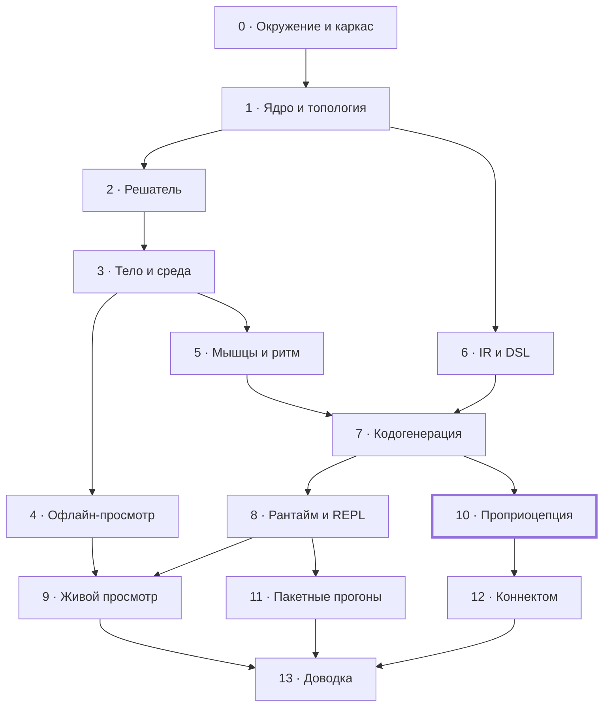

# Нематода на Лиспе: план этапов

Работа разбита на 14 этапов, каждый заканчивается работающей программой и проверяемыми условиями готовности. Модель описана в [дизайн-документе](design.md), устройство программы — в [архитектуре](architecture.md).

## Как пользоваться планом

Команда «перейди к этапу N» означает: я перечитываю раздел этапа и указанные в нём разделы дизайна и архитектуры, пишу код этапа целиком и отдаю его вместе с инструкцией проверки. Останавливаюсь посреди этапа только там, где нужен выбор между настоящими альтернативами.

**Ход одного этапа.**

1. Я пишу код этапа и прогоняю у себя всё, что можно проверить без виртуалки.
2. Я коммичу код в репозиторий на GitHub, в виртуалке делается git pull.
3. В PuTTY: `make test` и шаги проверки из раздела этапа; вывод присылается мне целиком.
4. Я исправляю, пока все пункты «Готово, когда» не выполнены.
5. Пункты отмечаются галочками, под разделом этапа пишется строка «Итог» с датой и главным результатом.

**Доставка кода — через GitHub** (решение от 16.10.2026). Автор коммитов — GitHub-аккаунт Ranatar (sheogorath2006@gmail.com), без упоминания ассистента; в виртуалке достаточно `git pull`. Репозиторий — [Ranatar/Wormlisp](https://github.com/Ranatar/Wormlisp).

**Если этап меняет решения.** Когда работа показывает, что дизайн или архитектура должны быть другими, правится соответствующий документ в `docs/`, в том же коммите, что и код. Новое архитектурное решение записывается в журнал решений архитектуры.

**Параллельная работа: параметры.** Значения параметров с источниками собраны в документе [параметров модели](parameters.md). Физическим тестам этапа 3 их точность не нужна; начиная с этапа 5 подбираемые параметры уточняются по кинематике, а открытые вопросы того документа закрываются по ходу этапов.

## Карта этапов

Этап можно начинать, когда закрыты все этапы, из которых в него идут стрелки. Этап 6 не зависит от физики и может идти параллельно этапам 2–5.

Обе ветки — физика на ручных ядрах и язык модели — сходятся на этапе 7, где сгенерированный код сверяется с ручным; главная проверка модели — этап 10.

## Этап 0. Окружение и каркас репозитория

В виртуалке собирается пустой проект, проходят тесты, а Firefox на хосте видит сервер через проброс порта.

**Опирается на:** архитектура — «Среда исполнения и ограничения», «Модули и зависимости», «Сборка, зависимости, раскладка репозитория».

**Результат.**

- Установлены SBCL, tmux, rlwrap (apt); библиотеки — в vendor/ с закреплёнными коммитами вместо Quicklisp.
- Репозиторий с `worm.asd`, пустыми системами всех семи слоёв и фасадным пакетом `worm`.
- `Makefile` с целями `test` и `image`; `scripts/repl.sh`.
- Проверочная страница Hunchentoot на порту 8740.

**Готово, когда:**

- [x] `make test` проходит: 85 проверок FiveAM, включая сверку слоёв с архитектурой
- [x] `scripts/repl.sh` открывает REPL в tmux, и разрыв SSH-сессии его не убивает
- [ ] Firefox 115 на хосте открывает проверочную страницу через проброс порта 8740
- [x] версия SBCL записана в README

**Зависит от:** —

**Итог** (16.10.2026, коммит `a759346`). Три пункта проверены в песочнице на той же Ubuntu 24.04 и SBCL 2.2.9: тесты на чистом клоне, сборка образа, REPL в tmux, переживший SIGHUP подключённого клиента. Проверочная страница открывается в Firefox 115 для Linux. Остался пункт с пробросом порта: его можно проверить только на твоём хосте. Отступление от архитектуры: вместо Quicklisp используется vendor/, а системы названы worm/\<имя>. Оба изменения внесены в архитектуру.

## Этап 1. Ядро, параметры, топология

Появляются нижние слои: типы и условия, реестр параметров с единицами, трубка N × K в массивах индексов и чтение анатомии мышц.

**Опирается на:** архитектура — «Представление модели», «Ошибки»; дизайн — «Модель тела» (узлы и элементы).

**Результат.**

- `worm.platform`, `worm.core`: типы массивов, корневые условия, журнал, структура `compiled-model`.
- `worm.params`: реестр, единицы и их перевод, загрузка наборов, отказ на `?`.
- `worm.topology`: нумерация узлов, семейства элементов, длины и объёмы покоя из профиля R(s).
- `worm.anatomy`: чтение файла мышц и привязка к рёбрам квадранта; нейроны и синапсы — заглушка до этапа 12.
- `anatomy/muscles.sexp`: положения мышц вдоль тела по правилу из документа параметров («Геометрия тела»): нумерация и ряды по WormAtlas, клетки 1–16 впереди вульвы, 17–24 позади; положение вульвы и концы рядов — параметры. Координаты в файле помечены как оценка.

**Готово, когда:**

- [x] число элементов каждого семейства совпадает с таблицей «Представление модели»
- [x] все объёмы покоя положительны, а их сумма совпадает с объёмом многогранной трубки, посчитанным независимым способом
- [x] загрузчик параметров отвергает значения без единиц и незаданные `?`
- [x] анатомия даёт 95 мышц, каждая привязана к двум рядам рёбер своего квадранта

**Зависит от:** этапа 0.

**Итог** (16.10.2026, коммит `ec82470`). Все четыре пункта проверены тестами в песочнице на той же Ubuntu 24.04 и SBCL 2.2.9, на чистом клоне: 1815 проверок. Независимый объём — формула усечённой пирамиды для каждого отсека; замкнутость поверхности отсека проверена тем, что объём не меняется при повороте и сдвиге искажённой трубки. Три намеренные поломки (перевёрнутый торец, неразделённый вес мышцы, число без единиц) тесты ловят. Отступления: профиль R(s) отнесён к `worm.topology`, а привязка мышц получает номера рёбер от вызывающего — решение 19 архитектуры; к внутренним единицам добавлены мВ и фКл для нервной части. По ходу найдена и исправлена ошибка в документе параметров: 120 кПа = 1,2·10⁵ мкН/мм², а не 120.

## Этап 2. Решатель на эталонных задачах

Решатель строится и проверяется на моделях, написанных руками, до появления тела: так ошибки численного метода не смешиваются с ошибками физики.

**Опирается на:** архитектура — «Решатель», «Ошибки», «Производительность и память».

**Результат.**

- Ленточная LU с частичным выбором ведущего элемента и плотная LU.
- Линейно-неявный шаг, каркас расщепления на нервную и механическую подсистемы.
- Кольцо контрольных точек в памяти, откат.
- Условия и перезапуски решателя; политика как функция от условия (потоков ещё нет).
- Эталонные модели: цепочка вязкоупругих звеньев с известным решением, жёсткая линейная система, модель с намеренным NaN.

**Готово, когда:**

- [ ] ленточная LU совпадает с плотной на случайных ленточных матрицах, включая требующие перестановок
- [ ] на эталонной задаче ошибка убывает с первым порядком по h
- [ ] 1000 шагов не выделяют памяти
- [ ] NaN превращается в `numerical-blowup`; `halve-timestep` и `rollback-to-checkpoint` работают

**Зависит от:** этапа 1.

## Этап 3. Тело и среда ручными ядрами

Тело и среда пишутся вручную в интерфейсе `compiled-model`, без DSL. Это даёт работающую физику раньше кодогенерации, а ручные ядра потом остаются в тестах как оракул, с которым сверяется сгенерированный код.

**Опирается на:** дизайн — «Модель тела», «Среда», «Валидация» (тесты звеньев); архитектура — «Кодогенерация» (известное узкое место).

**Результат.**

- Ядра рёбер всех четырёх семейств с упругостью и вязкостью.
- Давление отсеков с градиентом и гессианом объёма.
- Контакт с поверхностью; сопротивление по теории резистивных сил.
- Привод — заданное натяжение продольных рёбер как функция времени (кинематический вариант мышцы).
- Ручные ядра с якобианами в `tests/oracle/`.

**Готово, когда:**

- [ ] тесты тела и среды из дизайна проходят: расслабление к прямому, объём отсеков меняется меньше чем на 1%, при K = 1 нет тяги, обращение волны меняет направление движения
- [ ] якобиан каждого ручного ядра совпадает с конечными разностями
- [ ] решено, задаётся ли гессиан объёма вручную или выводится символьно, и решение записано в архитектуру
- [ ] заданная волна натяжения даёт движение вперёд и в воде, и на агаре

**Зависит от:** этапа 2.

## Этап 4. Запись и офлайн-просмотр

Прогоны начинают сохраняться в файлы, а червя становится видно в браузере. С этого этапа физику проверяют не только числами, но и глазами.

**Опирается на:** архитектура — «Хранилище и форматы файлов», «Сервер живого просмотра и протокол» (формат кадра), «Просмотрщик».

**Результат.**

- `worm.io`: `frames.bin`, `meta.json`, контрольные точки на диск, каталог прогона.
- `worm.analysis`: центральная линия, кривизна, скорость, частота и длина волны.
- `viewer/worm-viewer.html` в режиме чтения файлов с диска: трубка, раскраска, кимограмма, графики.
- Эталонный `tests/data/frames.bin` и самопроверка просмотрщика.

**Готово, когда:**

- [ ] кадр кодируется и декодируется в Лиспе без потерь
- [ ] самопроверка на эталонном файле проходит в Firefox 115
- [ ] прогон этапа 3 виден как трубка с бегущей волной, а кимограмма показывает наклонные полосы
- [ ] файлы прогона доходят до хоста через WinSCP и открываются просмотрщиком

**Зависит от:** этапа 3.

## Этап 5. Мышцы и генератор ритма

Заданное натяжение заменяется настоящими мышцами с кальциевой кинетикой, которыми управляет генератор ритма первого уровня. Это первый этап, где походку сравнивают с живыми червями, поэтому к нему нужен черновик документа параметров.

**Опирается на:** дизайн — «Модель мышцы», «Нервное управление» (уровень 1), «Валидация»; архитектура — «DSL компонентов» (скорости и `lagged`).

**Результат.**

- Ручные ядра усреднённой мышцы: кальций, функция Хилла, f_L, f_V через скорость прошлого шага.
- Рассеяние силы 95 мышц на продольные рёбра своих квадрантов.
- Управление первого уровня.
- Скорости прошлого шага в контрольных точках.

**Готово, когда:**

- [ ] тесты мышцы проходят: ступенька входа, развёртки по длине и скорости
- [ ] волна мышечной активации даёт походку, близкую к заданному натяжению этапа 3
- [ ] откат к контрольной точке и продолжение побитово совпадают с прогоном без остановки
- [ ] есть черновик документа параметров со значениями для мышц, кутикулы и сред

**Зависит от:** этапа 3; этап 4 нужен для глазной проверки.

## Этап 6. IR и DSL

Строится язык описания модели — промежуточное представление выражений и макросы `define-component` и `defmodel`. Этап не зависит от физики и может идти параллельно этапам 2–5.

**Опирается на:** архитектура — «DSL компонентов и defmodel», «Кодогенерация» (шаги 2–4), «Ошибки».

**Результат.**

- `worm.ir`: узлы с hash-consing, упрощение, символьная производная, интерпретатор, `define-primitive`.
- `worm.dsl`: `define-component`, `defmodel`, проверки при раскрытии, объект `model-spec`, канонический текст и хэш.

**Готово, когда:**

- [ ] производные IR совпадают с конечными разностями на случайных точках для всех операций языка выражений
- [ ] каждая ошибка модели из раздела «Ошибки» даёт своё условие с указанием компонента и формы
- [ ] канонический текст модели и её хэш одинаковы между запусками SBCL
- [ ] пробная модель из двух-трёх компонентов на DSL раскрывается без ошибок и интерпретируется

**Зависит от:** этапа 1.

## Этап 7. Кодогенерация и перенос компонентов на DSL

Модель начинает собираться из DSL в скомпилированные функции, а ручные ядра этапов 3 и 5 становятся эталоном, с которым сверяется сгенерированный код. После этапа вся модель описывается только на DSL.

**Опирается на:** архитектура — «Кодогенерация», «Представление модели», «Производительность и память».

**Результат.**

- `worm.codegen`: понижение, локальные якобианы, карты рассеяния, матрица вязкости, эмиссия, компиляция, кэш fasl.
- `worm.components`: тело, среда, мышцы и управление первого уровня на DSL; модель `worm-3d`.
- `(show-kernel ...)`, `(interpret-kernel ...)`, `(benchmark-step ...)`, `(profile-run ...)`.

**Готово, когда:**

- [ ] сгенерированные ядра, интерпретатор и ручные ядра совпадают до округления на случайных состояниях
- [ ] глобальный якобиан совпадает с конечными разностями; ширина ленты равна фактической
- [ ] в ядрах нет заметок о боксировании чисел, шаг не выделяет памяти
- [ ] время шага и его доли замерены и записаны в `bench/`
- [ ] прогоны этапов 3 и 5 на сгенерированном коде повторяют прежние результаты

**Зависит от:** этапов 5 и 6.

## Этап 8. Рантайм и терминальный REPL

Прогон получает собственный поток, команды, снимки и API для работы из PuTTY. После этапа с моделью можно работать интерактивно: менять параметры на ходу, ставить на паузу, откатываться и решать, что делать при сбое.

**Опирается на:** архитектура — «Потоки и интерактивная работа», «Решатель» (контрольные точки), «Ошибки» (политики).

**Результат.**

- `worm.runtime`: объект `run`, поток симуляции, почтовый ящик команд, атомарные снимки.
- API: `start-run`, `pause`, `resume`, `step-run`, `set-param`, `state-ref`, `rollback`, `rebuild`, `stop-run`.
- Решения о сбоях: `pending-problem`, `(problem)`, `(choose ...)`, `(debug-problem)`.
- Контрольные точки на диск по расписанию и по команде; `scripts/repl.sh` в окончательном виде.

**Готово, когда:**

- [ ] каждая команда из таблицы «Потоки» покрыта тестом
- [ ] сбой ставит прогон на паузу, а `(problem)` и `(choose ...)` работают из PuTTY
- [ ] `set-param` на ходу меняет поведение; параметры без живой правки отвергаются с объяснением
- [ ] `rebuild` переносит совместимое состояние
- [ ] разрыв SSH посреди прогона не останавливает счёт

**Зависит от:** этапа 7.

## Этап 9. Сервер и живой просмотр

Червь виден в Firefox во время счёта, и им можно управлять из браузера. Главное требование этапа — живой просмотр не замедляет симуляцию.

**Опирается на:** архитектура — «Сервер живого просмотра и протокол», «Просмотрщик», «Потоки и интерактивная работа» (снимки).

**Результат.**

- `worm.server`: маршруты, раздача прогонов, WebSocket `/live`, протокол управляющих сообщений, `:read-only`.
- Просмотрщик: живой режим, панель параметров, кнопки решений о сбоях, список прогонов с сервера.

**Готово, когда:**

- [ ] Firefox 115 показывает живой прогон через проброс порта
- [ ] время шага с подключённым клиентом не отличается от времени без клиента сверх шума замера
- [ ] медленный клиент пропускает кадры, симуляция его не ждёт
- [ ] `set-param` и `choose` из браузера работают; `:read-only` их запрещает
- [ ] искажённое сообщение клиента не влияет на прогон

**Зависит от:** этапов 4 и 8.

## Этап 10. Проприоцептивная цепь и адаптация походки

Волна перестаёт задаваться извне и возникает из проприоцепции. Здесь проверяется главный критерий проекта: один контроллер сам меняет походку с плавания на ползание при смене среды.

**Опирается на:** дизайн — «Нервное управление» (уровень 2), «Валидация» (главный тест); архитектура — «Решатель» (события).

**Результат.**

- Компонент второго уровня на DSL: B-нейроны с порогом и гистерезисом, рецептивные поля с направлением-параметром, D-торможение, головной осциллятор.
- Обработка событий на границе шага; при необходимости — поиск точки пересечения.
- Сценарий главного теста: плавный рост сопротивления среды при неизменных параметрах контроллера.

**Готово, когда:**

- [ ] устойчивая бегущая волна без внешнего задания ритма
- [ ] главный тест: частота и длина волны монотонно падают от водных значений к агаровым без перенастройки
- [ ] проверены оба направления рецептивного поля, результат записан в дизайн
- [ ] решено, хватает ли переключения на границе шага; решение записано в архитектуру

Если главный тест не проходит, этап закрывается разбором причин и решением, что менять в модели, а не подгонкой под результат.

**Зависит от:** этапа 7; этап 4 нужен для глазной проверки, этап 8 — для удобной подстройки.

## Этап 11. Пакетные прогоны

Развёртки параметров считаются параллельно на трёх ядрах виртуалки. Замер размера рабочего процесса окончательно определяет W.

**Опирается на:** архитектура — «Пакетные прогоны», «Хранилище и форматы файлов», «Среда исполнения» (бюджет памяти).

**Результат.**

- `worm.batch`: описание развёрток, раскрытие в задания, оркестратор, точка входа рабочего, таймауты.
- `make image` и `worm-image.core`; `scripts/run-sweep.sh`; `(run-sweep ...)` из REPL.
- Сводка развёртки в `worm.analysis`.

**Готово, когда:**

- [ ] проверочная развёртка считается на W рабочих: по главному тесту этапа 10, если он закрыт, иначе по первому уровню
- [ ] повторный запуск пропускает готовые задания
- [ ] размер рабочего замерен, W записан в настройки по умолчанию
- [ ] падение одного рабочего не задевает остальные; таймаут срабатывает
- [ ] пакетный прогон побитово совпадает с тем же прогоном в REPL

**Зависит от:** этапа 8.

## Этап 12. Коннектом

Управление третьего уровня: нейроны локомоторной сети как градуальные элементы со связями из опубликованного коннектома. Волна должна возникать из сети целиком.

**Опирается на:** дизайн — «Нервное управление» (уровень 3), «План работ и риски» (сила синапсов); архитектура — «Решатель» (нервный шаг).

**Результат.**

- `scripts/convert-connectome.lisp` и `anatomy/neurons.sexp`, `anatomy/synapses.sexp` с указанием источника и версии.
- Компонент градуального нейрона на DSL; нервная подсистема с плотной LU и пересборкой раз в R шагов.
- Масштабирование весов синапсов по классам связей как параметры.

**Готово, когда:**

- [ ] сеть без внешнего задания волны даёт устойчивое движение вперёд
- [ ] выбрано R; результат сходится при уменьшении h и R
- [ ] решено, нужно ли расщепление Стрэнга; решение записано в архитектуру
- [ ] источник коннектома и его версия записаны в `meta.json` каждого прогона

**Зависит от:** этапа 10.

## Этап 13. Экспорт, эталоны, доводка

Проект приводится в законченный вид: экспорт для внешних инструментов, полный набор эталонных прогонов и документы, соответствующие коду.

**Опирается на:** архитектура — «Тестирование», «Хранилище и форматы файлов»; все три документа целиком.

**Результат.**

- Экспорт WCON, полный набор метрик походки, сводки по развёрткам.
- Эталонные прогоны всех трёх уровней управления в `tests/golden/`, цель `make test-full`.
- Дизайн, архитектура и этот план обновлены по факту сделанного.

**Готово, когда:**

- [ ] эталоны всех уровней управления записаны и проходят
- [ ] экспорт WCON проходит проверку по схеме формата
- [ ] `make test-full` проходит в виртуалке
- [ ] в документах нет расхождений с кодом

**Зависит от:** этапов 9, 11 и 12.
